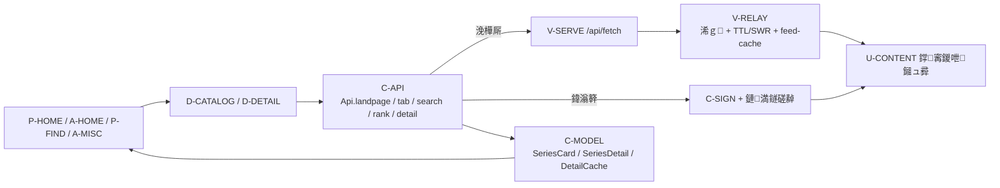
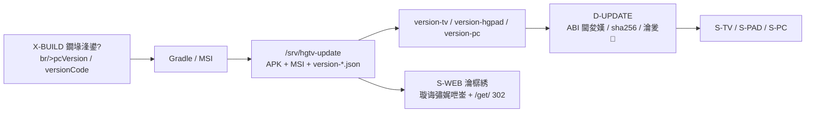
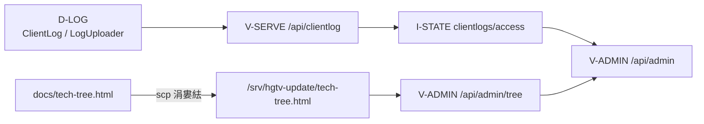

# 寮€蹇冩灉 路 鏋舵瀯涓栫晫鏍?
> 鍩虹嚎锛?026-11-15
> PC 1.2.82 路 Android 2.2.194锛圥ad/TV 鍚屼竴濂楁簮鐮侊級路 鏈嶅姟绔?8080(static/admin)/8082(api)/8081(dual)/9110/9118
>
> HTML 鐢?`docs/build_tech_tree.py` 鐢熸垚锛涙敼瀹岃妭鐐?杈瑰悗杩愯瀹冮噸鏂扮敓鎴?`tech-tree.html`銆?> 淇椤哄簭瑙?`docs/REMEDIATION_PLAN.md`锛岀嚎涓婂湪杩愯鐪嬫澘銆屾灦鏋勪笘鐣屾爲 鈫?淇椤哄簭銆嶃€?>
> 杩欎笉鏄骇鍝佷粙缁嶏紝鏄?*鏀瑰姩妫€鏌ュ浘**銆備互鍚庢敼浠讳綍鍔熻兘锛屽厛鍦ㄨ繖妫垫爲閲屾壘鍒拌妭鐐癸紝
> 娌垮畠鐨勪笂娓搞€佷笅娓搞€佸鐢熻妭鐐瑰悇璧颁竴閬嶏紝鍐嶅姩鎵嬨€?
---

## 0. 浣跨敤瑙勫垯锛堝己鍒讹級

姣忔鏀瑰姩鎸変笅闈㈤『搴忚蛋锛屼笉鍏佽鈥滃彧鐪嬪綋鍓嶆枃浠垛€濓細

1. **瀹氫綅鑺傜偣**锛氬湪 搂3 鑺傜偣鐩綍閲屾壘鍒拌鏀圭殑鑺傜偣 ID锛堜緥濡?`D-HISTORY`銆乣C-API`銆乣R-ORO`锛夈€?2. **鐪嬩笁鏉¤竟**锛?   - **涓婃父娑堣垂鑰?*锛氳皝璋冪敤瀹冿紵鏀硅緭鍑轰細鐮村潖璋侊紵
   - **涓嬫父渚濊禆**锛氬畠璋冪敤璋侊紵鏀硅緭鍏ャ€佽秴鏃躲€佸瓧娈点€佺紦瀛樹細褰卞搷璋侊紵
   - **瀛敓鑺傜偣**锛歅C 鈫?Android銆丳ad 鈫?TV銆丄ndroid `core` 鈫?PC `com.hongguotv.pad` 鍓湰銆?3. **杩囧彉鏇寸煩闃?*锛氬湪 搂5 鎵惧埌瀵瑰簲鐨勬敼鍔ㄧ被鍨嬶紝鎶婂垪鍑虹殑鑺傜偣鍏ㄩ儴妫€鏌ヤ竴閬嶃€?4. **璺戦獙璇佹竻鍗?*锛氭寜 搂7 瀵瑰簲灞傜骇鐨勬竻鍗曢獙璇侊紝涓嶅彧楠岃瘉鈥滅溂鍓嶈繖涓€鏉¤矾寰勨€濄€?5. **鏇存柊杩欐５鏍?*锛氭柊澧?鍒犻櫎鑺傜偣銆佹敼濂戠害銆佹敼绔彛銆佹敼缂撳瓨 TTL銆佹敼鍏ュ彛锛屽繀椤诲湪鍚屼竴涓彁浜ら噷鏇存柊鏈枃妗ｅ拰 `tech-tree.html`銆?
> 鍒ゆ柇鏍囧噯锛氬鏋滀竴涓敼鍔ㄥ彧鏀逛簡 1 涓枃浠讹紝浣嗘爲涓婃湁 3 涓笂娓搞€? 涓鐢熻妭鐐癸紝
> 閭ｈ繖娆℃敼鍔ㄨ嚦灏戣鐪?6 涓湴鏂癸紝鍚﹀垯涓嶇畻瀹屾垚銆?
---

## 1. 鏍戠殑褰㈢姸

```text
鏍癸細鐢ㄦ埛鐪嬪埌鐨勨€滃唴瀹光€濆拰鈥滄挱鏀锯€?鈹?鈹溾攢 L0 浜у搧鍏ュ彛
鈹?  PC 妗岄潰 / Android Pad / Android TV / 瀹樼綉涓嬭浇椤?/ 绠＄悊鐪嬫澘
鈹?鈹溾攢 L1 椤甸潰涓庝氦浜?鈹?  PC锛氶椤点€佹壘鍓с€佹帓琛屻€佹柊鍓с€佸巻鍙层€佽拷鏇?棰勭害銆佹垜鐨?璁剧疆銆佽鎯呫€佹挱鏀惧櫒銆佸埛鍓с€佺櫥褰曘€佹墦璧?鈹?  Android锛氬悓涓€缁勯〉闈紝Pad/TV 鍏辩敤锛汿V 鍙閬ユ帶鍣ㄩ敭浣嶄笌妯睆甯冨眬
鈹?鈹溾攢 L2 瀹㈡埛绔鍩?鈹?  鍐呭鐩綍 / 璇︽儏閫夐泦 / 鎾斁缂栨帓 / 鍘嗗彶杩涘害 / 璐﹀彿涓庝功鏋?/ 璇勮寮瑰箷 / 璁剧疆缂撳瓨 / 鏇存柊 / 鏃ュ織
鈹?鈹溾攢 L3 瀹㈡埛绔叡浜牳蹇?鈹?  API 涓庣鍚?/ 鏁版嵁妯″瀷 / CENC 瑙ｅ瘑 / 鐩撮摼浠ｇ悊 / 鍏ㄥ眬鐘舵€?/ 涓婚缁勪欢
鈹?鈹溾攢 L4 骞冲彴閫傞厤
鈹?  PC锛歠fmpeg 寮曟搸銆侀鍙栥€丳cStore銆丮SI 鏇存柊銆佹闈㈡棩蹇?鈹?  Android锛欵xoPlayer銆丟o 鍙栨祦銆丗eed 缂撳瓨/棰勮浇銆丄PK 鏇存柊銆佹棩蹇椾笂浼?鈹?鈹溾攢 L5 鏈嶅姟绔叆鍙?鈹?  dual_server(8081) / serve.py(8080) / relay 缂撳瓨 / playinfo / 鐑害 / 鍘嗗彶 / 闈欐€佸寘 / 鐪嬫澘
鈹?鈹溾攢 L6 瑙ｆ瀽銆佽浆鐮佷笌涓婃父
鈹?  streamsrv(9110) 鈫?oroplay(9118) 鈫?v5 sidecar(9119) 鈫?1080p锛涘け璐ヨ嚜鍔ㄥ洖 oracle(9120)锛涘吋瀹?fallback/VVC 杞爜鍏滃簳
鈹?  鐣寗鍐呭 API銆佹挱鏀炬ā鍨嬨€丆DN銆佺櫥褰曘€佸浘鐗囷紱妯辫姳/CF/cpolar 闅ч亾锛涚姸鎬佺洰褰曪紱systemd
鈹?鈹斺攢 妯垏绾︽潫锛氫笁绔竴鑷淬€佸巻鍙茶涔夈€佺鏈夊弬鏁般€佺紦瀛樺け鏁堛€佸彂鐗堟竻鍗曘€佹祴璇曡澶?```

---

## 2. 鑺傜偣鐩綍

> 琛ㄤ腑鐨勨€滀笂娓糕€? 璋佷娇鐢ㄨ繖涓妭鐐癸紱鈥滀笅娓糕€? 杩欎釜鑺傜偣渚濊禆璋併€?> 鏂囦欢璺緞鐩稿浠撳簱鏍?`D:\kaixinguo-pc`锛涙湇鍔＄璺緞鏄湇鍔″櫒缁濆璺緞銆?
### 2.1 L0 浜у搧鍏ュ彛

| ID | 鑺傜偣 | 鍏抽敭鏂囦欢/浣嶇疆 | 鑱岃矗 | 涓婃父 | 涓嬫父 |
|---|---|---|---|---|---|
| `S-PC` | PC 妗岄潰绔?| `src/main/kotlin/com/kaixinguo/pc` | Windows 瀹㈡埛绔紝Compose Desktop + ffmpeg | 鐢ㄦ埛 | `P-SHELL` |
| `S-PAD` | Android Pad | `android/pad`锛屽寘鍚?`com.hongguotv.pad` | 骞虫澘瑙﹀睆瀹㈡埛绔?| 鐢ㄦ埛 | `A-SHELL` |
| `S-TV` | Android TV | 鍚屼竴浠?`android/pad`锛宖lavor `tv`锛屽寘鍚?`com.hongguotv.nativeapp` | 鐢佃閬ユ帶鍣ㄥ鎴风 | 鐢ㄦ埛 | `A-SHELL` |
| `S-WEB` | 瀹樼綉/涓嬭浇椤?| 鏈嶅姟鍣?`/srv/hgtv-update/index.html` | 涓夌涓嬭浇鍏ュ彛锛岃鍙栫増鏈竻鍗?| 娴忚鍣?| `V-STATIC` |
| `S-ADMIN` | 绠＄悊鐪嬫澘 | `/api/admin?token=鈥 | 璁惧鏁般€佺増鏈€佺鍙ｃ€佽姹傞噺銆乂VC 浣跨敤锛涢《閮ㄣ€屾灦鏋勪笘鐣屾爲銆嶉〉绛?| 绠＄悊鍛?| `V-ADMIN` |

### 2.2 L1 PC 椤甸潰涓庝氦浜?
| ID | 鑺傜偣 | 鍏抽敭鏂囦欢 | 鑱岃矗 | 涓婃父 | 涓嬫父 |
|---|---|---|---|---|---|
| `P-SHELL` | 搴旂敤澹?渚ф爮/璺敱 | `Main.kt` 鐨?`AppShell`銆乣RouteHolder`銆乣Route` | 绐楀彛銆佷晶鏍忋€侀〉闈㈠垏鎹€佽繑鍥炴爤銆佹墦璧忔诞灞?| `S-PC` | `P-HOME`鈥P-LOGIN` |
| `P-HOME` | 棣栭〉 | `HomeScreens.kt` 鐨?`HomePage` | 鎺ㄨ崘/婕墽/鐪熶汉鍓т笁 tab銆乭ero銆佸崱鐗囨祦銆佹崲涓€鎵癸紱tab/鍒楄〃/hero/婊氬姩瀛?`PageMemo` | `P-SHELL` | `D-CATALOG`, `D-DETAIL`, `D-PLAY` |
| `P-FIND` | 鎵惧墽/鎼滅储 | `FindScreen.kt` 鐨?`FindPage` | 鎼滅储銆佽仈鎯炽€佺瓫閫夈€佺粨鏋滐紱鏉′欢/缁撴灉/鍒嗛〉/婊氬姩瀛?`PageMemo` | `P-SHELL` | `D-CATALOG` |
| `P-RANK` | 鎺掕姒?| `RankScreen.kt` 鐨?`RankPage` | 姒滃崟鍒嗙被銆佺瓫閫夈€佹湀姒溿€佹紨鍛樻锛涘ぇ绫?瀛愭/绛涢€?鍒楄〃/鍒嗛〉/婊氬姩鍏ㄩ儴璁板繂 | `P-SHELL` | `D-CATALOG` |
| `P-NEW` | 鏂板墽/鏃ュ巻 | `NewScreen.kt` 鐨?`NewPage` | 鏂板墽鍒楄〃銆佷笂绾挎棩鍘嗭紱瑙嗗浘/鍒嗙被/鏃ユ湡/婊氬姩瀛?`PageMemo`锛屼粠璇︽儏杩斿洖淇濈暀鐜板満 | `P-SHELL` | `D-CATALOG` |
| `P-HISTORY` | 鍘嗗彶椤?| `LibraryScreens.kt` 鐨?`HistoryPage` | 鏈湴/浜戠鍘嗗彶銆佺瓫閫夈€佺鐞嗐€佺户缁挱 | `P-SHELL` | `D-HISTORY`, `D-ACCOUNT` |
| `P-LIBRARY` | 杩芥洿/棰勭害/鎴戠殑 | `LibraryScreens.kt` 鐨?`FollowsPage`銆乣ReservePage`銆乣MinePage` | 杩芥洿鎻愰啋銆侀绾︺€佹敹钘?鐐硅禐鍏ュ彛銆佽处鍙峰悓姝ョ爜 | `P-SHELL` | `D-ACCOUNT` |
| `P-DETAIL` | 璇︽儏椤?| `DetailScreen.kt` | 璇︽儏銆侀€夐泦銆佸銆佸墽璇勩€佺浉鍏虫帹鑽愩€佺户缁湅 | `P-HOME` 绛?| `D-DETAIL`, `D-PLAY` |
| `P-PLAYER` | PC 鎾斁鍣?| `Player.kt` | 璧锋挱銆佸垏闆嗐€佹竻鏅板害銆佸€嶉€熴€侀槦鍒椼€侀鍙栥€佺湅闂ㄧ嫍銆佸巻鍙层€佸脊骞曘€佽瘎璁?| `P-DETAIL`, `P-HISTORY` | `D-PLAY`, `D-HISTORY`, `D-SOCIAL`, `X-PC-ENGINE` |
| `P-FEED` | PC 鍒峰墽 | `FeedPlayerScreen.kt` 鐨?`FeedPlayerPage`锛宍Player.kt` 鐨?embedded 妯″紡 | 鏁村睆杩炴挱銆佹崲鍓с€侀瑙堜笉璁板巻鍙?| `P-SHELL` | `D-CATALOG`, `D-PLAY` |
| `P-LOGIN` | PC 鐧诲綍/閰嶅 | `PcLogin.kt`, `PcLoginScreen.kt` | 鐭俊 MFA銆佽处鍙?cookies銆佸尮閰嶇爜鍚屾 | `P-SHELL`, `P-LIBRARY` | `D-ACCOUNT`, `C-API` |
| `P-DONATE` | 鎵撹祻娴眰 | `Donate.kt` | 灞曠ず鎵撹祻鐮侊紝涓嶆帴鏀粯 SDK | `P-SHELL` | `C-UI`锛堢爜璧勬簮锛?|

### 2.3 L1 Android 椤甸潰涓庝氦浜?
| ID | 鑺傜偣 | 鍏抽敭鏂囦欢 | 鑱岃矗 | 涓婃父 | 涓嬫父 |
|---|---|---|---|---|---|
| `A-SHELL` | App/瀵艰埅/渚ф爮 | `MainActivity.kt`, `App.kt`, `Screen.kt` | 鍒濆鍖栥€佽矾鐢辨爤銆佷晶鏍忋€佽繑鍥炪€丳ad/TV 閫傞厤 | `S-PAD`, `S-TV` | `A-HOME`鈥A-LOGIN` |
| `A-HOME` | 棣栭〉 | `HomeFeed.kt` | 涓?tab銆乭ero銆佸崱鐗囥€佺户缁湅 | `A-SHELL` | `D-CATALOG`, `D-DETAIL`, `D-PLAY` |
| `A-FEED` | 鍒峰墽 | `FeedScreen.kt`, `FeedPreload.kt` | 鏁村睆杩炴挱銆佷笂涓嬫崲鍓с€侀杞?| `A-SHELL` | `D-CATALOG`, `D-PLAY`, `X-AN-CACHE` |
| `A-DETAIL` | 璇︽儏椤?| `DetailScreen.kt` | 璇︽儏銆侀€夐泦銆佸銆佸墽璇勩€佺浉鍏虫帹鑽愩€佺户缁湅 | `A-HOME` 绛?| `D-DETAIL`, `D-PLAY` |
| `A-PLAYER` | 鎾斁椤?| `PlayerScreen.kt` | 璧锋挱銆侀槦鍒椼€侀鍙栥€佹棤缂濆垏闆嗐€佺湅闂ㄧ嫍銆佸巻鍙层€佽繘搴︿笂鎶?| `A-DETAIL`, `A-HOME` | `D-PLAY`, `D-HISTORY`, `X-AN-EXO` |
| `A-CHROME` | 鎾斁鎺у埗鏉?| `PlayerChrome.kt` | 杩涘害鏉°€佹挱鏀?鏆傚仠銆佷笂涓嬮泦銆佸€嶉€熴€佹竻鏅板害銆侀€夐泦銆佸脊骞曡缃?| `A-PLAYER` | `D-PLAY`, `D-SOCIAL` |
| `A-MISC` | 鍏朵綑椤甸潰 | `FindScreens.kt`銆乣RankScreens.kt`銆乣NewScreens.kt`銆乣RecordsScreens.kt`銆乣FollowScreens.kt`銆乣AccountScreens.kt`銆乣SettingsScreen.kt`銆乣CreatorScreens.kt` | 鎵惧墽銆佹帓琛屻€佹柊鍓с€佸巻鍙层€佹敹钘?鐐硅禐銆佽拷鏇淬€侀绾︺€佹垜鐨勩€佽缃€佹紨鑱屽憳锛涙柊鍓?棣栭〉/鎺掕/鍘嗗彶/鏀惰棌/鐐硅禐/杩芥洿/棰勭害/婕旇亴鍛樼殑 tab銆佺瓫閫夈€佸垎椤典笌婊氬姩閮藉瓨 `UiMemo`锛岃鎯呰繑鍥炰繚鐣欑幇鍦?| `A-SHELL` | `D-CATALOG`, `D-HISTORY`, `D-ACCOUNT`, `D-SETTINGS` |
| `A-SOCIAL` | 璇勮/寮瑰箷/鎵撹祻 | `CommentsPanel.kt`, `Danmaku.kt`, `DonateDialog.kt` | 鍗曢泦璇勮銆佸墽璇勩€佸脊骞曠獥鍙?鍙戦€併€佹墦璧忕爜 | `A-PLAYER`, `A-MISC` | `D-SOCIAL` |
| `A-LOGIN` | 鐧诲綍/閰嶅 | `Login.kt`, `LoginScreen.kt` 璐﹀彿鍖?| 鐭俊 MFA銆佽处鍙?cookies銆佸尮閰嶇爜 | `A-MISC` | `D-ACCOUNT`, `C-API` |

### 2.4 L2 瀹㈡埛绔鍩?
| ID | 鑺傜偣 | 鍏抽敭鏂囦欢 | 鑱岃矗 | 涓婃父 | 涓嬫父 |
|---|---|---|---|---|---|
| `D-CATALOG` | 鍐呭鐩綍 | `Api.landpage/tab/search/rank/new/calendar/heat`锛沗HomeFeed.kt`锛沗FeedCache.kt` | 棣栭〉/鎵惧墽/鎺掕/鏂板墽/鏃ュ巻鐨勬暟鎹紪鎺掍笌缂撳瓨 | `P-HOME`鈥P-NEW`, `A-HOME`, `A-MISC` | `C-API`, `C-MODEL`, `X-AN-CACHE` |
| `D-DETAIL` | 璇︽儏/閫夐泦/瀛?| `DetailScreen.kt` 涓ょ锛沗Api.ensureDetail/seasons/reviews/related` | 璇︽儏銆侀泦鏁版槧灏勩€佸鍒囨崲銆佺浉鍏虫帹鑽愩€佸墽璇?| `P-DETAIL`, `A-DETAIL` | `C-API`, `C-MODEL`, `D-HISTORY` |
| `D-PLAY` | 鎾斁缂栨帓 | `PlayerScreen.kt`, `Player.kt`, `PlaybackSession.kt`, `PlaybackSourcePlanner.kt`, `PlaybackGuard.kt`, `PlayerUiState.kt`, `PlaybackPrefetch.kt`, `FeedPreload.kt` | 閫夋。銆佸彇娴併€侀鍙栥€侀槦鍒椼€佹棤缂濆垏闆嗐€佺湅闂ㄧ嫍銆佹竻鏅板害/鍊嶉€燂紱鐘舵€?閫夋簮/鐪嬮棬鐙?UI 鐘舵€佸凡鍒嗗眰 | `P-PLAYER`, `P-FEED`, `A-PLAYER`, `A-FEED` | `C-API`, `C-PROXY`, `C-MEDIA`, `X-PC-ENGINE`, `X-AN-EXO`, `D-HISTORY` |
| `D-HISTORY` | 鍘嗗彶/缁挱 | `HistoryStore.kt`, `PcHistoryStore.kt`, `HistoryRepository.kt`, `Api.historySync/reportProgress` | 璁板綍鐪熷疄鎾斁銆佺画鎾鏁般€佽法绔悎骞躲€佸巻鍙查〉锛涘悎骞剁瓥鐣ユ敹鍙ｅ湪鍏变韩 `HistoryRepository`锛圠IMIT=1500 + 璇曠湅淇濇姢锛氫綆闆嗘暟鐭挱鏀?60s 涓嶉《鎺夐珮杩涘害锛屾湇鍔＄ history_store.py 鍚岃鍒欙級锛涒殸锔忓畨鍗撳啓鍘嗗彶/鎶ュ畼鏂瑰繀椤昏 `curIndex/curEpisodes`锛坮emember(startIndex) 鎹㈤泦浼氶噸寤虹姸鎬佸璞★紝LaunchedEffect(player) 寰幆鏀ョ潃鏃у€尖€斺€?.2.190 杩炴挱鍘嗗彶鍗℃棫闆嗘暟浜嬫晠鏍瑰洜锛?| `P-PLAYER`, `A-PLAYER`, `P-HISTORY`, `A-MISC` | `X-PC-STORE`, `X-AN-STORE`, `C-API`, `V-HIST` |
| `D-ACCOUNT` | 璐﹀彿/涔︽灦 | `Login.kt`, `PcLogin.kt`, `Api.shelf/follow/reserve/like/pair` | 鐧诲綍銆侀厤瀵广€佹敹钘忋€佺偣璧炪€佽拷鏇淬€侀绾︺€佷簯绔姸鎬?| `P-LIBRARY`, `A-MISC`, `A-LOGIN` | `C-API`, `C-SIGN`, `X-PC-STORE`, `X-AN-STORE` |
| `D-SOCIAL` | 璇勮/寮瑰箷 | `CommentsPanel.kt`, `Danmaku.kt`, `Player.kt` 寮瑰箷灞?| 鍗曢泦璇勮銆佸墽璇勩€佸洖澶嶃€佺偣璧炪€佸脊骞曟媺鍙?鍙戦€?娓叉煋 | `P-PLAYER`, `A-PLAYER`, `A-SOCIAL` | `C-API` |
| `D-SETTINGS` | 璁剧疆/缂撳瓨 | `SettingsPage` 涓ょ锛宍Store`/`PcStore` | 鎾斁璁剧疆銆佹湇鍔￠厤缃€佺紦瀛樻竻鐞嗐€佸叧浜?鏇存柊鍏ュ彛 | `P-SHELL`, `A-SHELL` | `X-PC-STORE`, `X-AN-STORE`, `C-STATE`, `D-UPDATE` |
| `D-UPDATE` | 鏇存柊 | `Updater.kt` 涓ょ锛宍UpdateProvider.kt`, `ListUpdate.kt` | 妫€鏌ユ竻鍗曘€佷笅杞姐€乻ha256銆佸畨瑁?閲嶅惎 | `P-SHELL`, `A-SHELL`, `D-SETTINGS` | `V-STATIC`, `X-PC-UPD`, `X-AN-UPD` |
| `D-LOG` | 瀹㈡埛绔棩蹇?| `ClientLog.kt`, `LogUploader.kt` | 鏈湴鏃ュ織銆佽劚鏁忋€佷笂浼犲埌 `/api/clientlog` | 鍚勯〉闈?鎾斁鍣?| `V-SERVE`, `X-PC-UPD`, `X-AN-UPD` |

### 2.5 L3 瀹㈡埛绔叡浜牳蹇?
| ID | 鑺傜偣 | 鍏抽敭鏂囦欢 | 鑱岃矗 | 涓婃父 | 涓嬫父 |
|---|---|---|---|---|---|
| `C-API` | API/绛惧悕/缂撳瓨 | `android/core/.../Api.kt` **鍜?* `src/main/kotlin/com/hongguotv/pad/Api.kt` | 鎵€鏈変笂娓稿唴瀹规帴鍙ｃ€佹湇鍔″櫒浠ｅ彇銆佸彇娴併€佸巻鍙层€佷功鏋躲€佽瘎璁恒€佸脊骞曘€佺紦瀛?| 鎵€鏈?`D-*` | `C-SIGN`, `V-SERVE`, `V-PLAYINFO`, `U-CONTENT` |
| `C-SIGN` | 鏈満绛惧悕 | `LocalSign.kt`, `sign/Argus.kt`, `Gorgon.kt`, `Helios.kt`, `Medusa.kt`, `AesV3.kt`, `Signer.kt` | 鐢熸垚涓婃父瑕佹眰鐨勭鍚嶅ご/璁惧澶?| `C-API` | `U-PASSPORT`/涓婃父鎺ュ彛 |
| `C-MODEL` | 妯″瀷/灏忕紦瀛?| `Models.kt`, `DetailCache.kt`, `RankMetaFallback.kt` | `SeriesCard`/`SeriesDetail`/`Episode`/`PlayTier`锛岃鎯?LRU 60锛屾鍗曞厹搴?| 鎵€鏈?UI/棰嗗煙 | `C-API` |
| `C-MEDIA` | CENC 瑙ｅ瘑 | `MediaCrypto.kt`锛堜袱绔€愬瓧涓€鑷达級 | 瑙ｆ瀽 MP4 鏍锋湰琛ㄣ€佹淳鐢熷唴瀹瑰瘑閽ャ€丄ES-CTR 瑙ｅ瘑 | `C-PROXY`, `R-TRANSCODE` 鐨?Java 鍓湰 | 涓婃父鍔犲瘑 MP4 |
| `C-PROXY` | 鐩撮摼浠ｇ悊 | `Playback.kt` 鐨?`RemoteVideo`銆乣StreamProxy` | 鎷?1MB 澶撮儴銆佸噯澶囨牱鏈〃銆佹湰鍦?HTTP 浠ｇ悊銆丷ange/鐭澶勭悊 | `D-PLAY` | `C-MEDIA`, `U-CDN` |
| `C-STATE` | 鍏ㄥ眬濂戠害 | `App.kt` 涓ょ | `loggedIn`銆乧ookies銆乣maxHeight`銆乣playBases`銆乣historyBase`銆佽澶囪韩浠姐€佸巻鍙叉帴鍙?| 涓ょ App | 鎵€鏈?`D-*`/`C-API` |
| `C-UI` | 涓婚/缁勪欢 | `Ui.kt`, `Theme.kt`, `UiMemo.kt` | 棰滆壊銆佸瓧浣撱€佸崱鐗囥€佹寜閽€佺劍鐐广€佸竷灞€鍙ｅ緞 | 鎵€鏈夐〉闈?| 鈥?|

### 2.6 L4 骞冲彴閫傞厤

| ID | 鑺傜偣 | 鍏抽敭鏂囦欢 | 鑱岃矗 | 涓婃父 | 涓嬫父 |
|---|---|---|---|---|---|
| `X-PC-STORE` | PC 鏈湴搴?| `PcStore.kt`, `PcHistoryStore.kt`, `PcNoticeStore.kt` | 璁剧疆銆佽处鍙枫€佸巻鍙层€佽拷鏇撮€氱煡銆佹敹钘?鐐硅禐/杩芥洿/棰勭害銆佺紦瀛樼粺璁?| `D-HISTORY`, `D-ACCOUNT`, `D-SETTINGS` | `%APPDATA%/KaixinguoPC` |
| `X-PC-ENGINE` | PC 鎾斁寮曟搸 | `VideoEngine.kt` | 鍚姩/鎺у埗 ffmpeg 杩涚▼銆佹帰娴嬨€乻eek銆侀煶閲忋€佸€嶉€熴€佹殏鍋?| `P-PLAYER` | 鏈満 `ffmpeg` |
| `X-PC-PREFETCH` | PC 棰勫彇 | `PlaybackPrefetch.kt` | 棰勭儹涓嬩竴闆嗙洿閾?澶撮儴/浠ｇ悊锛屾渶澶氭寜璁剧疆 N 闆?| `P-PLAYER` | `C-API`, `C-PROXY` |
| `X-PC-UPD` | PC 骞冲彴鏈嶅姟 | `Updater.kt`, `ClientLog.kt`, `Resolver.kt` | MSI 鏇存柊銆佹棩蹇椾笂浼犮€乫fmpeg 璺緞瑙ｆ瀽 | `D-UPDATE`, `D-LOG` | `V-STATIC`, `V-SERVE` |
| `X-AN-STORE` | Android 鏈湴搴?| `Store.kt`, `ShelfStore.kt`, `HistoryStore.kt` | SharedPreferences锛氳缃€佽处鍙枫€佸巻鍙层€佷功鏋躲€佺紦瀛樻竻鐞?| `D-HISTORY`, `D-ACCOUNT`, `D-SETTINGS` | `hongguo_pad` prefs |
| `X-AN-EXO` | Android 鎾斁寮曟搸 | Media3 ExoPlayer 1.4.1 + `PlayerScreen` 闃熷垪 | 纭В/杞В銆佹挱鏀惧垪琛ㄣ€佷簨浠躲€侀甯с€侀敊璇仮澶?| `A-PLAYER` | `C-PROXY` |
| `X-AN-GO` | Android 鏈満鍙栨祦 | `DeviceResolver.kt` + `openhongguo.jar`锛坓omobile锛?| 鏈満 Go 绛惧悕/鍙栨祦鍏滃簳锛宍LocalResolverProvider` | `C-API` | `R-STREAM` 鍚岀被閫昏緫 |
| `X-AN-CACHE` | Android 缂撳瓨/棰勮浇 | `FeedCache.kt`, `FeedPreload.kt` | 鍒峰墽棣栧睆纾佺洏缂撳瓨 24h銆侀杞?5 閮?| `A-FEED`, `D-CATALOG` | 鏈湴鏂囦欢 |
| `X-AN-UPD` | Android 骞冲彴鏈嶅姟 | `Updater.kt`, `LogUploader.kt`, `UpdateProvider.kt` | APK 娓呭崟/ABI 閫夋嫨/涓嬭浇/sha/瀹夎銆佹棩蹇椾笂浼?| `D-UPDATE`, `D-LOG` | `V-STATIC`, `V-SERVE` |
| `X-BUILD` | 鏋勫缓/绛惧悕/鍙傛暟 | `build.gradle.kts` 涓ょ锛宍android/release.sh` | 鐗堟湰鍙枫€佺鏈?`-P` 鍙傛暟銆乫lavor銆丄BI 鎷嗗垎銆丮SI銆佺鍚?| 鍙戝竷鑰?| `S-PC`, `S-PAD`, `S-TV` |

### 2.7 L5 鏈嶅姟绔叆鍙?
| ID | 鑺傜偣 | 鍏抽敭浣嶇疆 | 鑱岃矗 | 涓婃父 | 涓嬫父 |
|---|---|---|---|---|---|
| `V-DUAL` | 鍙屽崗璁綉鍏?| `/opt/hgtv-update/dual_server.py`锛?081/TLS | `/api/admin*` 鍙嶄唬 8080锛堥潤鎬?鐪嬫澘锛夛紝`/sign` 涓庡叾浣?`/api/*` 鍙嶄唬 8082锛涢潤鎬?瀹樼綉锛沗/get/*` 302 鍒颁笅杞借妭鐐癸紱**闈欐€?Range 鏀寔 HTTP keep-alive**锛堟挱鏀惧櫒杩炵画 Range 涓嶅啀姣忔潯閲嶅缓 TLS锛?026-11-21锛?| 鍏綉/闅ч亾/娴忚鍣?| `V-SERVE`, `V-API`, `V-STATIC` |
| `V-SERVE` | 闈欐€?鐪嬫澘杩涚▼ | `/opt/hgtv-update/serve.py`锛圧OLE=static锛夛紝8080锛宍hgtv-update.service` | 闈欐€佹枃浠?Range銆乣/admin`銆乣/api/admin*`锛涘叾浣?`/api/*` 鍙嶄唬 8082 | 瀹㈡埛绔€佸畼缃?| `V-API`, `V-STATIC`, `V-ADMIN` |
| `V-API` | 鍐呭 API 杩涚▼ | `/opt/hgtv-update/serve.py`锛圧OLE=api锛夛紝8082锛宍hgtv-api.service` | `/api/fetch`銆乣sign`銆乣playinfo`銆乣history`銆乣heat`銆乣chart`銆乣rankmeta`銆乣seasons`銆乣family`銆乣clientlog`銆乣flags`銆乣transcode/status`锛涗笉鎻愪緵闈欐€?鐪嬫澘 | `V-SERVE`, `V-DUAL` | `V-RELAY`, `V-PLAYINFO`, `V-HEAT`, `V-HIST` |
| `V-RELAY` | 涓婃父浠ｅ彇/缂撳瓨 | `/opt/hgtv-update/relay.py` | 浠ｇ銆佷唬鎷夈€乀TL/SWR/纾佺洏缂撳瓨銆乫eed-cache | `V-API` | `R-SIGN`锛堟湇鍔″櫒 9100锛夈€乣U-CONTENT` |
| `V-PLAYINFO` | 鍙栨祦涓浆 | `/opt/hgtv-update/playinfo.py` | 30min 鎴愬姛缂撳瓨銆?5s 璐熺紦瀛樸€佸揩閫熼噸璇曘€佽В key/鐩撮摼锛?02 pending + job 杞 | `V-API` | `R-STREAM` |
| `V-HEAT` | 鐑害/姒滃崟鍏冩暟鎹?| `heat.py`锛宍serve.py` 鐨?chart/rankmeta | 鐑害 6h 缂撳瓨銆佹鍗曞厓鏁版嵁 10min銆佺己鐑害鍥炲～ | `V-API` | `U-CONTENT`, `I-STATE` |
| `V-HIST` | 鍘嗗彶/鏃ュ織 | `history_store.py` 鐨?`history_merge`銆乣serve.py` 鐨?`/api/history`銆乣clientlog` | 鍘嗗彶鍚堝苟锛堝敮涓€妯″潡锛夈€佸鎴风鏃ュ織銆佽闂祦姘达紱Phase 12 宸插垹 `/sync`/room | `C-API`, 涓ょ鏃ュ織 | `I-STATE` |
| `V-STATIC` | 闈欐€?鍙戝竷鐗?| `/srv/hgtv-update` | APK/MSI銆乣version-*.json`銆佸畼缃戙€乣tech-tree.html`銆乣/transcode/*`銆侀暅鍍忔竻鍗?| `V-DUAL`, 鏇存柊鍣? 鐪嬫澘 | `I-STATE`, `I-TUNNEL` |
| `V-ADMIN` | 鐪嬫澘 | `admin.py`銆乣serve.py`锛圧OLE=static锛塦/api/admin`銆乣/api/admin/stats`銆乣/api/admin/tree`锛宍admin.token` | 杩愯鏁版嵁 + 鏋舵瀯涓栫晫鏍戯紙璇诲彇 `/srv/hgtv-update/tech-tree.html`锛?| 绠＄悊鍛?| `I-STATE`, 鏃ュ織, `V-STATIC` |

### 2.8 L6 瑙ｆ瀽銆佽浆鐮併€佷笂娓镐笌鍩虹璁炬柦

| ID | 鑺傜偣 | 鍏抽敭浣嶇疆 | 鑱岃矗 | 涓婃父 | 涓嬫父 |
|---|---|---|---|---|---|
| `R-STREAM` | 绛惧悕鍙栨祦鏈嶅姟 | `/opt/research/streamsrv`锛?110锛孏o | `/play` 缂撳瓨 25min/400 鏉★紱鍙蛋 oroplay锛沚vc2-only 杩斿洖 202 pending锛沗/transcode` 浠ｇ悊 job 鏌ヨ | `V-PLAYINFO` | `R-ORO`, `R-SIGN`, `U-PLAY` |
| `R-ORO` | 鐪熺鍚嶈В鏋?| `/opt/research/oroplay.js`锛?118锛孨ode | **v5 浼樺厛**锛氬厛璋?`R-V5`锛屽け璐?绌?瓒呮椂鍥?`R-ORACLE`锛沗bytevc1`锛圚EVC锛夌洿鎺ラ€忎紶锛沄VC/AV1 鍏堝彇 `fallback_api` 鍏煎妗ｏ紙1080P HEVC/H.265锛夛紝鏈€鍚庢墠杞爜锛?*鍛戒腑宸茶浆鐮佹枃浠舵椂鐩存帴杩斿洖 `/transcode/<vid>_<h>_v4.mp4`锛堢敾璐ㄧ増锛夛紝涓嶅啀鎵撲笂娓革紱鏃?`_v3` 鍙湪杞爜澶辫触鏃跺厹搴?*锛?026-11-21锛夛紱杩斿洖鍓嶅己鍒惰繃婊?`bytevc2`锛涙棫 video_tab 浠呰瘖鏂厹搴曪紱寮傛杞爜 job锛?0min/200 鏉★紝鍙疆璇級 | `R-STREAM` | `R-V5`, `R-ORACLE`, `R-SIGN`, `R-TRANSCODE`, `U-PLAY`, `U-CDN` |
| `R-V5` | v5 绾?HTTP 绛惧悕 | `/opt/research/v5/v5resolver.js`锛?27.0.0.1:9119锛沗playback-v5-sign.js`銆乣mobile-playback-v5.js` 绛?| 鍖垮悕璁惧娉ㄥ唽 + Android `v04.10.03` v5 绛惧悕 + gzip mobile 妯″瀷锛沄VC/AV1 闆嗚皟 `fallback_api` 鐨?`codec_type=3/1` 鍙?1080P HEVC/H.265锛涘崟璁惧銆?.2s 闂撮殧銆佺┖鍝嶅簲 90s 鍐峰嵈 | `R-ORO` | `U-PLAY` |
| `R-ORACLE` | Android 瀹樻柟 App oracle | `/opt/research/oracle_parent.py` + `resolve_one.py` + `oracle_resolver.js`锛?120锛況edroid Android 13 瀹瑰櫒 + 瀹樻柟绾㈡灉 App + Frida | oroplay 鐨?*鍏滃簳**锛歷5 澶辫触/绌?瓒呮椂鏃舵寜 vid 璁╁畼鏂?App 鐢ㄨ嚜宸辩殑绛惧悕/TTNet 鍙栨ā鍨嬶紝杩斿洖 1080p/720p 绛夊叏閮ㄦ。浣嶏紱瀹瑰櫒/systemd 寮€鏈鸿嚜鍚?| `R-ORO` | `U-PLAY`, `U-CDN` |
| `R-SIGN` | 绛惧悕/璁惧姹?| 9100/9101/9099锛宍playback-sign.js`, `playback-device.js`, `sign-server.jar` | 涓婃父绛惧悕銆佽澶囪韩浠芥敞鍐?杞崲銆丄rgus/Ladon | `C-API`, `V-RELAY`, `R-ORO` | `U-PASSPORT`/涓婃父 |
| `R-TRANSCODE` | VVC/AV1 杞爜 | `/opt/research/transcode/do_transcode.py`, `extract_vvc.py`, `DecryptMp4.java` | 涓嬭浇鍔犲瘑 MP4 鈫?Java 瑙ｅ瘑 鈫?H.264/HEVC/AV1 鐩存帴瑙?MP4锛圓V1 瑁告祦浼氶煶棰?only锛夛紝VVC 鎵嶆娊 Annex-B 鈫?ffmpeg H.264锛?*鐢昏川瀵归綈鍚岃锛氫笉鏀惧ぇ銆乂AAPI CQP23锛坸264 veryfast CRF23 鍏滃簳锛夈€丄AC 闊抽 copy銆乵axrate 4.5Mbps銆佹帴杩?16:9 褰掍竴鍒?1920锛涜緭鍑?`_v4.mp4`**锛涚鐩樺墿 <8GB 鑷姩鍒犳渶鏃э紱**瀹瑰櫒鏍?`av01` 浣?1 绉掕В鐮佸け璐ユ椂鎸?VVC 閲嶆柊鎶藉彇**锛涜緭鍑哄繀椤?ffprobe 鏈夎棰戣建锛屽惁鍒欏垹闄ゆ姤閿?| `R-ORO` | `C-MEDIA`锛圝ava 鍓湰锛? 鏈満 ffmpeg, `V-STATIC` |
| `R-LIVE` | 鍐峰惎鍔ㄨ竟杞竟鎾?| `/opt/research/transcode/do_live.py`锛岃緭鍑?`/srv/hgtv-update/transcode/live/<vid>/` | 娌℃湁 v4 缂撳瓨鐨?VVC 闆嗭細涓嬭浇/瑙ｅ瘑鍚庣洿鎺ュ啓 **4 绉?fMP4 鍒嗙墖 + EVENT 鎾斁鍒楄〃**锛坄index.m3u8`锛夛紝瀹㈡埛绔嚑绉掕捣鎾紱鍚庡彴璺戝畬鎶婂垎鐗囨嫾鍥?`_v4.mp4` 渚涗笅娆＄寮€锛涙崲闆嗘潃鎺夋棫杈硅浆杩涚▼銆亀arm 杞爜璁╄矾锛涘垎鐗囩洰褰?3 灏忔椂娓呯悊 | `R-ORO` | `C-MEDIA`锛圝ava 鍓湰锛? 鏈満 ffmpeg, `V-STATIC` |
| `U-CONTENT` | 鐣寗鍐呭鎺ュ彛 | `api5-normal-lq.fqnovel.com` 绛?| 棣栭〉/璇︽儏/鎼滅储/鎺掕/鏃ュ巻/杩芥洿/璇勮/寮瑰箷/鍘嗗彶/婕旇亴鍛?| `C-API`, `V-RELAY` | 鈥?|
| `U-PLAY` | 鐣寗鎾斁妯″瀷 | `multi_video_model/v1`銆乣fallback_api`銆乣video_meta/codec_type` | 妗ｄ綅銆佺紪鐮併€佸瘑閽ョ瀛愩€佸吋瀹规帴鍙?| `R-STREAM`, `R-ORO`, `R-V5` | 鈥?|
| `U-CDN` | 瑙嗛/鍥剧墖 CDN | 瀛楄妭 CDN | 鍔犲瘑 MP4銆佸皝闈€佸ご鍍?| `C-PROXY`, 杞爜涓嬭浇 | 鈥?|
| `U-PASSPORT` | 鐧诲綍/MFA | 鐣寗 passport | 鐭俊鐧诲綍銆丮FA銆乧ookies | `D-ACCOUNT`, `C-SIGN` | 鈥?|
| `I-TUNNEL` | 鍏綉閫氶亾 | Cloudflare锛坄hgtv.fabao.xin` / `tc.fabao.xin`鈫?081 / `kxg.fabao.xin`锛夈€佹ū鑺?frpc锛堜粎 `dl.fabao.xin` 鐪熻瘉涔︼紝44468锛夛紱cpolar 宸插垹 | 鍏綉鍒嗘祦锛?*灏忚姹備富璧版ū鑺?dl锛屼綆寤惰繜)**銆?*杞爜澶ф枃浠惰蛋 CF(tc鈫?081锛岄珮鍚炲悙+鍒嗘206)**銆佸畼缃?鐪嬫澘璧?CF(hgtv/kxg) | 瀹㈡埛绔?| `V-DUAL` |
| `I-GITHUB` | GitHub Release 鏇存柊闀滃儚 | `github.com/Arkbiubiubiu/kaixinguo/releases`锛堝叕寮€锛夛紝`axisnow.gh-proxy.org` / `gh-proxy.org`銆乣dl.fabao.xin:44468`锛宍/srv/hgtv-update/github-release-tag` | 鏇存柊鍖呭叕寮€鎵樼 + 鍥藉唴鍔犻€熼暅鍍忥紱**鍥哄畾 tag**锛坙atest/download 浼氳 CDN 缂撳瓨鏃у唴瀹癸級锛涗笅杞界嚎璺?axisnow鈫抔h-proxy鈫抎l.fabao.xin锛堢湡璇佷功鍏滃簳锛夛紝宸插幓 frp-bar 鑷涓?cpolar锛涘鎴风涓嶅啀鈥滀俊浠绘墍鏈夎瘉涔︹€濓紱瀹樼綉 `/get` 302 鍒拌繖閲岋紱PC/瀹夊崜/TV 缁熶竴 3 娈典笅杞?| `X-BUILD`, `D-UPDATE`, `S-WEB` | 鈥?|
| `I-STATE` | 鏈嶅姟绔姸鎬?| `/var/lib/hgtv-sync` | 鍘嗗彶銆佹埧闂淬€乫eed-cache銆乭eat銆乧lientlogs銆乤ccess 娴佹按銆乤dmin token | `V-*` | 纾佺洏 |
| `I-SYSTEMD` | 瀹堟姢/澶囦唤 | systemd units銆乣mirror_watchdog`銆乣cloudflared_watchdog` | 鏈嶅姟甯搁┗銆侀暅鍍忓彂鐜般€侀毀閬撳畧鎶ゃ€佸浠?| 杩愮淮 | `V-*` |

> **v5 涓昏矾寰勫凡鍒囨崲锛?026-11-17锛?*锛歚oroplay` 鍏堣皟 `R-V5`锛?119锛夛紝澶辫触/绌?瓒呮椂鍥?`R-ORACLE`锛?120锛夛紝鏃?video_tab 浠呰瘖鏂€俈VC/AV1 闆嗕笉纭浆锛氬厛鐢ㄦā鍨?`fallback_api` 鐨?`codec_type=3/1` 鍙?1080P HEVC/H.265锛? 涓巻鍙查煶棰?only AV1 缂撳瓨宸查殧绂伙紝`R-TRANSCODE` 澧炲姞鈥滆緭鍑哄繀椤绘湁瑙嗛杞ㄢ€濇牎楠屻€傚疄娴?7 閮ㄥ父瑙?+ 4 涓?AV1 闆嗗叏閮?5 妗ｃ€? 绌哄搷搴斻€佹棤 `bytevc2` 杩斿洖銆?> **鍏綉鍒嗘祦锛?026-11-21 瀹炴祴瀹氾紝瑙?I-TUNNEL锛?*锛氬皬璇锋眰锛堝唴瀹?鍙栨祦/鍘嗗彶/绛惧悕锛変富璧?*妯辫姳 `dl.fabao.xin`**锛堝欢杩?0.13s锛屾瘮 CF 0.86s 蹇害 6.8 鍊嶏級锛?*杞爜澶ф枃浠惰緭鍑哄煙鍚嶇敱 `dl.fabao.xin` 鏀逛负 `tc.fabao.xin`锛圕loudflare鈫?081锛屾敮鎸?Range 206 + keep-alive锛屽疄娴?4.4MB/s vs 妯辫姳 1.3MB/s锛?*鈥斺€旀鍓?婕墽鐪嬪嚑绉掑悗姣忕鍗′竴涓?鍗宠浆鐮佺墖璧版ū鑺卞甫瀹?鏂祦鎵€鑷达紱瀹樼綉/鐪嬫澘璧?CF锛坔gtv/kxg锛夈€俙oroplay.js`/`do_transcode.py`/`do_live.py` 鐨勮浆鐮?URL 鍩哄潃宸叉敼涓?`https://tc.fabao.xin/transcode/`銆?
---

## 3. 鍏抽敭鏁版嵁娴?
### 3.1 鍐呭璇诲彇锛堥椤?鎵惧墽/鎺掕/鏂板墽/璇︽儏锛?


**濂戠害**锛歚/api/fetch` 杩斿洖 `{text,cached,age,tookMs}`锛涘鎴风瑕佹寜 `Content-Encoding` 瑙?gzip銆?缂撳瓨 TTL 鐢?`relay.ttl_for` 鍐冲畾锛氭悳绱?120s銆乼ab 900s銆乨etail 1800s銆乸layer 300s銆乧ell/rank 300s銆?
### 3.2 鎾斁锛堟渶鍏抽敭鐨勪竴鏉★級

```mermaid
flowchart TB
  UI["P-PLAYER / A-PLAYER"] --> PLAY["D-PLAY<br/>閫夋。 / 棰勫彇 / 闃熷垪 / 鐪嬮棬鐙?]
  PLAY --> API["C-API.play<br/>POST /api/playinfo (X-Token, 70s)"]
  API --> PI["V-PLAYINFO<br/>30min 缂撳瓨 / 15s 璐熺紦瀛?/ 3 娆￠噸璇?]
  PI --> SS["R-STREAM 9110<br/>25min 缂撳瓨"]
  SS --> ORO["R-ORO 9118<br/>鐪熺鍚?+ 涓绘帴鍙?]
  ORO --> FALLBACK{"涓绘帴鍙ｅ叏鏄?bvc2?"}
  FALLBACK -->|鏄瘄 FB["鍏煎鎺ュ彛<br/>codec_type=0&force_codec=h264"]
  FALLBACK -->|鍚 TIERS["姝ｅ父 hvc1/avc1 妗ｄ綅"]
  FB --> QUAL{"鏈€楂樻。 < 720?"}
  QUAL -->|鏄瘄 TX["R-TRANSCODE<br/>VVC 鈫?H.264"]
  QUAL -->|鍚 TIERS
  TX --> STATIC["V-STATIC /transcode/*_v3.mp4"]
  TIERS --> CDN["U-CDN 鍔犲瘑 MP4"]
  STATIC --> PROXY["C-PROXY<br/>RemoteVideo + StreamProxy"]
  CDN --> PROXY
  PROXY --> CRYPTO["C-MEDIA<br/>MediaCrypto 瑙ｅ瘑"]
  CRYPTO --> EXO["X-AN-EXO ExoPlayer<br/>Pad/TV"]
  CRYPTO --> FFMPEG["X-PC-ENGINE ffmpeg<br/>PC"]
```

**涓嶅彲鐮村潖鐨勭害鏉?*锛?
- 鏈嶅姟绔案杩滀笉瑕佹妸 `bvc2` 鐩存帴杩斿洖缁欏鎴风锛沗streamsrv` 鐨?`hasPlayable` 浼氬墧闄わ紝`oroplay` 杩斿洖鍓嶈繕浼氬己鍒惰繃婊や竴娆°€?- `bytevc1` 鏄爣鍑?HEVC锛坄hvc1`锛夛紝PC 鐨?FFmpeg 鍐呮牳鍜屽畨鍗?TV 鐨?MediaCodec 閮借兘鐩存帴瑙ｏ紝**涓嶈杞爜**锛沗bytevc2`/`bvc2`/AV1 鍏堝彇妯″瀷 `fallback_api` 鐨?`codec_type=3`锛圚EVC锛夋垨 `1`锛圚.265锛夛紝鎷垮埌鍏煎 1080P 灏辩洿鎺ョ敤锛涘彧鏈夊吋瀹规帴鍙ｄ篃鏃犺В鎵嶇敱 `R-TRANSCODE` 杞?H.264銆?- 杞爜杈撳嚭蹇呴』 `ffprobe` 鑳界湅鍒拌棰戣建锛汚V1 婧愪笉瑕佹妸瑁告祦鍠?`-f av1`锛堜細鍙啓鍑?AAC銆侀煶棰?only锛夛紝H.264/HEVC/AV1 鐩存帴鐢ㄨВ瀵嗗悗鐨?MP4銆傛病鏈夎棰戣建灏卞垹闄ゅ苟鎶ラ敊锛岀粷涓嶈繑鍥為煶棰?only銆?- 杞爜杈撳嚭 URL 蹇呴』璧版湁鏁堣瘉涔﹀煙鍚嶏紙`dl.fabao.xin:44468` / `kxg.fabao.xin`锛夛紝涓嶈鍐嶇敤鑷 `frp-bar.com`銆?- 瀹㈡埛绔?`/api/playinfo` 璇昏秴鏃?70s锛岀粰 1080 杞爜/鎺掗槦鐣欐椂闂达紱5xx 绔嬪嵆鎹㈠湴鍧€/鍥為€€锛屼笉鍙嶅绛夈€?- 棰勫彇鍙鍚庨潰 3 闆嗘。浣?澶撮儴锛沗PREFETCH_AHEAD=3`锛涙挱鏀鹃槦鍒楁寜闆嗗彿鍒ら噸锛屼笉鑳芥寜浠ｇ悊鍦板潃鍒ら噸銆?- 鍒囬泦/璇佷功閿欒鍏堟竻妗ｄ綅缂撳瓨鍜?ExoPlayer 闃熷垪锛屽啀閲嶅彇褰撳墠闆嗭紝绂佹璁╂挱鏀惧櫒鑷繁杩炶烦銆?- 鍗￠】鐪嬮棬鐙?8 绉掍笉鍔ㄩ噸鍙栵紱绗竴娆￠檷 720锛屾渶澶?2 娆°€?
### 3.3 鍘嗗彶涓庣画鎾?
```mermaid
flowchart LR
  PL["P-PLAYER / A-PLAYER<br/>鐪熷疄鎾斁 > 3 绉?] --> DOM["D-HISTORY<br/>recordPlayback(ep, pos, at)"]
  DOM --> STORE["X-PC-STORE / X-AN-STORE<br/>鏈湴鍘嗗彶"]
  DOM --> SYNC["C-API.historySync<br/>+ reportProgress"]
  SYNC --> SRV["V-HIST /api/history<br/>鏈€杩戠湡瀹炴挱鏀捐€呰儨"]
  SYNC --> OFF["U-CONTENT read_history<br/>瀹樻柟鍘嗗彶"]
  SRV --> OTHER["鍙︿竴鍙拌澶?]
  OFF --> OTHER
  OTHER --> MERGE["mergeHistory<br/>at 鏈€鏂拌€呰儨锛? 绉掍笉瑕嗙洊"]
  MERGE --> READ["P-HISTORY / A-MISC / P-DETAIL / A-DETAIL / P-HOME / A-HOME"]
  READ --> PL
```

**褰撳墠璇箟锛?.2.170锛?*锛?
- 鍘嗗彶 = 鏈€杩戜竴娆?*鐪熷疄鎾斁**锛氭湰娆¤繘鍏ヨ繖涓€闆嗗悗鐪熸挱瓒呰繃 3 绉掓墠鍐欙紝鍐?`episode + positionMs + at`銆?- 鎹㈠埌鏇翠綆闆嗘暟姝ｅ父鐪嬶紝鍘嗗彶涔熺収瀹炲洖閫€锛涗笉鍐嶁€滃彧澧炰笉鍑忊€濄€?- 鍙偣寮€銆? 绉掗€€鍑恒€佺画鎾泦鐐瑰紑鍗抽€€锛屼笉鍐欏巻鍙层€?- 鍚堝苟锛歚at` 鏈€鏂拌€呰儨锛沗positionMs=0` 鐨勬棫鈥滃彧鐐瑰紑鈥濊褰曚笉鑳借鐩栧凡鏈夌湡瀹炴挱鏀句綅缃紱`at` 鐩稿悓鍐嶆瘮闆嗘暟/绉掓暟銆?- 鍏ュ彛蹇呴』甯?`episode + positionMs`锛歚Screen.Play(id, ep, pos)` / `Route.Player(id, ep, pos)`銆?- 瀹樻柟 `reportProgress` 鍙湪鎾斁 5 绉掑悗/20 绉掕妭鎷?閫€鍑鸿ˉ鎶ワ紝涓嶅湪杩涘叆闆嗘暟鏃剁珛鍒绘姤銆?
### 3.4 鐧诲綍涓庤澶囬厤瀵?
```mermaid
flowchart LR
  LOGIN["A-LOGIN / P-LOGIN"] --> SIGN["C-SIGN / C-API.passport"]
  SIGN --> PASS["U-PASSPORT 鐭俊/MFA"]
  LOGIN --> PAIR["鍖归厤鐮?pairUpload/pairFetch"]
  PAIR --> ROOM["V-HIST /sync<br/>room-*.json"]
  ROOM --> STATE["cookies / 璐﹀彿鐘舵€?]
  STATE --> API["C-API 涓€у寲鎺ュ彛"]
```

**绾︽潫**锛氳处鍙?cookies 鍙繘鏈湴 prefs/鏈嶅姟绔?room锛屼笉鍏ュ簱銆佷笉杩涙棩蹇楋紱涓嶈澶嶇敤娲讳綋瀹㈡埛绔韩浠藉幓鎵撲笂娓搞€?
### 3.5 鏇存柊涓庡彂甯?


**绾︽潫**锛?
- Android 鐗堟湰鍙峰敮涓€鏉ユ簮锛歚android/pad/build.gradle.kts`锛汸C 鍞竴鏉ユ簮锛氭牴 `build.gradle.kts` 鐨?`pcVersion`銆?- 鍙戠増蹇呴』甯﹀叏濂楃鏈?`-P` 鍙傛暟锛坰ignUrl/playBases/playToken/updateBases/historyBase锛夛紝鍚﹀垯瑁呭埌璁惧涓婁細鍙樻垚鎵嬪姩閰嶇疆銆?- 娓呭崟蹇呴』鍚屾椂鏈?`path`銆乣size`銆乣sha256`銆乣abis`锛汚BI 鏂囦欢鍚嶅拰瀹為檯浜х墿涓€鑷淬€?- PC MSI 涓?Android APK 閮借鏍￠獙 sha256 鍚庡啀瀹夎銆?- 妗岄潰 APK 鐩綍鍙斁鏈€鏂?TV/Pad 涓や釜閫氱敤鍖呫€?
### 3.6 鏃ュ織涓庣湅鏉?


鐪嬫澘椤堕儴鏈変袱涓〉绛撅細**杩愯鏁版嵁** 鍜?**鏋舵瀯涓栫晫鏍?*銆備笘鐣屾爲椤电鐢ㄥ悓婧?iframe 鍔犺浇
`/api/admin/tree?token=鈥锛屼篃鍙互鐐广€屾柊绐楀彛鎵撳紑銆嶅叏灞忕湅銆?鐪嬫澘鍦板潃鍚庡姞 `&tree=1` 鍙互鐩存帴榛樿鎵撳紑涓栫晫鏍戙€?
---

## 4. 鍙樻洿褰卞搷鐭╅樀

> 鐢ㄦ硶锛氬厛鍦ㄥ乏鍒楁壘鍒版敼鍔ㄧ被鍨嬶紝鍐嶆妸鍙冲垪鑺傜偣鍏ㄩ儴杩囦竴閬嶏紱灏戜竴涓兘绠楁紡鏀广€?
| 鏀瑰姩绫诲瀷 | 蹇呴』妫€鏌ョ殑鑺傜偣 | 棰濆楠岃瘉 |
|---|---|---|
| 椤甸潰/鍗＄墖/hero/甯冨眬 | 瀵瑰簲 `P-*`/`A-*` 鈫?`C-UI` 鈫?`D-CATALOG`/`D-DETAIL`锛汸ad/TV 涓ゅ灏哄 | Pad + TV 鎴浘/鐒︾偣锛汸C 绐楀彛瀹藉害锛涚┖鎬?鍔犺浇鎬?|
| API 瀛楁/瑙ｆ瀽/绛涢€?| `C-API`锛?*涓や唤鍓湰**锛夆啋 `C-MODEL` 鈫?`D-CATALOG`/`D-DETAIL`/`D-SOCIAL`锛沗V-RELAY` 缂撳瓨 | PC/Android 鍚屽瓧娈碉紱鏃х紦瀛樿繃鏈燂紱澶辫触鎬?|
| 姒滃崟/鍒嗙被/瀛?鐑害 | `D-CATALOG`/`D-DETAIL` 鈫?`C-API` 鈫?`V-HEAT`/`V-RELAY`锛沗C-MODEL` | tab_type 16/36/39锛涚儹搴︾湡鍊?`hot_score`锛涜法绔竴鑷?|
| 鍙栨祦/鎾斁鍣?| `D-PLAY` 鈫?`C-API.play` 鈫?`V-PLAYINFO` 鈫?`R-STREAM` 鈫?`R-ORO` 鈫?`R-TRANSCODE`锛沗C-PROXY`/`C-MEDIA`锛沗X-AN-EXO`/`X-PC-ENGINE` | 姝ｅ父/VVC/鍏煎鎺ュ彛/杞爜锛涜瘉涔︼紱鍒囬泦锛涢鍙栵紱鍗￠】锛涘０闊?|
| 鍘嗗彶/缁挱 | `D-HISTORY` 鈫?`X-*-STORE` 鈫?`C-API.historySync/reportProgress` 鈫?`V-HIST` 鈫?`U-CONTENT`锛涙墍鏈夋挱鏀惧叆鍙?| 3 绉掗棬妲涳紱浣庨泦鏁帮紱缁挱绉掓暟锛涘揩閫熺偣寮€锛涜法绔?|
| 璐﹀彿/鏀惰棌/杩芥洿/棰勭害 | `D-ACCOUNT` 鈫?`C-API`锛坰helf/follow/reserve/pair锛夆啋 `C-SIGN` 鈫?`U-PASSPORT`锛沗X-*-STORE` | 鏈櫥褰曟€侊紱鐧诲綍鎬侊紱閰嶅鐮侊紱鎹㈣澶?|
| 璇勮/寮瑰箷 | `D-SOCIAL` 鈫?`C-API` 鈫?`U-CONTENT`锛沗A-SOCIAL`/`P-PLAYER` 娓叉煋 | 鏈櫥褰曪紱鍙戦€侊紱鍒嗛〉锛涙椂闂磋酱锛汿V 鐒︾偣 |
| 缂撳瓨/TTL | `V-RELAY`/`V-PLAYINFO`/`R-STREAM`/`V-HEAT`锛沗C-API.tierCache`/listCache锛沗DetailCache`锛沗FeedCache`锛沗X-*-STORE` 娓呯悊 | 鍛戒腑/杩囨湡/璐熺紦瀛橈紱鏀?schema 蹇呴』鎹㈢紦瀛?key/鐗堟湰 |
| 鏇存柊/鍙戠増 | `X-BUILD` 鈫?鏋勫缓浜х墿 鈫?`V-STATIC` 娓呭崟 鈫?`D-UPDATE` 鈫?`S-WEB` | 鐗堟湰鍙凤紱sha256锛汚BI锛涚鍚嶏紱绉佹湁鍙傛暟锛涗笅杞?302 |
| **璺ㄧ琛屼负淇**锛堥〉闈?鎾斁/鍘嗗彶/鏇存柊璇箟锛?| 瀵瑰簲 `P-*`/`A-*` + **鍙岀 `X-BUILD` 鐗堟湰鍙?* + `V-STATIC` 娓呭崟 + `D-UPDATE` | **鍙岀閮借鏈夋柊鐗堟湰浜х墿骞跺彂甯?瑁呮満**锛涜窇 `tools/check_versions.py`锛涘彧缂栬瘧涓嶇畻瀹屾垚锛涘崟绔慨澶嶈璇存槑鍘熷洜 |
| **鍒楄〃椤?鈫?璇︽儏 鈫?杩斿洖** | 瀵瑰簲 `P-*`/`A-*` + `UiMemo`/`PageMemo` + `D-CATALOG` | tab/绛涢€?鎼滅储/鍒嗛〉娓告爣/宸插姞杞芥暟鎹?婊氬姩鍏ㄩ儴鎭㈠锛沗RETURN_TTL_MS` 鍐呬笉閲嶆媺棣栧睆锛涙柊澧炲垪琛ㄩ〉鎴栭捇鍙栧眰绾у繀椤诲悓鏃惰ˉ memo |
| 鏈嶅姟鍦板潃/绔彛/璇佷功 | `X-BUILD` 绉佹湁鍙傛暟 鈫?`C-STATE.playBases/historyBase` 鈫?`V-DUAL`/`V-SERVE` 鈫?`I-TUNNEL` 鈫?`V-STATIC` | 灞€鍩熺綉/鍏綉锛涜瘉涔︼紱`/get` 302锛涙棫瀹㈡埛绔?|
| 鏈嶅姟绔姸鎬?娓呯悊 | `V-HIST`/`V-HEAT`/`V-STATIC`/`V-ADMIN` 鈫?`I-STATE` | 澶囦唤锛涢攣锛涘纰戯紱閲嶅惎锛涚鐩?|
| 鏃ュ織/鐪嬫澘 | `D-LOG` 鈫?`V-SERVE /api/clientlog` 鈫?`I-STATE` 鈫?`V-ADMIN` | 鑴辨晱锛涗笂浼狅紱璁惧璇嗗埆锛涚粺璁″彛寰?|

### 4.1 绀轰緥锛氭敼鈥滃巻鍙插啓鍏モ€?
鍋囪瑕佹敼 `D-HISTORY` 鐨?3 绉掗棬妲涳細

- **涓婃父**锛歚P-PLAYER`銆乣A-PLAYER`銆乣P-HISTORY`銆乣A-MISC`銆乣P-DETAIL`銆乣A-DETAIL`銆乣P-HOME`銆乣A-HOME` 閮戒細璇诲埌鍘嗗彶锛?- **涓嬫父**锛歚X-PC-STORE`銆乣X-AN-STORE`銆乣C-API`銆乣V-HIST` 鍐冲畾淇濆瓨/鍚堝苟/涓婃姤锛?- **瀛敓**锛歅C `PcStore` 鈫?Android `Store`锛汚ndroid 璇︽儏/棣栭〉/鎺掕/鏂板墽/杩芥洿鍏ュ彛锛?- **鏈嶅姟绔?*锛歚V-HIST` 鐨?`history_merge` 鍜屽畼鏂?`read_history`锛?- **楠岃瘉**锛氱湡鎾?3 绉掋€? 绉掗€€鍑恒€佷綆闆嗘暟銆佺画鎾鏁般€佽法绔€佹棫鏁版嵁銆?
鍙敼 `Store.kt` 鐨勪竴涓暟瀛楋紝鑷冲皯瑕佸悓鏃剁湅杩?12 涓妭鐐癸紱鍚﹀垯灏变細鍑虹幇鈥滅數瑙嗕慨濂戒簡锛孭C 鎴栬鎯呴〉杩樻槸鏃х殑鈥濄€?
---

## 5. 褰撳墠宸茬煡涓嶄竴鑷?/ 椋庨櫓锛堣繖妫垫爲鍏堟妸瀹冧滑鏍囧嚭鏉ワ級

杩欎簺涓嶆槸鈥滄柊 bug鈥濓紝鏄綋鍓嶄唬鐮佺殑鐪熷疄鐘舵€侊紱浠ュ悗鏀瑰埌鐩稿叧鑺傜偣蹇呴』涓€璧锋敹鍙ｃ€?
1. **Android 鎺掕姒?鏂板墽鐨勬挱鏀惧叆鍙ｄ粛鍐欐绗?1 闆?*
   - `android/pad/.../App.kt`锛歊ank `Screen.Play(it.seriesId, 1)`銆丯ewDrama `Screen.Play(id, 1)`銆?   - 涓庨椤?璇︽儏/鍘嗗彶/杩芥洿鐨勨€滄寜鍘嗗彶琛岀画鎾€濅笉涓€鑷淬€?   - 褰卞搷锛氫粠鎺掕姒?鏂板墽鐐规挱鏀句細涓笂娆￠泦鏁板拰绉掓暟銆?
2. **PC 璇︽儏椤碘€滅户缁湅鈥濅笉甯︾鏁?*
   - `DetailScreen.kt` 鐨?`onPlay(continueIndex)` 鍙紶闆嗘暟锛沗Main.kt` 鐨?`Route.Detail` 鏄犲皠涔熶笉鎺?`startMs`銆?   - PC 鎾斁鍣ㄤ紭鍏堢敤鏈満 `PcStore.posOf`锛屾崲璁惧鍚庡彲鑳戒粠 0 绉掑紑濮嬨€?   - 鍘嗗彶椤靛叆鍙?`Route.Player(id, ep, pos)` 鏄甫绉掓暟鐨勶紝涓や釜鍏ュ彛涓嶄竴鑷淬€?
3. **PC 鈥滈椤?鎵惧墽/鎺掕/鏂板墽/杩芥洿/鎴戠殑鈥濈粺涓€璧?`playSeries(id)`**
   - 鍙浜嗛泦鏁帮紝娌℃湁鎶?`positionMs` 浼犵粰 `Route.Player`銆?   - 鏈満鏈?`posOf` 鏃惰兘缁笂锛涙崲璁惧/娓呯紦瀛樺悗涓嶈兘銆?
4. **PC 鍘嗗彶椤电櫥褰曟€佺洿鎺ヨ瀹樻柟 `officialHistory`**
   - 涓嶇粡杩?`PcStore.mergeHistory`锛涙湰鍦板巻鍙插拰浜戠鍘嗗彶鍙兘鐭殏涓嶅悓銆?   - Android 鍘嗗彶椤垫槸鏈湴 `Store.history()` + `historySync` 鍚堝苟锛屼袱绔娉曚笉鍚屻€?
5. **`Api.kt` 鏄袱浠界墿鐞嗗壇鏈?*
   - Android `android/core/.../Api.kt` 涓?PC `src/main/kotlin/com/hongguotv/pad/Api.kt`銆?   - 鍙厑璁镐笁澶勫钩鍙板樊寮傦紙鍙栨祦鍏滃簳銆丷eviewItem.score 瑙ｆ瀽銆佽澶囪韩浠介粯璁ゅ€硷級锛屽叾浣欏繀椤婚€愬瓧涓€鑷淬€?   - 鏀逛换浣曟帴鍙ｅ瓧娈碉紝涓や唤閮借鏀癸紱鍚﹀垯浼氬嚭鐜扳€滀竴绔慨濂藉彟涓€绔繕鍦ㄢ€濄€?
6. **`mirror_watchdog` 浼氭敼 `version-tv/hgpad.json` 鐨?`url` 瀛楁**
   - 姣?5 鍒嗛挓鎶?`url` 鍐欐垚 cpolar 鍔ㄦ€佸湴鍧€锛涙墜宸ュ啓 manifest 鏃朵笉瑕佸彧鏀?`url`锛屽惁鍒欎細琚鐩栥€?   - `path`/`sha256`/`abis` 鏄潈濞侊紝`url` 鍙槸鏃у鎴风鏁戞€ラ€氶亾銆?
7. **鏈嶅姟绔紦瀛樻槸杩涚▼鍐呭唴瀛?*
   - `V-PLAYINFO`銆乣V-RELAY`銆乣R-STREAM`銆乣V-HEAT` 閮芥湁鍐呭瓨缂撳瓨锛涙敼瑙ｆ瀽/瀛楁/杞爜閫昏緫鍚庡繀椤婚噸鍚搴旀湇鍔★紝鍚﹀垯鏃х粨鏋滀細缁х画鍛戒腑 TTL銆?   - `playinfo` 30min銆乣streamsrv` 25min銆乣heat` 6h銆乣relay` 120s~1800s銆?
8. **杞爜鏄噸璧勬簮璺緞**
   - `R-ORO` 杞爜闃熷垪锛氬綋鍓嶆挱鏀句紭鍏堬紙鏈€澶?2 涓級锛岄鍙栨渶澶氬崰 1 涓紝棰勫彇涓嶄細鍫典綇褰撳墠闆嗭紱`bytevc1`锛圚EVC锛変笉杞爜锛沄VC/AV1 鍏堣蛋 `R-V5` 鐨?`fallback_api codec_type=3/1`锛屽彧鏈夊吋瀹规。涔熸病鏈夋墠杞爜銆?   - `do_transcode.py` 浼樺厛 `h264_vaapi`锛圧YZEN 5400U 鏍告樉锛?82 绉?1080 瀹炴祴绾?21 绉掞紱鍘?x264 veryfast 绾?72 绉掞級锛屽け璐ヨ嚜鍔ㄥ洖閫€ x264锛汬.264/HEVC/AV1 鐩存帴瑙?`dec.mp4`锛孉V1 瑁告祦浼氶煶棰?only锛涜緭鍑哄繀椤绘湁瑙嗛杞紝鍚﹀垯鍒犻櫎鎶ラ敊銆?   - **鐢昏川鍙ｅ緞瀵归綈鍚岃锛?026-11-21锛?*锛氬悓琛?`hongguo-drama` 鐢?`veryfast / CRF 23 / 鍘熷鍒嗚鲸鐜?/ 闊抽 copy`锛涙垜浠師鏉ュ浐瀹?1800k + 鏀惧ぇ 1080 + 閲嶇紪 AAC锛屽鑷?VVC 闆嗗彂铏氥€傜幇鍦ㄦ敼涓?VAAPI `CQP 23`锛坸264 `veryfast CRF23` 鍏滃簳锛夈€佷笉鏀惧ぇ銆丄AC 鐩存帴 copy銆乵axrate 4.5Mbps銆佹帴杩?16:9 鏃跺綊涓€鍒?1920x1080锛岃緭鍑?`_v4.mp4`銆?   - **`bv2C` 涓嶇瓑浜?AV1**锛歚MediaCrypto` 涓哄吋瀹?ExoPlayer 鎶婄鏈?`bvc2` 涓€寰嬫敼鍐欐垚 `av01`锛屼絾閮ㄥ垎闆嗙殑鐪熷疄鐮佹祦鏄?VVC锛岀粨鏋?ffmpeg 鎶?`No sequence header`銆佹暣闆嗚浆鐮佸け璐ワ紙2026-11-20 鐢ㄦ埛鎶ャ€屼粖鐢熷悜闃宠€岃 S3 绗?2 闆嗘斁涓嶅嚭銆嶏級銆傜幇鍦ㄦ爣绛句负 av1 鏃跺厛鍋?1 绉掕В鐮佽瘯鎺紝澶辫触鎸?VVC 璧?`extract_vvc.py`銆?   - `R-ORO.resolve()` 鍏堟煡 `/srv/hgtv-update/transcode`锛氬凡鏈夎 vid 鐨?`*_v4.mp4`锛?100KB锛夊氨鐩存帴杩斿洖锛屼笉鍐嶈姹?v5/oracle锛涙棫 `_v3` 鍙湪杞爜澶辫触鏃跺厹搴曘€備笂娓搁檺娴侊紙`200+0` / `video_tab empty`锛屽喎鍗?90s 鍏ㄥ眬锛夋椂锛岃繖涓€姝ヤ繚璇佸凡鐪嬭繃鐨勯泦鐓у父鎾€?   - 鎾斁浼犺緭锛歚V-DUAL` 闈欐€?Range 鏀寔 keep-alive锛?026-11-21 瀹炴祴鍏綉鍚岃繛鎺?5脳1MB鈮?.8s/鍧楋級锛涙鍓嶆瘡鏉?Range 閲嶅缓 TLS锛岄暱鐗囧鏄撴柇绮€屾斁鍒颁竴鍗婂崱浣忋€嶃€?   - **鍐峰惎鍔?HLS锛氬凡鏁翠綋鍥炴。鍒犻櫎**锛堟湇鍔＄鑴氭湰涓庡鎴风浠ｇ爜鍧囧洖鍒?2.2.203 鐘舵€侊紝`do_live.py` 涓嶅啀琚皟鐢級銆?   - 杞爜杈撳嚭 `/transcode/<vid>_<h>_v4.mp4`锛? 澶?200 鏂囦欢娓呯悊 + 纾佺洏鍓?<8GB 鑷姩鍒犳渶鏃э紱鏀硅緭鍑哄懡鍚?涓绘満/璇佷功浼氬悓鏃跺奖鍝嶅鎴风缂撳瓨鍜屾棫 URL銆?
9. **鏃х殑 VVC 鏈湴鎾斁鍣ㄥ凡鍒犻櫎**
   - 瀹㈡埛绔粺涓€鏅€氭挱鏀惧櫒锛涙湇鍔＄璐熻矗鍏煎鎺ュ彛/杞爜銆備笉瑕佸啀寮曞叆绗簩濂楁挱鏀惧櫒/鎺у埗鏉°€?
10. **娴嬭瘯璁惧闄愬埗**
    - 鐪熸満楠岃瘉鍙厑璁?LDPlayer `emulator-5554`锛涚粷涓嶈鍒扮敤鎴风殑鐢佃/骞虫澘銆?    - 妯℃嫙鍣ㄦ棤娉曡繕鍘?TV/骞虫澘鐨勮В鐮佸櫒銆丟PU銆丼oC 鎬ц兘锛涒€滄ā鎷熷櫒姝ｅ父鈥濅笉绛変簬鐪熸満姝ｅ父銆?
11. **瀹㈡埛绔?`RemoteVideo` 娌℃湁杩炴帴閲嶈瘯锛屽崟娆″崱浣忎細闀挎椂闂村仠鍦ㄢ€滄鍦ㄥ彇娴佲€?*
    - 2026-11-17 19:00:59 MiTV锛宍vid=7703448864409275417`銆乣rid=a98c6e83`锛氭湇鍔＄ `/api/playinfo` 200銆乿5 403ms 杩斿洖 5 妗?HEVC锛涚敤鎴?19:01:28 杩斿洖銆?9:01:37 閲嶈繘鍚庣珛鍗虫仮澶嶃€?    - 鏈嶅姟绔湴鍧€瀹炴祴 Range 206銆?2.6MB銆丠EVC Main 8bit 姝ｅ父锛沷racle 鏈Е鍙戯紙v5 resolve 鎴愬姛锛夛紝璇存槑鍗″湪瀹㈡埛绔嬁鍒?URL 鍚庣殑杩炴帴/鍑嗗闃舵锛屼笉鏄鍚?涓婃父/鍏滃簳銆?    - 瀹㈡埛绔?OkHttp `readTimeout=30s`锛宍RemoteVideo.fetch/prepare` 鏃犻噸璇曪紱29 绉掗棿闅斾笌 30 绉掕秴鏃跺惢鍚堛€傝繑鍥為噸杩涗細鏂板缓 `RemoteVideo/StreamProxy` 杩炴帴锛屾墍浠ユ仮澶嶃€?    - 鑻ュ鐜帮細鏀逛袱浠?`Playback.kt`锛屽け璐?瓒呮椂鎹㈡柊杩炴帴閲嶈瘯涓€娆★紝浼樺厛 `backupUrl`锛屽ご閮ㄦ帰娴嬭秴鏃堕檷鍒?8鈥?0 绉掞紱闇€瑕?PC + 瀹夊崜/TV 鍙戠増銆?
12. **鍒峰墽 feed 鐨?tab 涓庣紦瀛?*
    - 涓婃父鐪熷疄 tab锛歚36`=婕墽銆乣39`=鐪熶汉鍓с€乣16`=鎺ㄨ崘锛涙棫 `3/4/2` 鍏ㄩ儴鍥炴帹鑽愶紙2026-11-17 瀹炴祴锛夈€備笁绔粯璁?`36` 婕墽锛汸C/瀹夊崜 UI 椤哄簭婕墽/鐪熶汉鍓?鎺ㄨ崘锛孴V 鎸夋瀬绠€璁捐涓嶆樉绀?tab銆?    - 鐢ㄦ埛瑕佹眰鈥滄瘡娆¤繘鍏ュ埛鍓у繀椤荤幇鎷夆€濓細浠庤彍鍗?鍒?tab 杩涘叆涓€寰?loading銆佹竻绌烘棫鍒楄〃骞?`Api.firstPage(..., refresh=true)`锛涙湇鍔＄ `refresh=true` 浼氳 relay 涓㈡帀璇?URL 鐨勭紦瀛樸€佺粫寮€ `tab/v` 15min / `cell/change` 5min銆傚彧鏈変粠璇︽儏/璇勮杩斿洖鍚屼竴娆″埛鍓т細璇濇墠淇濈暀褰撳墠鍓?浣嶇疆锛坄feedReturnKeep`锛夈€?    - 瀹夊崜 `FeedCache` 24h 浠嶅彧浣滃惎鍔ㄩ鐑?绂荤嚎鍙傝€冿紝涓嶅啀浣滀负鍒峰墽棣栧睆鏄剧ず锛涢椤?姒滃崟鐨勬櫘閫氱紦瀛橀€昏緫涓嶅彉銆?    - 鍒峰墽棰勮浇锛堝洖妗ｅ彛寰勶級锛氬悗 5 閮ㄥ彧鎷夎鎯咃紝**鏈€杩?2 閮ㄥ仛瀹屾暣棰勮浇**锛堟。浣?瑙ｅ瘑澶撮儴锛夛紱涓嶅仛涓嬩竴椤垫彁鍓嶅姞杞姐€傜寮€鍒峰墽/鎾斁椤靛叏閮ㄩ噴鏀俱€?    - TV 鍒峰墽閿綅锛氣啈/鈫?鎹㈠墽銆佲啇 褰撳墠鍓ц鎯呫€佲啋 褰撳墠鍓у畬鏁存挱鏀鹃〉锛坄Screen.Play(seriesId,1)`锛屾櫘閫氭挱鏀惧櫒/瀹屾暣閫夐泦锛夈€佺‘瀹氭殏鍋溿€佽繑鍥為€€鍑猴紱浠庡畬鏁存挱鏀鹃〉杩斿洖淇濈暀鍒峰墽鐜板満銆?    - TV 鏅€氭挱鏀撅細鎺у埗鏉℃樉绀烘椂鎸変竴娆¤繑鍥炵洿鎺ユ敹璧锋帶鍒舵潯骞舵妸鐒︾偣杩樼粰鍏ㄥ睆灞傦紱鏆傚仠鐘舵€佷篃濡傛锛屼笉鍐嶅嚭鐜扳€滅劍鐐规秷澶便€佹潯杩樺湪銆佹寜閿け鐏点€佷簩娆¤繑鍥為€€鍑衡€濓紙瀹夊崜 2.2.198锛夈€?    - TV 鏅€氭挱鏀撅細鎸変笅閿脊鍑烘帶鍒舵潯鏃惰嚜鍔ㄦ妸鐒︾偣钀藉埌鎾斁/鏆傚仠閿紱姣忔鎸?鈫?鐢?`chromeFocusTick` 寮哄埗閲嶈瘯锛涙寜閽/娴眰瀹瑰櫒鍒濇 `onFocusChanged(false)` 涓嶅啀娓呮帀 `focusOnShow`锛堝畨鍗?2.2.200锛夈€?    - 鎾斁杩炴帴锛氫袱浠?`Playback.kt` 鐨?`RemoteVideo` 缃戠粶 IOException锛坈onnection reset/EOF/瓒呮椂锛夎嚜鍔ㄦ崲鏂拌繛鎺ラ噸璇曚竴娆★紱PC 鎶娾€滄挱鏀惧櫒姝ｅ父鏂紑鈥濇棩蹇楅檷绾т负 D锛圥C 1.2.86 / 瀹夊崜 2.2.201锛夈€?    - VVC/AV1 棣栨挱绛夊緟锛歅C/瀹夊崜璇︽儏椤靛姞杞藉畬鎴愬悗鍚庡彴棰勭儹鍓?2 闆嗭紙`PlaybackApi.tiers(vid, priority=false)`锛夛紝璁╂湇鍔＄鎻愬墠鎺掗槦杞爜锛涘彇娴佽秴杩?3 绉掍粛鏈氨缁紝鎾斁椤靛湪鍔犺浇鍦堜笅鏄剧ず鈥滅墖婧愭鍦ㄥ噯澶囷紝棣栨鎾斁鍙兘闇€瑕佸嚑鍗佺鈥︹€濓紝浠ｆ浛鍙浆鍦堬紙PC 1.2.87 / 瀹夊崜 2.2.202锛夈€?    - VVC 闆嗚浆鐮佺瓑寰咃細涓绘挱鏀捐矾寰勶紙PC `normalSource()` / 瀹夊崜璧锋挱 effect锛夋嬁鍒扮┖妗ｄ綅涓斿瓨鍦?`pendingJob` 鏃讹紝绛?job 鏈€澶?60s 鍐嶅彇涓€娆℃。浣嶏紝涓嶅啀鎶?202銆岃浆鐮佷腑銆嶅綋鍙栨祦澶辫触锛圥C 1.2.88 / 瀹夊崜 2.2.203锛夈€?    - 棰勫彇椤哄簭绾︽潫锛氶鍙?N+1 澶辫触鏃跺繀椤诲仠姝紝涓嶅緱缁х画鎶?N+2 鎸傝繘鎾斁鍣ㄩ槦鍒楋紱鍚﹀垯褰撳墠闆嗘挱瀹?ExoPlayer 浼氱洿鎺ユ挱 N+2锛堢敤鎴风湅鍒扳€滃崱涓€涓嬬劧鍚庤烦杩囦竴闆嗏€濓紝2026-11-20 淇紝PC 1.2.88 / 瀹夊崜 2.2.203锛夈€?    - **鍐峰惎鍔?HLS锛堝畨鍗?2.2.204锛?*锛氭病鏈?v4 缂撳瓨鐨?VVC 闆嗙涓€娆＄偣寮€鏃讹紝鏈嶅姟绔厛鍑?4 绉掑垎鐗囨挱鏀惧垪琛紝鍑犵璧锋挱锛涘悗鍙拌浆瀹屾暣闆嗗啓 v4锛岀浜屾璧疯蛋鏁撮泦 MP4銆傚彧鏈夈€屽喎鍚姩鐨勯偅涓€闆嗐€嶇敤 HLS锛岄鍙?涓嬩竴闆嗘案杩滄嬁 MP4銆?
    - 鏂祦缁媺锛?.2.97 / 2.2.213锛夛細`RemoteVideo` 鐨?`retryIo` 閲嶈瘯 2鈫? 娆★紙250/600/1200ms 閫€閬匡級锛沗StreamProxy` 鎺ㄦ祦閬囧埌绌哄潡鏃跺悓涓€浣嶇疆鍐嶆媺 3 娆★紙0.4/0.8/1.2s锛夛紝鎷夊埌浜嗙户缁帹锛屼笉鍐嶇洿鎺ユ柇杩炴帴瀵艰嚧鍑犵榛戝睆銆?    - 鐗堟湰锛歅C 1.2.97 / 瀹夊崜 2.2.213锛?026-11-21锛夈€?
13. **鏇存柊鍖呯粺涓€璧?GitHub Release 闀滃儚**
    - 鍏紑 Release锛歚Arkbiubiubiu/kaixinguo`锛屽綋鍓?tag `v1.2.97-2.2.213`锛屽惈 PC 1.2.97 / 瀹夊崜 & TV 2.2.213 鐨勫叏閮?ABI/閫氱敤鍖呭拰娓呭崟銆?    - `update-mirrors.json` 鐢?`mirror_watchdog.sh` 姣?5 鍒嗛挓鍐欙細鍥哄畾 tag 鐨?`axisnow.gh-proxy.org/.../releases/download/<tag>` 鈫?`gh-proxy.org` 鈫?`https://dl.fabao.xin:44468`锛堢湡璇佷功鍏滃簳锛夛紱宸插垹闄ゆū鑺卞洓鏉′笌 cpolar銆倀ag 璇?`/srv/hgtv-update/github-release-tag`銆?*涓嶈鐢?`latest/download`锛歛xisnow/CDN 浼氱紦瀛樻棫鍐呭**銆?    - PC `PcUpdater`銆佸畨鍗?TV `Updater` 閮芥寜 ABI/鏂囦欢澶у皬璧?3 娈?Range锛涘疄娴?GitHub axisnow 鏈€蹇紙宄板€煎彲杈?~10MB/s锛夛紝dl.fabao 绾?1.3MB/s 绋冲畾鍏滃簳銆傚畼缃?`/get/<file>` 302 鍒板悓涓€鍥哄畾 tag 闀滃儚锛屼笉鐢辨湇鍔″櫒涓浆銆傚鎴风宸茬Щ闄ゅ frp-bar/fabao.xin 鐨勨€滀俊浠绘墍鏈夎瘉涔︹€濓紝鍏ㄩ儴璧版爣鍑嗚瘉涔︽牎楠屻€?    - 浠ュ悗鍙戠増蹇呴』鍚屾椂涓婁紶 GitHub Release 璧勪骇锛屽苟鏇存柊 `/srv/hgtv-update/github-release-tag`锛涗笉瑕佷緷璧?latest銆?
### 5.1 鎾斁鍏ュ彛涓€鑷存€э紙褰撳墠鐘舵€侊級

| 鍏ュ彛 | 闆嗘暟 | 绉掓暟 | 鐘舵€?|
|---|---|---|---|
| Android 鍘嗗彶椤?| 鍘嗗彶琛?| 鍘嗗彶琛?| 鉁?|
| Android 璇︽儏椤碘€滅户缁湅鈥?| `resumeIndex` | 鍘嗗彶琛?`positionMs` | 鉁?2.2.170 |
| Android 棣栭〉 hero鈥滅户缁湅鈥?| 鍘嗗彶琛?| 鍘嗗彶琛?| 鉁?2.2.170 |
| Android 杩芥洿/棰勭害 | 鍘嗗彶琛?| 鍘嗗彶琛?| 鉁?2.2.170 |
| Android 鎺掕姒?| 鍐欐 1 | 0 | 鉂?寰呮敹鍙?|
| Android 鏂板墽 | 鍐欐 1 | 0 | 鉂?寰呮敹鍙?|
| PC 鍘嗗彶椤?| 鍘嗗彶琛?| 鍘嗗彶琛?| 鉁?|
| PC 璇︽儏椤碘€滅户缁湅鈥?| `continueIndex` | 0锛堥潬鏈満 `posOf`锛?| 鉂?寰呮敹鍙?|
| PC 棣栭〉/鎵惧墽/鎺掕/鏂板墽/杩芥洿/棰勭害/鎴戠殑 | `playSeries` 鍙栭泦鏁?| 0锛堥潬鏈満 `posOf`锛?| 鈿狅笍 鏈満鍙画锛岃法绔彲鑳戒粠 0 |

> 杩欏紶琛ㄦ槸鈥滃巻鍙蹭笘鐣屾爲鈥濈殑鍏ュ彛渚э紱浠ュ悗鏂板浠讳綍鎾斁鎸夐挳锛屽繀椤诲湪杩欏紶琛ㄩ噷鍔犱竴琛屽苟纭闆嗘暟/绉掓暟銆?
### 5.2 缁撴瀯鎬т笉鍚堢悊锛?026-11-15 璇勫锛?
> 杩欎竴鑺備笉鏄€滃緟淇?bug 娓呭崟鈥濓紝鏄灦鏋勫眰闈㈢殑鍧忓懗閬撱€備紭鍏堢骇鎸夆€滃鍙潬鎬у拰鏀瑰姩鎴愭湰鐨勪激瀹斥€濇帓銆?
| 绾у埆 | 闂 | 璇佹嵁鑺傜偣 | 涓轰粈涔堜笉鍚堢悊 | 寤鸿鏂瑰悜 |
|---|---|---|---|---|
| P0 | **鍘嗗彶鏄笁鍐欎袱璇?* | `D-HISTORY`銆乣X-PC-STORE`銆乣X-AN-STORE`銆乣C-API`銆乣V-HIST`銆乣U-CONTENT` | 鏈湴涓€浠姐€佽嚜寤烘《涓€浠姐€佸畼鏂逛竴浠斤紱涓夊鍐欍€佷袱濂楀悎骞讹紱PC 鍘嗗彶椤佃瀹樻柟銆丄ndroid 璇绘湰鍦?鍚堝苟銆傚悓涓€浜嬪疄娌℃湁鍞竴 owner锛屾晠闅滄椂鏃犳硶鍒ゆ柇鍝唤鏄湡鐩?| 瀹氫箟鍞竴鐨?HistoryRepository/Service锛氭湰鍦板彧鍋氱紦瀛橈紝鏈嶅姟绔彧鍋氫竴浠藉悎骞讹紝瀹樻柟鍙仛鍚屾閫傞厤鍣紱PC/Android 璧板悓涓€濂楄璺緞 |
| P0 | **鍙栨祦閾捐矾杩囬暱锛岃秴鏃堕绠椾笉涓€鑷?* | `C-API`銆乣V-PLAYINFO`銆乣R-STREAM`銆乣R-ORO`銆乣R-TRANSCODE` | 瀹㈡埛绔?70s銆乻treamsrv 120s銆佽浆鐮?300s锛涜浆鐮佸彲鑳芥瘮瀹㈡埛绔秴鏃舵洿涔咃紝瀹㈡埛绔蛋浜嗘湇鍔″櫒杩樺湪璺戯紱棰勫彇鍜屽綋鍓嶆挱鏀惧叡鐢?FIFO 杞爜闃熷垪锛岄鍙栧彲鑳藉牭浣忓綋鍓嶉泦 | 缁熶竴鈥滆В鏋愬绾?+ 瓒呮椂棰勭畻鈥濓紱杞爜鏀瑰紓姝?job + 杞/鍥炶皟锛涘綋鍓嶆挱鏀句紭鍏堜簬棰勫彇锛涙妸 fallback 鍒嗘敮鏀舵暃鎴愭樉寮忕姸鎬佹満 |
| P0 | **鍏变韩鏍稿績鏄袱浠界墿鐞嗗壇鏈?* | `C-API`銆乣C-MEDIA`銆乣C-PROXY`銆乣C-STATE` | PC 涓?Android 鍚勪竴浠?`Api.kt`/`Playback.kt`锛岄潬浜哄伐淇濇寔閫愬瓧涓€鑷达紱鎺ュ彛瀛楁涓€鏀瑰氨瑕佷袱杈瑰悓姝ワ紝婕忎竴杈瑰氨鏄€滀竴绔慨濂藉彟涓€绔繕鍦ㄢ€?| 鎶芥垚鐪熸鐨勫叡浜ā鍧楋紙KMP/鐙珛 jar锛夛紝鎴栬嚦灏戝姞 CI diff 妫€鏌?+ 鍏变韩濂戠害娴嬭瘯锛涚姝㈤暱鏈熷鍒剁矘璐?|
| P1 | **`serve.py` 鍗曚綋鎶婃帶鍒堕潰鍜屾暟鎹潰缁戜竴璧?* | `V-SERVE`銆乣V-HIST`銆乣V-ADMIN`銆乣V-STATIC` | 棣栭〉/鍘嗗彶/鍙栨祦/鏃ュ織/鐪嬫澘/涓栫晫鏍戝湪鍚屼竴涓繘绋嬶紱鏀圭湅鏉挎垨閲嶅惎鏈嶅姟浼氱鍒板巻鍙?鍙栨祦锛沘dmin token 杩樻斁鍦?query 閲?| 鎶?admin/涓栫晫鏍?闈欐€佹帶鍒堕潰鎷嗘垚鐙珛鍙鏈嶅姟锛涙暟鎹潰鍙毚闇茬ǔ瀹?API锛沘dmin 鏀?cookie/鐭椂绁ㄦ嵁锛屼笉鎶?token 鏀?URL |
| P1 | **鎾斁鍣ㄥ拰 UI 鏄?god file锛岄鍩熼€昏緫闀垮湪鐣岄潰閲?* | `P-PLAYER`銆乣A-PLAYER`銆乣A-CHROME`銆乣P-HOME`銆乣A-MISC` | `PlayerScreen.kt` 1800+ 琛屻€乣Player.kt` 2300+ 琛屻€乣Main.kt` 3300+ 琛屻€乣MiscScreens.kt` 3700+ 琛岋紱鎾斁銆侀鍙栥€侀槦鍒椼€佸巻鍙层€佸脊骞曘€佽瘎璁恒€侀敊璇仮澶嶅叏鍦ㄤ竴涓妭鐐归噷锛屾敼鍘嗗彶浼氱鎾斁鍣紝鏀规挱鏀惧櫒浼氱 UI | 鎶藉嚭 PlaybackSession / PrefetchController / HistoryReporter / PlayerUiState 鍥涘眰锛沀I 鍙闃呯姸鎬侊紝涓嶇洿鎺ュ啓鍘嗗彶/缃戠粶 |
| P1 | **缂撳瓨灞傚お澶氫笖娌℃湁鐗堟湰** | `V-RELAY`銆乣V-PLAYINFO`銆乣R-STREAM`銆乣C-API`銆乣DetailCache`銆乣FeedCache`銆乣V-HEAT` | 鑷冲皯 7 灞傜紦瀛樸€乀TL 鍚勪笉鐩稿悓锛涙敼瀛楁/schema 鍚庢棫缂撳瓨浠嶅彲鑳藉懡涓紱娌℃湁缁熶竴澶辨晥鍏ュ彛锛岄棶棰樹細琛ㄧ幇鎴愨€滄敼瀹屼簡浣嗙嚎涓婅繕鏄棫鐨勨€?| 缂撳瓨 key 鍔?schema 鐗堟湰锛涙瘡灞傛槑纭?TTL/澶辨晥 owner锛涙敼濂戠害鏃?bump 鐗堟湰骞舵竻瀵瑰簲灞?|
| P1 | **鏇存柊/鍙戝竷閾剧鐗囧寲** | `X-BUILD`銆乣V-STATIC`銆乣D-UPDATE`銆乣S-WEB`銆乣I-SYSTEMD` | 鏈嶅姟鍣?`release.sh` 鍜屾湰鏈烘瀯寤轰袱濂楋紱PC/Android 涓や釜鐗堟湰婧愶紱manifest 鎵嬪伐鐢熸垚锛沗mirror_watchdog` 杩樹細鏀?`url` 瀛楁锛涘畼缃戦粯璁ゅ€煎鏄撹繃鏈?| 涓€鏉″彂甯冩祦姘寸嚎锛氱増鏈彿 鈫?鏋勫缓 鈫?sha/ABI 鈫?manifest 鈫?瀹樼綉 鈫?鐪嬫澘锛涚姝㈠悗缃敼 manifest锛涘彂甯冭剼鏈撼鍏ョ増鏈簱 |
| P2 | **璁よ瘉/绛惧悕鏍堝綊灞炰笉娓?* | `C-SIGN`銆乣R-SIGN`銆乣X-AN-GO`銆乣U-PASSPORT` | 瀹㈡埛绔鍚嶃€佹湇鍔″櫒绛惧悕銆佹挱鏀剧鍚嶃€佽澶囨睜銆乬omobile 鏈満瑙ｆ瀽娣峰湪涓€璧凤紱鍑洪棶棰樺緢闅惧垽鏂槸鍝竴灞傜閿?韬唤閿?| 鐢绘竻鈥滆皝绛句粈涔堚€濈殑濂戠害琛紱璁惧韬唤鍙繚鐣欎竴涓睜锛涙妸鎾斁绛惧悕鍜岀櫥褰曠鍚嶅交搴曞垎寮€ |
| P2 | **鍏綉璺敱澶氬叆鍙?* | `V-DUAL`銆乣V-SERVE`銆乣I-TUNNEL` | `/admin` 涓嶅湪 dual_server 鐨勫弽浠ｈ寖鍥达紝鎵嶉渶瑕佹妸涓栫晫鏍戞寕鍒?`/api/admin/tree`锛?080/8081/CF/cpolar/frpc 澶氬鍏ュ彛 | 缁熶竴涓€涓?router锛氭墍鏈夊悗鍙?闈欐€?API 閮借蛋鍚屼竴鍓嶇紑锛涘噺灏戔€滆繖涓湴鍧€鍙湪鏌愪釜绔彛鍙敤鈥濈殑鐗逛緥 |
| P2 | **鏍戞湰韬贩鍚堜簡杈圭被鍨嬶紝涓旈潬浜哄伐缁存姢** | 鍏ㄦ爲 | 鐜板湪涓€鏉¤竟鍙兘鏄繍琛屾椂璋冪敤銆佹瀯寤轰骇鐗┿€侀儴缃插叧绯汇€佷唬鐮佸壇鏈€佹暟鎹祦锛涙贩鍦ㄤ竴璧蜂細璁┾€滀笂涓嬫父鈥濋亶鍘嗕骇鐢熷櫔澹帮紱鑺傜偣/杈规槸鎵嬪伐鏁版嵁锛屼唬鐮佸彉浜嗕笉浼氳嚜鍔ㄦ姤璀?| 缁欒竟鍔?`runtime/build/deploy/copy/data` 绫诲瀷锛涘叧閿妭鐐瑰姞 CI 鏍￠獙锛堟枃浠跺瓨鍦ㄣ€佸叆鍙ｅ瓨鍦級锛涙爲鍙繚鐣欑ǔ瀹氳竟鐣岋紝涓嶈拷姣忎釜鍑芥暟 |

### 5.3 鍐椾綑 / 姝讳唬鐮侊紙鏈夎皟鐢ㄨ瘉鎹級

> 杩欎竴鑺傚彧鏀垛€滆兘璇佹槑娌¤褰撳墠浠ｇ爜璧板埌鐨勮矾寰勨€濄€備笉鏄嚟鎰熻璇粹€滅湅鐫€鍍忛噸澶嶁€濄€?
| 椤?| 璇佹嵁 | 缁撹 / 澶勭悊 |
|---|---|---|
| `playinfo.py` 鏃х洿杩炲彇娴佹暣娈?| `_attempt`銆乣_pick`銆乣_pick_all`銆乣_sign`銆乣_decrypt_url` 鍦ㄤ粨搴?鏈嶅姟绔病鏈変换浣曡皟鐢紱`playinfo()` 瀹為檯鍙蛋 `_via_streamsrv` | **宸叉竻鐞嗭紙2026-11-15锛?*銆傛枃浠朵粠 355 琛岄檷鍒?84 琛岋紝澶栭儴绛惧悕閰嶇疆涓€骞跺垹闄?|
| `streamsrv` 鐨?SDK 鍏滃簳閾捐矾 | 浠ｇ爜娉ㄩ噴鏄庣‘鍐欌€淪DK 鍏ご绛惧悕宸插け鏁堚€濓紱鍙湪 oroplay 澶辫触鍚庢墽琛?6 娆?+ 400ms sleep锛屾瘡娆¤繕鍙兘娉ㄥ唽鍖垮悕璁惧 | **瀹為檯涓嶅彲鐢?*銆傚垹闄ゆ垨鏀规垚鏄惧紡 env 寮€鍏筹紱oroplay 澶辫触搴斿揩閫熻繑鍥烇紝涓嶈鐧界瓑 |
| `android/src/main/java/.../HomeFeed.kt` | 395 琛屾棫鐗堥椤碉紝浣嶄簬 `android/src`锛屼笉鍦?`settings.gradle.kts` 鐨?`:core`/`:pad` 妯″潡鍐咃紝**浠庢湭鍙備笌缂栬瘧** | **宸插垹闄わ紙2026-11-15锛?*銆備互鍚庝笉浼氬啀鏀归敊鍓湰 |
| PC `Api.localPlay` 鐩磋繛鍏滃簳 | 娉ㄩ噴鍜?Android 鍓湰閮藉啓鈥滄湰鏈虹洿杩炲凡澶辨晥鈥濓紱PC `LOCAL_DIRECT_PLAY=false` 瀹氫箟浜嗗嵈娌¤ `play()` 浣跨敤锛屾湇鍔″櫒澶辫触鍚庝粛浼氳繘杩欐潯姝昏矾 | **瀹為檯涓嶅彲鐢ㄤ笖鎷栨參澶辫触**銆傚垹鎺夋垨鍍?Android 涓€鏍?fast-fail锛涗笉瑕佷繚鐣欎細鐧界瓑鐨勮矾寰?|
| `RemoteVideo.saveDecrypted` + `prepare(allowVvc)` | VVC 鏈湴鎾斁鍣ㄥ凡鍒犻櫎锛沗saveDecrypted` 娌℃湁浠讳綍璋冪敤锛沗allowVvc` 娌℃湁浠讳綍璋冪敤鏂逛紶 true | **宸插垹闄わ紙2026-11-15锛?*锛屼袱浠?Playback.kt 鍚屾娓呯悊 |
| 鐪嬫澘銆孷VC 浣跨敤璁惧銆嶅崱鐗?| 瀹㈡埛绔?VVC 鎾斁鍣ㄥ凡鍒犻櫎锛屽綋鍓?2.2.170 涓嶅啀浜х敓 `VvcStat`锛涘彧鍓╁巻鍙叉棩蹇楄兘鎵埌鏃ч噰鏍?| **姝ｅ湪鍙樻垚绌烘寚鏍?*銆傛敼鎴愯浆鐮?鎾斁澶辫触缁熻锛屾垨鐩存帴绉婚櫎 |
| 鏈嶅姟绔?`/sync` + `progress.json` + `room-*.json` | 褰撳墠瀹㈡埛绔巻鍙茶蛋 `/api/history`锛岄厤瀵硅蛋绛惧悕鏈嶅姟 `/pair`锛涜闂祦姘撮噷杩戜袱澶?`/sync` 璇锋眰涓?0 | **鏃у悓姝ュ悗绔?*銆傚厛纭鑰佺増鏈鏈洪噺锛涙病鏈夊氨鍒狅紝閬垮厤绗笁濂楀巻鍙?鏀惰棌鐘舵€?|
| `oroplay` 鐨?`force_fallback` 璋冭瘯鍒嗘敮 | 鐢熶骇瑙ｆ瀽鍣ㄦ帴鍙楀鎴风浼犲叆鐨?`force_fallback`锛屽綋鍓嶅鎴风娌℃湁鍙戦€侊紱瀹冧細缁曡繃缂撳瓨/涓绘帴鍙?| **宸插垹闄わ紙2026-11-15锛?*锛宲arseTiers/fetchTiers/resolve 涓嶅啀鎺ュ彈璇ュ弬鏁?|
| PC `FileDownload` 鍥炬爣 import | 涓嬭浇鍔熻兘宸茬Щ闄わ紝import 浠嶄繚鐣?| **宸插垹闄わ紙2026-11-15锛?* |

> 澶勭悊椤哄簭寤鸿锛氬厛鍒?100% 鏃犺皟鐢ㄧ殑锛坄playinfo` 鏃ц矾寰勩€乻tale HomeFeed銆乣saveDecrypted/allowVvc`锛夛紝
> 鍐嶅鐞嗏€滆繕鍦ㄦ墽琛屼絾纭鏃犳晥鈥濈殑锛坰treamsrv SDK銆丳C localPlay锛夛紝鏈€鍚庡啀鍔?`/sync` 鍜岀湅鏉挎寚鏍囷紙瑕佸厛纭鑰佸鎴风/鍘嗗彶鏁版嵁锛夈€?
### 5.4 鍚堝苟 / 鎷嗗垎鍊欓€夛紙2026-11-15锛?
> 璇︾粏璇存槑鍦ㄦ爲鐨勩€屽悎骞?鎷嗗垎銆嶉〉绛撅紱杩欓噷淇濈暀鏉冨▉娓呭崟銆?
**鍙互鍚堝苟锛堝悓涓€姒傚康澶氬瀹炵幇锛?*

| 瀵硅薄 | 鍚堝苟鏂瑰悜 | 浼樺厛绾?|
|---|---|---|
| 鍘嗗彶涓変唤瀛樺偍/涓ゅ鍚堝苟锛坄D-HISTORY`銆佷袱绔?Store銆乣V-HIST`銆佸畼鏂瑰巻鍙诧級 | 涓€涓?HistoryRepository锛涙湰鍦板彧鍋氱紦瀛橈紝瀹樻柟鍙仛閫傞厤鍣?| P0 |
| PC/Android `Api.kt`銆乣Playback.kt`銆乣MediaCrypto.kt` | 鐪熷叡浜ā鍧楋紙KMP/鐙珛 jar锛夛紝骞冲彴鍙繚鐣欓€傞厤 | P0 |
| 鏈満鐩磋繛 / SDK / oroplay / 鍏煎鎺ュ彛 / 杞爜 | 涓€涓?Resolver 濂戠害 + 缁熶竴閿欒鐮?瓒呮椂锛涘垹姝昏矾寰?| P0 |
| 鏀惰棌/鐐硅禐/杩芥洿/棰勭害 | 涓€涓?ShelfRepository + ShelfKind锛涗笂娓稿樊寮傛斁 adapter | P1 |
| `seasons` / `nextSeason` / `fillMissingSeasons` | 涓€涓?SeasonService锛屽叡浜紦瀛?涓诲垱鏍￠獙 | P1 |
| PC `PlaybackPrefetch` / Android `buildReady` | 鍏变韩閫夋。/澶撮儴/澶辨晥 SourcePlanner锛涘钩鍙板彧绠￠槦鍒?| P1 |
| 鏇存柊妫€鏌?涓嬭浇/sha/闀滃儚 | 鍏变韩 UpdaterCore锛汸C MSI/Android ABI 鍙繚鐣欏畨瑁?adapter锛涗竴浠?manifest schema | P2 |
| PC/Android 鐧诲綍鍗忚 | 鍏变韩 PassportClient锛涗袱绔彧淇濈暀鐧诲綍 UI | P2 |
| 8080/8081 闈欐€併€乣/admin` 涓?`/api/admin` | 涓€涓?canonical router锛涢潤鎬?handler 鍏变韩 | P2 |

**闇€瑕佹媶鍒嗭紙涓€涓妭鐐硅澶氫欢浜嬶級**

| 瀵硅薄 | 鎷嗗垎鏂瑰悜 | 浼樺厛绾?|
|---|---|---|
| `C-API` 3741 琛?| HttpCore + Catalog/Detail/Playback/History/Account/Social API | P0 |
| `Player.kt` 2390 琛?/ `PlayerScreen.kt` 1814 琛?| PlaybackSession / PrefetchController / HistoryReporter / PlayerUiState / Chrome | P0 |
| PC `Main.kt` 3349 琛?| AppShell + 姣忛〉涓€涓枃浠?| P1 |
| Android `MiscScreens.kt` 3765 琛?| Find/Rank/New/History/Library/Account/Settings/Creator 鍒嗘枃浠?| P1 |
| `serve.py` 837 琛?| static_update / content_api / library_api / telemetry_admin锛沘dmin 鐙珛杩涚▼ | P1 |
| `oroplay.js` 462 琛?| identity / tiers / transcode-queue / server | P2 |
| `streamsrv` 320 琛?| resolver / cache / http锛涘垹 SDK 鍏滃簳 | P2 |
| `Store.kt` 538 琛?/ `PcStore.kt` 448 琛?| 璁剧疆/璐﹀彿/鍘嗗彶/涔︽灦/缂撳瓨瀛樺偍鎺ュ彛 | P2 |
| `PlayerChrome.kt` 1088 琛?| BaseChrome + Quality/Speed/Episode/Danmaku 娴眰 | P2 |

> 鍘熷垯锛?*鍚堝苟鈥滃悓涓€姒傚康鐨勪笉鍚屽疄鐜扳€濓紝鎷嗗垎鈥滀竴涓妭鐐归噷鐨勪笉鍚屾蹇碘€?*銆?> PC/Android 鐨?UI銆乫fmpeg/ExoPlayer銆佹湇鍔＄浠ｅ彇/鏈満鍏滃簳灞炰簬鏈夋剰宸紓锛屼笉瑕佷负浜嗏€滅粺涓€鈥濈‖鍚堛€?
### 5.5 鐪嬭捣鏉ヤ笉鍚堢悊銆佷絾鍏跺疄鏄悎鐞嗗彇鑸?
- **PC 鐢?ffmpeg銆丄ndroid 鐢?ExoPlayer**锛氬钩鍙拌В鐮佽兘鍔涗笉鍚岋紝寮鸿缁熶竴鍙嶈€屾洿宸€?- **鏈嶅姟绔唬鍙?*锛氱暘鑼勫彇娴佺綉鍏虫寜 TLS 鎸囩汗鏀捐锛屽鎴风鐩磋繛鎷夸笉鍒板湴鍧€锛岃繖涓€姝ュ繀椤绘斁鏈嶅姟鍣ㄣ€?- **VVC 鍏煎鎺ュ彛 + 杞爜鍏滃簳**锛氫笂娓告牸寮忎笉鍙帶锛岃浆鐮佹槸鏈€鍚庡厹搴曪紱涓嶅悎鐞嗙殑鏄悓姝ョ瓑寰呭拰闃熷垪浼樺厛绾э紝涓嶆槸鈥滆浆鐮佲€濇湰韬€?- **PC/Android 鍚勬湁涓€濂?UI**锛氫袱绔殑杈撳叆鏂瑰紡锛堥紶鏍?閬ユ帶鍣?瑙﹀睆锛夊樊寮傚お澶э紝鍏辩敤涓€濂楃晫闈細浜掔浉鐗虹壊锛涘簲璇ュ叡鐢ㄩ鍩熷眰锛屼笉鏄叡鐢ㄥ儚绱犮€?
---

## 6. 楂橀鏀瑰姩娓呭崟锛堟寜閾捐矾锛?
### 6.1 鏀规挱鏀?鍙栨祦

鎸夐『搴忕湅锛?
1. `D-PLAY`锛氶€夋。銆侀鍙栥€侀槦鍒椼€佺湅闂ㄧ嫍銆佸垏闆嗐€?2. `C-API.play`锛歚/api/playinfo` 璇锋眰銆?0s 瓒呮椂銆侀噸璇?鍥為€€銆?3. `V-PLAYINFO`锛氱紦瀛?璐熺紦瀛?閲嶈瘯銆?4. `R-STREAM`锛歰roplay鈫扴DK 鍥為€€銆乥vc2 鍓旈櫎銆佺紦瀛樸€?5. `R-ORO`锛氫富鎺ュ彛銆佸吋瀹规帴鍙ｃ€佹。浣嶈ˉ榻愩€佽浆鐮侀槦鍒椼€?6. `R-TRANSCODE`锛氳В瀵嗐€佹娊杞ㄣ€佸抚鐜囥€乫fmpeg 鍙傛暟銆佽緭鍑?URL銆?7. `C-PROXY`/`C-MEDIA`锛氫唬鐞嗐€丷ange銆佺煭璇汇€丆ENC銆?8. `X-AN-EXO`/`X-PC-ENGINE`锛氳В鐮佸櫒銆佷簨浠躲€侀敊璇€?9. `D-HISTORY`锛氬垏闆?缁挱/杩涘害銆?10. 楠岃瘉锛氭甯搁泦 + VVC 闆?+ 鍏煎鎺ュ彛 + 杞爜 + 璇佷功/404 + 棰勫彇 + 鏃犵紳 + 鍘嗗彶銆?
### 6.2 鏀归椤?璇︽儏/姒滃崟

1. `C-API` 瀵瑰簲瑙ｆ瀽锛堜袱浠斤級銆?2. `C-MODEL` 瀛楁銆?3. `V-RELAY` 缂撳瓨 TTL / `V-HEAT` 鐑害銆?4. `D-CATALOG`/`D-DETAIL` 缂栨帓銆?5. `P-*`/`A-*` 甯冨眬涓庣┖/閿?鍔犺浇鎬併€?6. 楠岃瘉锛歅C + Pad + TV锛泃ab 16/36/39锛涚儹搴︾湡鍊硷紱绛涢€変笉涓茬被锛沨ero 涓嶈烦鍥炪€?
### 6.3 鏀瑰巻鍙?缁挱

1. `D-HISTORY`锛氬啓鍏ラ棬妲涖€佸瓧娈点€佸悎骞惰鍒欍€?2. `X-PC-STORE`/`X-AN-STORE`锛氬瓨鍌ㄣ€佽縼绉汇€佹竻鐞嗐€?3. `C-API.historySync/reportProgress`锛氬畼鏂?鑷缓妗躲€佽妭鎷嶃€?4. `V-HIST`锛歚history_merge`銆侀攣銆? 绉掍繚鎶ゃ€?5. 鎵€鏈夊叆鍙ｏ細璇︽儏/棣栭〉/鎺掕/鏂板墽/杩芥洿/棰勭害/鍘嗗彶銆?6. 楠岃瘉锛? 绉掋€佷綆闆嗘暟銆佺画鎾鏁般€佸揩閫熺偣寮€銆佽法绔€佹棫鏁版嵁銆?
### 6.4 鏀瑰彂鐗?鏇存柊

1. `X-BUILD`锛氱増鏈彿銆佺鏈夊弬鏁般€乫lavor銆丄BI銆佺鍚嶃€?2. 鏋勫缓浜х墿锛歍V/Pad universal + 涓変釜 ABI锛汸C MSI銆?3. `V-STATIC`锛氭枃浠躲€乣version-*.json`銆乻ha256銆丄BI 鑺傜偣銆?4. `S-WEB`锛氶椤典笅杞藉崱/娓呭崟銆?5. `D-UPDATE`锛欰BI 閫夋嫨銆佷笅杞姐€佹牎楠屻€佸畨瑁呫€?6. 楠岃瘉锛氳蒋浠跺唴妫€鏌ユ洿鏂般€佷笅杞姐€乻ha銆佸畨瑁呫€侀噸鍚紱鏃у鎴风鏁戞€?URL銆?7. 濡傛灉鏇存柊浜嗘灦鏋勬爲锛氭妸 `docs/tech-tree.html` 涓婁紶鍒?`/srv/hgtv-update/tech-tree.html`锛屽惁鍒欑湅鏉块噷杩樻槸鏃ф爲銆?
---

## 7. 鏀瑰姩楠岃瘉娓呭崟

### 7.1 閫氱敤

- [ ] 涓ょ `Api.kt` 閮芥敼浜嗗悧锛熼€愬瓧宸紓鏄惁浠嶅彧鏈夊厑璁哥殑涓夊锛?- [ ] Pad/TV 鏄悓涓€浠芥簮鐮侊紝TV 鐨勭劍鐐?杩斿洖閿?妯睆鏈夋病鏈変竴璧风湅锛?- [ ] 鏂板瀛楁/鎺ュ彛鏄惁澶勭悊浜嗙┖鍊笺€佸け璐ャ€佹棫缂撳瓨锛?- [ ] 鏈夋病鏈夋敼绔彛/鍩熷悕/绉佹湁鍙傛暟锛熸瀯寤哄弬鏁板拰娓呭崟鍚屾浜嗗悧锛?- [ ] 鏂囨。/鏍戞槸鍚︽洿鏂帮紵

### 7.2 鎾斁

- [ ] 鏅€?H.264/HEVC 闆嗚兘鎾€佹湁澹伴煶銆?- [ ] VVC 闆嗚蛋鍏煎鎺ュ彛/杞爜鑳芥挱銆佹湁澹伴煶銆佸彲 seek銆佸彲鍊嶉€熴€?- [ ] 鍒囬泦/鑷姩杩炴挱/浣庨泦鏁?楂橀泦鏁伴兘涓嶈烦闆嗐€佷笉榛戝睆銆佷笉姝婚攣銆?- [ ] 璇佷功閿欒/404/5xx 浼氶噸鍙栧綋鍓嶉泦锛屼笉浼氳繛璺炽€?- [ ] 棰勫彇鍛戒腑/鏈懡涓兘涓嶆姠棣栧抚甯﹀銆?- [ ] 8 绉掑崱椤跨湅闂ㄧ嫍鍙噸璇曞綋鍓嶉泦锛屾渶澶?2 娆°€?
### 7.3 鍘嗗彶

- [ ] 鐪熸挱 >3 绉掑啓褰撳墠闆?绉掓暟锛? 绉掗€€鍑轰笉鍐欍€?- [ ] 浣庨泦鏁版甯哥湅浼氬洖閫€锛? 绉掓棫璁板綍涓嶈鐩栫湡瀹炰綅缃€?- [ ] 璇︽儏/棣栭〉/鍘嗗彶/杩芥洿/鎺掕/鏂板墽鍏ュ彛閮藉甫瀵归泦鏁板拰绉掓暟銆?- [ ] 鍙︿竴鍙拌澶囨媺鍙栧悗鏄剧ず鏈€杩戜竴娆＄湡瀹炴挱鏀俱€?- [ ] 宸插啓鍧忕殑鍘嗗彶涓嶄細琚嚜鍔ㄢ€滅寽鈥濆洖鍘伙紙鍙兘閲嶆柊鐪嬩竴娆★級銆?
### 7.4 鏈嶅姟绔?鍙戝竷

- [ ] `/api/playinfo`銆乣/api/history`銆乣/api/fetch`銆乣/transcode` 鍙闂€?- [ ] `systemctl` 鏈嶅姟 active锛涙敼浠ｇ爜鍚庡凡閲嶅惎瀵瑰簲鏈嶅姟銆?- [ ] manifest 鐨?`size`/`sha256`/`abis` 涓庡疄闄呮枃浠朵竴鑷淬€?- [ ] 妗岄潰 APK 鐩綍鍙湁鏈€鏂?TV/Pad 涓や釜閫氱敤鍖呫€?- [ ] 澶囦唤/鏃ュ織/璁块棶娴佹按娌℃湁娉勯湶 token/cookie銆?
---

## 8. 鏂囦欢閫熸煡

| 浣犳敼浠€涔?| 鍏堢湅杩欓噷 |
|---|---|
| PC 椤甸潰/璺敱/渚ф爮 | `src/main/kotlin/com/kaixinguo/pc/Main.kt` |
| PC 鎾斁鍣?| `src/main/kotlin/com/kaixinguo/pc/Player.kt`銆乣VideoEngine.kt`銆乣PlaybackPrefetch.kt` |
| PC 鏈湴鏁版嵁 | `src/main/kotlin/com/kaixinguo/pc/PcStore.kt` |
| PC 鐧诲綍/閰嶅 | `PcLogin.kt`銆乣PcLoginScreen.kt` |
| Android 瀵艰埅/鍏ュ彛 | `android/pad/.../App.kt`銆乣Screen.kt`銆乣MainActivity.kt` |
| Android 鎾斁鍣?| `android/pad/.../PlayerScreen.kt`銆乣PlayerChrome.kt` |
| Android 鏈湴鏁版嵁 | `android/pad/.../Store.kt` |
| Android 鍏跺畠椤甸潰 | `android/pad/.../MiscScreens.kt`銆乣HomeFeed.kt`銆乣DetailScreen.kt` |
| 鍏变韩 API/绛惧悕 | `android/core/.../Api.kt` 鈫?`src/main/kotlin/com/hongguotv/pad/Api.kt` |
| 鍏变韩鎾斁/瑙ｅ瘑 | `android/core/.../Playback.kt`銆乣MediaCrypto.kt`锛圥C 鍓湰鍚屽悕锛?|
| 鏈嶅姟绔?API/鍘嗗彶/闈欐€?| `/opt/hgtv-update/serve.py`銆乣relay.py`銆乣playinfo.py` |
| 鍙栨祦瑙ｆ瀽 | `/opt/research/openhongguo/cmd/streamsrv/main.go`銆乣/opt/research/oroplay.js` |
| 杞爜 | `/opt/research/transcode/*` |
| 鍙戝竷娓呭崟/瀹樼綉 | `/srv/hgtv-update/*` |
| 鏈嶅姟鐘舵€?鏃ュ織 | `/var/lib/hgtv-sync/*`銆乣journalctl -u <service>` |

---

## 9. 鐗堟湰鍩虹嚎

- PC锛歚1.2.100`锛坄build.gradle.kts` 鐨?`pcVersion`锛?- Android锛歚2.2.216`锛坄android/pad/build.gradle.kts` 鐨?`versionCode=336`锛?- 鏈嶅姟绔細`hgtv-update`锛?080锛夈€乣dual-server`锛?081锛夈€乣streamsrv`锛?110锛夈€乣oroplay`锛?118锛?- 鍏綉锛氬皬璇锋眰璧版ū鑺?`dl.fabao.xin:44468`锛涜浆鐮佸ぇ鏂囦欢璧?CF `tc.fabao.xin`锛涘畼缃?鐪嬫澘 `hgtv.fabao.xin` / `kxg.fabao.xin`锛坒rp-bar 鑷宸插叧銆乧polar 宸插垹锛?
> 姣忔鍙戠増鍙敼鏈€鍚庝竴鑺傜殑鐗堟湰鍜屽搴旇妭鐐癸紱涓嶈鍦ㄨ繖妫垫爲閲屽啓 token銆乧ookie銆佺閽ャ€?

<!-- NODEINDEX:START -->
## 全量节点索引（自动生成·以此为准）

| 层 | id | 名称 | 摘要 |
|---|---|---|---|
| L0 | `S-PC` | PC 桌面端 | Windows 客户端，Compose Desktop + 本机 ffmpeg。三端功能基准之一。 |
| L0 | `S-PAD` | Android Pad | 平板触屏客户端，包名 com.hongguotv.pad。与 TV 共用同一套源码。 |
| L0 | `S-TV` | Android TV | 电视遥控器客户端，flavor tv，包名 com.hongguotv.nativeapp。 |
| L0 | `S-WEB` | 官网 / 下载页 | 三端下载入口，读取版本清单并跳转下载节点。 |
| L0 | `S-ADMIN` | 管理看板 | 设备数、版本、接入端口、请求量、VVC 使用；顶部「架构世界树」页签。 |
| L1 | `P-SHELL` | PC 应用壳 / 路由 | 窗口、侧栏、页面切换、返回栈、打赏浮层。所有 PC 页面从这里进入。 |
| L1 | `P-HOME` | PC 首页 | 推荐/漫剧/真人剧三 tab、hero、卡片流、换一批、继续看；tab/列表/hero/滚动存 UiMemo，详情返回保留现场。 |
| L1 | `P-FIND` | PC 找剧 / 搜索 | 搜索、联想、筛选、结果列表；条件/结果/分页/滚动存 FindMemo+UiMemo，详情返回不丢。 |
| L1 | `P-RANK` | PC 排行榜 | 榜单分类、筛选、月榜、演员榜；大类/子榜/筛选/列表/分页/滚动全部记忆，详情返回保留。 |
| L1 | `P-NEW` | PC 新剧 / 日历 | 新剧列表、上线日历；视图/分类/日期/分页/滚动存 PageMemo，从详情返回保留现场。 |
| L1 | `P-HISTORY` | PC 历史页 | 本地/云端历史、筛选、管理、继续播。 |
| L1 | `P-LIBRARY` | PC 追更/预约/我的 | 追更提醒、预约、收藏/点赞入口、账号同步码。 |
| L1 | `P-DETAIL` | PC 详情页 | 详情、选集、季、剧评、相关推荐、继续看。 |
| L1 | `P-PLAYER` | PC 播放器 | 起播、切集、清晰度、倍速、队列、预取、看门狗、历史、弹幕、评论。 |
| L1 | `P-FEED` | PC 刷剧 | 整屏连播、换剧、预览不记历史；**后 5 部第一集真实流预取（warmFeed），进页即预拉下一页**。 |
| L1 | `P-LOGIN` | PC 登录/配对 | 短信 MFA、账号 cookies、匹配码同步。 |
| L1 | `P-DONATE` | PC 打赏浮层 | 展示打赏码，不接支付 SDK。 |
| L1 | `A-SHELL` | Android App / 导航 | 初始化、路由栈、侧栏、返回、Pad/TV 适配。 |
| L1 | `A-HOME` | Android 首页 | 三 tab、hero、卡片、继续看。 |
| L1 | `A-FEED` | Android 刷剧 | 整屏连播、上下换剧；后 5 部详情、最近 2 部完整预载（回档 2.2.203 口径）。 |
| L1 | `A-DETAIL` | Android 详情页 | 详情、选集、季、剧评、相关推荐、继续看。 |
| L1 | `A-PLAYER` | Android 播放页 | 起播、队列、预取、无缝切集、看门狗、历史、进度上报。 |
| L1 | `A-CHROME` | Android 播放控制条 | 进度条、播放/暂停、上下集、倍速、清晰度、选集、弹幕设置。 |
| L1 | `A-MISC` | Android 其余页面 | 找剧、排行、新剧、历史、收藏/点赞、追更、预约、我的、设置、演职员；新剧页视图/分类/日期/滚动存 UiMemo，返回不丢。 |
| L1 | `A-SOCIAL` | Android 评论/弹幕/打赏 | 单集评论、剧评、弹幕窗口/发送、打赏码。 |
| L1 | `A-LOGIN` | Android 登录/配对 | 短信 MFA、账号 cookies、匹配码。 |
| L2 | `D-CATALOG` | 内容目录 | 首页/找剧/排行/新剧/日历的数据编排与缓存；新剧翻页必须带 session_id（只传 offset 上游会重复第 1 页）。 |
| L2 | `D-DETAIL` | 详情/选集/季 | 详情、集数映射、季切换、相关推荐、剧评。 |
| L2 | `D-PLAY` | 播放编排 | 选档、取流、预取、队列、无缝切集、看门狗、清晰度/倍速；**全 VVC 集先等转码 job 再选档**；**下一集未就绪不得预排后一集，防止播完跳过 N+1**。 |
| L2 | `D-HISTORY` | 历史 / 续播 | 记录真实播放、续播秒数、跨端合并、历史页。合并策略已收口到 HistoryRepository（PC/Android 共用）。 |
| L2 | `D-ACCOUNT` | 账号 / 书架 | 登录、配对、收藏、点赞、追更、预约、云端状态。 |
| L2 | `D-SOCIAL` | 评论 / 弹幕 | 单集评论、剧评、回复、点赞、弹幕拉取/发送/渲染。 |
| L2 | `D-SETTINGS` | 设置 / 缓存 | 播放设置、服务配置、缓存清理、关于/更新入口。 |
| L2 | `D-UPDATE` | 更新 | 检查清单、下载、sha256、安装/重启。 |
| L2 | `D-LOG` | 客户端日志 | 本地日志、脱敏、上传到 /api/clientlog。 |
| L3 | `C-API` | API / 签名 / 缓存 | 所有上游内容接口、服务器代取、取流、历史、书架、评论、弹幕、缓存。两份物理副本，修改必须同步。 |
| L3 | `C-SIGN` | 本机签名 | 生成上游要求的签名头/设备头（Argus/Gorgon/Helios/AesV3）。 |
| L3 | `C-MODEL` | 模型 / 小缓存 | SeriesCard/SeriesDetail/Episode/PlayTier；详情 LRU 60；榜单元数据兜底。 |
| L3 | `C-MEDIA` | CENC 解密 | 解析 MP4 样本表、派生内容密钥、AES-CTR 解密。PC/Android 逐字一致。 |
| L3 | `C-PROXY` | 直链代理 | 拉 1MB 头部、准备样本表、本地 HTTP 代理、Range/短读处理。 |
| L3 | `C-STATE` | 全局契约 | loggedIn、cookies、maxHeight、playBases、historyBase、设备身份、历史接口。 |
| L3 | `C-UI` | 主题 / 组件 | 颜色、字体、卡片、按钮、焦点、布局口径。 |
| L4 | `X-PC-STORE` | PC 本地库 | 设置、账号、历史、收藏/点赞/追更/预约、缓存统计。 |
| L4 | `X-PC-ENGINE` | PC 播放引擎 | 启动/控制 ffmpeg 进程、探测、seek、音量、倍速、暂停。 |
| L4 | `X-PC-PREFETCH` | PC 预取 | 预热下一集直链/头部/代理，最多按设置 N 集；**刷剧 warmFeed 预载其他剧第一集**。 |
| L4 | `X-PC-UPD` | PC 平台服务 | MSI 更新、日志上传、ffmpeg 路径解析。 |
| L4 | `X-AN-STORE` | Android 本地库 | SharedPreferences：设置、账号、历史、书架、缓存清理。 |
| L4 | `X-AN-EXO` | Android 播放引擎 | Media3 ExoPlayer 1.4.1 + 播放列表、硬解/软解、首帧、错误恢复。 |
| L4 | `X-AN-GO` | Android 本机取流 | gomobile Go 绑定，本机签名/取流兜底；LocalResolverProvider。 |
| L4 | `X-AN-CACHE` | Android 缓存/预载 | 刷剧首屏磁盘缓存 24h；后 5 部只拉详情、最近 2 部完整预载（回档 2.2.203 口径）。 |
| L4 | `X-AN-UPD` | Android 平台服务 | APK 清单/ABI 选择/下载/sha/安装、日志上传。 |
| L4 | `X-BUILD` | 构建 / 签名 / 参数 | 版本号、私有 -P 参数、flavor、ABI 拆分、MSI、签名。 |
| L5 | `V-DUAL` | 双协议网关 | /api/admin* 反代 8080（静态/看板），其余 /api/* 与 /sign 反代 8082（内容 API）；静态/官网；/get/* 302 到下载节点；**静态 Range 支持 keep-alive**（播放器连续 Range 不再每条重建 TLS）。 |
| L5 | `V-SERVE` | 静态 / 看板进程 | ROLE=static（8080）：静态 Range、/admin、/api/admin*；其余 /api/* 反代 V-API。看板重启不影响取流。 |
| L5 | `V-API` | 内容 API 进程 | ROLE=api（8082）：fetch/sign/playinfo/history/heat/rankmeta/seasons/flags/transcode；不提供静态和看板。 |
| L5 | `V-RELAY` | 上游代取/缓存 | 代签、代拉、TTL/SWR/磁盘缓存、feed-cache。 |
| L5 | `V-PLAYINFO` | 取流中转 | 30min 成功缓存、15s 负缓存、快速重试；202 pending + job 轮询（异步转码）。 |
| L5 | `V-HEAT` | 热度/榜单元数据 | 热度 6h 缓存、榜单元数据 10min、缺热度回填。 |
| L5 | `V-HIST` | 历史/房间/日志 | 历史合并、客户端日志、访问流水；Phase 12 已删除 /sync 与 room-*.json。 |
| L5 | `V-STATIC` | 静态/发布物 | APK/MSI、version-*.json、官网、/transcode/*、镜像清单。 |
| L5 | `V-ADMIN` | 看板 | 运行数据 + 架构世界树；/api/admin/tree 读取 /srv/hgtv-update/tech-tree.html。 |
| L6 | `R-STREAM` | 签名取流服务 | /play 缓存 25min/400 条；只走 oroplay；bvc2-only 返回 202 pending；/transcode 代理 job 查询。 |
| L6 | `R-ORO` | 真签名解析 | **v5 优先**：优先调 R-V5（纯 HTTP v5 签名）取全部清晰度，失败/空/超时回 R-ORACLE；**已转码的 vid 直接发 `/transcode/*_v4.mp4`（画质版），不再打上游；旧 `_v3` 只作转码失败兜底**；bytevc1（HEVC）直接透传，VVC/AV1 先要兼容 fallback（codec_type=3/1），最后才转码；返回前强制过滤 bytevc2；旧 video_tab 仅诊断兜底；转码 job 可查询（30min/200 条）。 |
| L6 | `R-V5` | v5 纯 HTTP 签名 | N3urda/aston314 GPL 实现：匿名设备注册 + Android v04.10.03 Medusa/Helios/Khronos v5 签名 + gzip mobile 模型；VVC/AV1 集用模型 fallback_api 的 codec_type=3/1 取 1080P HEVC/H.265；HTTP 9119，单设备、1.2s 间隔、空响应 90s 冷却。 |
| L6 | `R-ORACLE` | Android 官方 App oracle | redroid Android 13 容器 + 官方红果 App + Frida 同步 Java 调用；作为 R-ORO 的**兜底**，v5 失败时按 vid 取 1080p/720p 等全部档位，HTTP 9120，容器/systemd 开机自启。 |
| L6 | `R-SIGN` | 签名/设备池 | 上游签名、设备身份注册/轮换、Argus/Ladon。 |
| L6 | `R-TRANSCODE` | VVC/AV1 转码 | 【解码=软解(CPU，VVC 无硬解、HEVC 解码也软解)；编码=核显 VAAPI h264_vaapi 硬编(/dev/dri/renderD128, CQP23, maxrate4.5M, profile high)，失败回退 libx264 veryfast CRF23】下载加密 MP4 → Java 解密 → H.264/HEVC/AV1 直接解 MP4（AV1 裸流会音频-only），VVC 才抽 Annex-B → ffmpeg H.264；**画质对齐同行：不放大、VAAPI CQP23（x264 veryfast CRF23 兜底）、AAC 音频 copy、maxrate 4.5Mbps、接近 16:9 归一到 1920，输出 _v4.mp4；磁盘剩 <8GB 自动删最旧**；容器标 av01 但 1 秒解码失败时按 VVC 重抽；输出必须 ffprobe 有视频轨，否则删除报错。 |
| L6 | `R-LIVE` | 冷启动边转边播（已停用） | **2026-11-21 已回滚，KXG_HLS=1 才启用**；没有 v4 缓存的 VVC 集：**do_live.py** 下载/解密后直接写 4 秒 fMP4 分片 + EVENT 播放列表（index.m3u8），客户端几秒起播；后台跑完把分片拼回 _v4.mp4 供下次秒开；用户换集会杀掉旧的边转进程，warm 转码会让路；分片目录 3 小时清理。 |
| L6 | `U-CONTENT` | 番茄内容接口 | 首页/详情/搜索/排行/日历/追更/评论/弹幕/历史/演职员。 |
| L6 | `U-PLAY` | 番茄播放模型 | multi_video_model、fallback_api、video_meta/codec_type。 |
| L6 | `U-CDN` | 视频/图片 CDN | 加密 MP4、封面、头像。 |
| L6 | `U-PASSPORT` | 登录/MFA | 短信登录、MFA、cookies。 |
| L6 | `I-TUNNEL` | 公网通道 | Cloudflare（hgtv/kxg.fabao.xin→8080、tc.fabao.xin→8081）、樱花 frpc（仅 dl.fabao.xin:44468 真证书）；cpolar 已删、frp-bar 自签关。小请求走樱花(dl)；**转码视频当前实际仍交付 dl.fabao.xin:44468（tc 已就绪但未在 oroplay 生效）**。 |
| L6 | `I-GITHUB` | GitHub Release 更新镜像 | 公开 kaixinguo Release 资产；axisnow/gh-proxy 加速；固定 tag 地址（/srv/hgtv-update/github-release-tag，禁用会被 CDN 缓存的 latest/download）；下载线路 axisnow→gh-proxy→dl.fabao.xin(真证书兜底)，已去 frp-bar 自签/cpolar；客户端不再信任所有证书；PC/安卓/TV 3 段。 |
| L6 | `I-STATE` | 服务端状态 | 历史、房间、feed-cache、heat、clientlogs、access 流水、admin token。 |
| L6 | `I-SYSTEMD` | 守护/备份 | systemd units、镜像 watchdog、隧道 watchdog、备份。 |
| L1 | `P-SETTINGS` | PC 设置页 | 外观/播放(自动下一集/看完删除/最小化暂停/连播预取集数/清晰度上限/默认倍速)/磁盘清缓存/服务配置(取流/签名/token/历史基址/更新源/设备身份)/关于+检查更新。设置走 PcStore 可观察镜像，改完立即生效。 |
| L1 | `P-CREATOR` | PC 演职员页 | 演职员资料+作品列表；user_id 取真名，按 tab_type=11/29 双通道搜索兜底并过滤 0 集条目。 |
| L1 | `A-INIT` | Android 启动/初始化/权限/生命周期 | Store.init、注入 App 全局态、FeedCache.init、LogUploader.start、后台 DeviceResolver.init(Go取流)、后台 Api.fetchFlags；冷启动先画 LaunchScreen 首帧再组 TvRoot{App()}；onStart/onStop→AppLifecycle(退后台暂停)；Android13+ 运行期请求 POST_NOTIFICATIONS + 建「追更提醒」渠道 + 调度 FollowNotifyWorker(12h/联网/KEEP)。 |
| L1 | `A-TV-FOCUS` | TV 焦点体系 / 遥控器键位 | TvRoot 整屏单点焦点框(TvFocusFrame)；侧栏 NavRail 锁+1dp 焦点跳板+返回语义(压栈出栈/进板块回导航层/顶层再退出)；播放器 tvKeys/feedKeys/媒体键 KEYCODE_MEDIA_*/数字键快进；Pad 不锁、无焦点框、触屏优先。 |
| L2 | `A-MEMO` | 浏览状态记忆 UiMemo | 页面按需组合、切页销毁局部 state；UiMemo 单例保留刷剧现场(feedTab/cursor/cards/page/feedReturnKeep)、各列表滚动、首页/新剧/排行/历史/收藏/追更/预约的 tab·筛选·游标·已加载；RETURN_TTL_MS=5min 内返回不重拉。 |
| L2 | `A-PLAY-SESSION` | 播放页状态分层 | UI 状态(PlayerUiState：控制条/浮层/提示/评论/输入) 与 单集会话(PlaybackSession：preparedIndex/tiers/curDef/duration/preparing/failed/attempt/switching) 分层；UI 只订阅状态。 |
| L2 | `A-PLAY-SOURCE` | 选档 / 预取编排 | ReadyEpisode/buildReady/nextup：选档上限、拉头部+样本表+本地代理、按集号判重、N+1 未就绪即停(禁预排 N+2 防跳集)、dropReady 关代理；详情页预热前 2 集档位让服务端提前转码。 |
| L3 | `C-HIST` | 历史合并(单源) | shared HistoryRepository：at 最新者胜、positionMs=0 不覆盖真实进度、试看保护(低集数+<60s 不顶高进度)、空 cover/title 不覆盖、同 seriesId 一条、LIMIT1500/SCHEMA3；只合并不存储，服务端 history_store.py 同规则；HistoryShadow PC 侧影子 diff。 |
| L3 | `C-GUARD` | 播放保护/看门狗(单源) | shared PlaybackGuard：PlaybackErrorPolicy 错误可恢复分类 + StallWatchdog 8s 卡顿最多2次；错误恢复与卡顿共用重试预算；平台只重建自己引擎。 |
| L3 | `C-DOMAIN` | 领域门面 | shared ApiDomains facade(Phase5 strangler)：PlaybackApi/HistoryApi/AccountApi/SocialApi/CatalogApi 转调 Api；领域只依赖各 facade。 |
| L3 | `C-SHELF` | 书架(单源) | shared ShelfRepository：收藏/点赞/追更/预约统一(PC 19 / Android 10 引用)；云端权威+本地离线镜像+订阅基线。 |
| L3 | `C-SEASON` | 季服务(单源) | shared SeasonService：季清单/补季/下一季/主创校验。 |
| L3 | `C-PASSPORT` | Passport 登录协议(单源) | shared PassportClient：短信/MFA/passport 协议/错误码(如 1003 设备不符)。 |
| L3 | `C-UPDCORE` | 更新清单核心(单源) | shared UpdateManifest：一份 manifest schema(packages+abis) 供两端解析。 |
| L3 | `C-PARITY` | 双副本一致性守门 | tools/check_api_parity.py：两份 Api.kt(阈值340)/Playback.kt(阈值20)/sign 忽略空白 diff，超阈值报红；建议收紧+白名单(LocalResolverProvider/MULTI_URL/日志级别)。 |
| L4 | `X-PC-WINDOW` | PC 窗口/DPI/单实例/生命周期 | 原生标题栏 DWM 染色；单实例 app.lock(抢不到退出)；Density 固定 1f；竖屏/小窗/真全屏由 UiMode 改窗口几何；最小化→AppLifecycle 暂停、回前台不续播。 |
| L4 | `X-PC-CACHE` | PC 封面缓存/清理 | 封面内存 LRU + 磁盘 %APPDATA%/KaixinguoPC/covers；启动后台 autoClean(30天/3000张)，设置页可清；RemoteImage 占位/回退，HEIC 经 ffmpeg 转 PNG。 |
| L4 | `X-PC-LOG` | PC 日志落盘/回传 | Log.sink→println+DiagLog 落 app.log(>5MB 滚动)；ClientLog 每 10 分钟增量(≤256KB/次、失败静默)到 /api/clientlog，标准证书校验。 |
| L4 | `X-PC-RESOLVER` | PC 本机取流服务 | 随包 streamsrv.exe 只监听 127.0.0.1:38120；注册匿名设备取直链后作废；启动最多等 4s health；用户自填取流地址时不启动。 |
| L4 | `X-AN-NOTIFY` | 追更/预约 系统通知 | CoroutineWorker 周期(12h/联网/KEEP)：后台拉起先补 Store.init+App 全局态，未登录 success；调 Store.checkFollowUpdates() 有新增发「追更提醒」；Android13+ 无权限跳过；静默不崩。 |
| L4 | `X-AN-NET` | 网络安全配置(明文收窄) | res/xml/network_security_config.xml：默认只 HTTPS；仅 localhost/127.0.0.1(本机代理) 与 192.168.1.54(局域网签名/取流/更新) 允许明文；Manifest networkSecurityConfig 取代全局 usesCleartextTraffic。 |
| L4 | `X-RELEASE` | 发布流水线 | tools/release.py 一条命令：bump→gradle 构建(tv/pad universal+3ABI、pc MSI)→verify_dex→stage→release_manifest 清单→scp+远端 sha 校验→prune_remote(留2版)→publish_github(gh release+写 github-release-tag)→copy_to_desktop。五参校验缺失即失败；私参不打印不入库。 |
| L4 | `X-MANIFEST` | 发布清单生成 | tools/release_manifest.py 由 APK 目录生成 version-tv/hgpad.json：path/size/sha256 + abis(arm64-v8a/armeabi-v7a/x86_64 各带 path/size/sha256)。 |
| L4 | `X-PRIVATE-ENV` | 私参文件 release.env | 本地 KEY=VALUE(D:/kaixinguo-backup/private/release.env，不入库)：SIGN_URL/PLAY_BASES/PLAY_TOKEN/UPDATE_BASES/HISTORY_BASE/DEVICE_*；release.py 读取注入构建，不打印不入库。 |
| L4 | `X-SIGN-KEYSTORE` | 签名 keystore | android/debug.keystore(store/key=android, alias=androiddebugkey)；release 也用此签名保证老设备覆盖升级不被拒；PC 走 Compose MSI。 |
| L4 | `X-DESKTOP-OUT` | 桌面留包目录「开心果apk」 | ~/Desktop/开心果apk：copy_to_desktop 只放最新 TV/Pad 两个通用包、旧 APK 自动清理。 |
| L5 | `V-FLAGS` | 特性开关 | GET /api/flags 返回 flags.json(history_v2/resolver_v2/player_session_v2 等)。 |
| L5 | `V-TRANSCODEAPI` | 转码 job 查询代理 | GET /api/transcode/status?id= → playinfo.job_status → streamsrv/oroplay transcode；只回 job 不回直链；完成后客户端重取 playinfo 命中缓存。 |
| L6 | `R-DEVICEPOOL` | 签名设备池 | 匿名设备身份注册/轮换/持久化：playback-device.js + streamsrv PROFILE_DIR=/var/lib/hgtv-sync/ohg-pool(每 vid 取址用新身份、失败换新)。 |
| L6 | `R-DECRYPT` | CENC 解密(服务端) | Java DecryptMp4：加密 MP4 + spade_a → 派生内容密钥 → AES-CTR 出 dec.mp4；与客户端 C-MEDIA 同算法。 |
| L6 | `R-EXTRACT` | VVC 抽 Annex-B | extract_vvc.py：解密 MP4 抽 video.266+audio.aac+meta(fps)；仅 VVC 需要；H.264/HEVC/AV1 直接喂 MP4。 |
| L6 | `I-CF` | Cloudflare 隧道 | cloudflared(cf-start.sh)+config.yml ingress：hgtv/kxg.fabao.xin→8080、tc.fabao.xin→8081；cf-watchdog 守护。 |
| L6 | `I-FRP` | 樱花 frpc 隧道 | frpc@<instance>：只暴露 dl.fabao.xin:44468(真证书)，承接小请求/更新包/转码交付；frp-bar 自签已关、cpolar 已删。 |
| L6 | `I-MIRROR` | 更新镜像发现 | mirror_watchdog 每~5min 写 update-mirrors.json(axisnow→gh-proxy→dl)，读 github-release-tag 固定 tag；只发现镜像、不改 manifest 的 path/sha/abis。 |
| L7 | `I-SECRETS` | 密钥/私参/Token | 不入库不进日志：CF DNS token、8081 自签私钥、看板 admin token(600,query)、服务器 X-Token(playinfo TOKEN+TOKEN_OLD 轮换)、客户端构建 -P 私参。 |
| L7 | `I-TLS` | 证书管理 | dual_server 按 SNI 选证书：dl/kxg.fabao.xin 用 Let's Encrypt，其余用自签 kxg-selfsigned；公网 CF 边缘另配。 |
| L7 | `I-MONITOR` | 监控/守护 | streamwatch(timer~30min)+stream-status.log 巡检流；cf-watchdog(timer~5min) 守护 cloudflared；看板 /api/admin/stats 汇总设备/端口/请求量。 |
| L7 | `I-CLEANUP` | 定时清理 | ark-cleanup(timer 每日04:33) 清 apt/docker/journal/tmp；转码侧 7天/200文件 + 磁盘<8GB 删最旧。 |
| L7 | `I-BACKUP` | 备份/回滚 | 改前快照 /root/kxg-unify-backup-YYYYMMDD(源文件+二进制)；/var/lib/hgtv-sync 与 /srv/hgtv-update 可整体快照。 |
| L7 | `I-ARCHIVE` | 归档/数据盘 | srv-hgtv-archive.mount 归档盘；data-redroid.mount 为 oracle redroid 容器数据盘；主盘 nvme 承载 /srv 与 /var/lib/hgtv-sync。 |
| L7 | `X-GATE-VERSIONS` | 版本一致性门禁 | tools/check_versions.py：源码↔服务器清单↔本机安装；verify_artifacts 校验 abis≥3、manifest sha256 与本地 dist 一致。 |
| L7 | `X-TREE` | 架构树生成/校验 | docs/build_tech_tree.py 由节点/边生成 tech-tree.html；tools/check_tree.py 校验 TECH_TREE.md 节点 id↔html tree-data↔引用文件存在；改完须重跑并 scp 到 /srv/hgtv-update/tech-tree.html。 |
| L7 | `X-DOC-DISCIPLINE` | 文档与发版纪律 | AGENTS.md(发版纪律)、docs/TECH_TREE.md(权威清单·§9 版本基线)、README、REMEDIATION_PLAN；改发版参数/版本须同步 §9 与 tech-tree.html。 |
<!-- NODEINDEX:END -->
