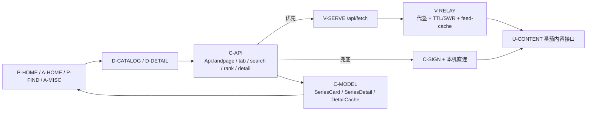
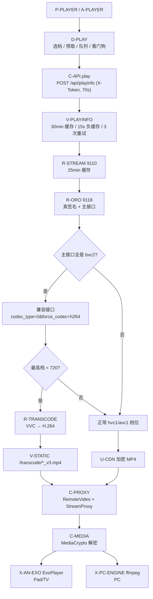
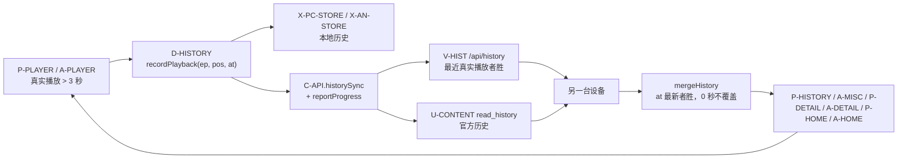
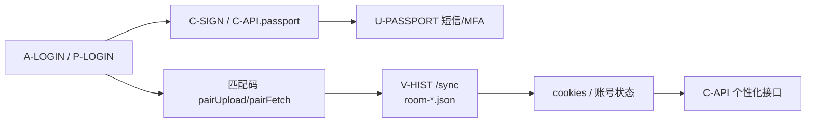
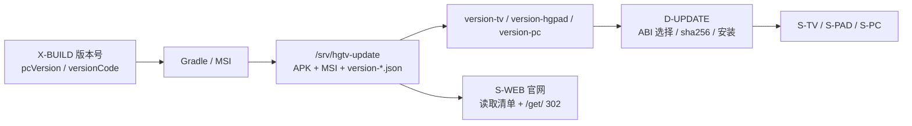
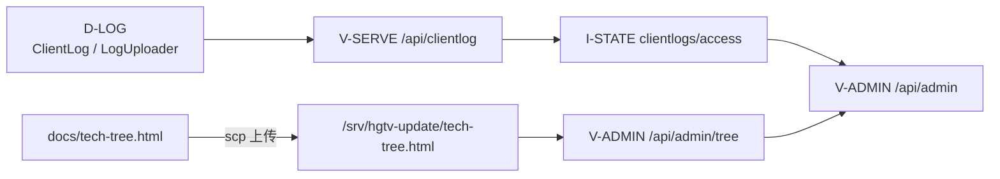

# 开心果 · 架构世界树

> 基线：2026-11-15
> PC 1.2.82 · Android 2.2.194（Pad/TV 同一套源码）· 服务端 8080(static/admin)/8082(api)/8081(dual)/9110/9118
>
> HTML 由 `docs/build_tech_tree.py` 生成；改完节点/边后运行它重新生成 `tech-tree.html`。
> 修复顺序见 `docs/REMEDIATION_PLAN.md`，线上在运行看板「架构世界树 → 修复顺序」。
>
> 这不是产品介绍，是**改动检查图**。以后改任何功能，先在这棵树里找到节点，
> 沿它的上游、下游、孪生节点各走一遍，再动手。

---

## 0. 使用规则（强制）

每次改动按下面顺序走，不允许“只看当前文件”：

1. **定位节点**：在 §3 节点目录里找到要改的节点 ID（例如 `D-HISTORY`、`C-API`、`R-ORO`）。
2. **看三条边**：
   - **上游消费者**：谁调用它？改输出会破坏谁？
   - **下游依赖**：它调用谁？改输入、超时、字段、缓存会影响谁？
   - **孪生节点**：PC ↔ Android、Pad ↔ TV、Android `core` ↔ PC `com.hongguotv.pad` 副本。
3. **过变更矩阵**：在 §5 找到对应的改动类型，把列出的节点全部检查一遍。
4. **跑验证清单**：按 §7 对应层级的清单验证，不只验证“眼前这一条路径”。
5. **更新这棵树**：新增/删除节点、改契约、改端口、改缓存 TTL、改入口，必须在同一个提交里更新本文档和 `tech-tree.html`。

> 判断标准：如果一个改动只改了 1 个文件，但树上有 3 个上游、2 个孪生节点，
> 那这次改动至少要看 6 个地方，否则不算完成。

---

## 1. 树的形状

```text
根：用户看到的“内容”和“播放”
│
├─ L0 产品入口
│   PC 桌面 / Android Pad / Android TV / 官网下载页 / 管理看板
│
├─ L1 页面与交互
│   PC：首页、找剧、排行、新剧、历史、追更/预约、我的/设置、详情、播放器、刷剧、登录、打赏
│   Android：同一组页面，Pad/TV 共用；TV 只多遥控器键位与横屏布局
│
├─ L2 客户端领域
│   内容目录 / 详情选集 / 播放编排 / 历史进度 / 账号与书架 / 评论弹幕 / 设置缓存 / 更新 / 日志
│
├─ L3 客户端共享核心
│   API 与签名 / 数据模型 / CENC 解密 / 直链代理 / 全局状态 / 主题组件
│
├─ L4 平台适配
│   PC：ffmpeg 引擎、预取、PcStore、MSI 更新、桌面日志
│   Android：ExoPlayer、Go 取流、Feed 缓存/预载、APK 更新、日志上传
│
├─ L5 服务端入口
│   dual_server(8081) / serve.py(8080) / relay 缓存 / playinfo / 热度 / 历史 / 静态包 / 看板
│
├─ L6 解析、转码与上游
│   streamsrv(9110) → oroplay(9118) → Android 官方 App oracle(9120) → 1080p；旧主接口/兼容接口/转码兜底
│   番茄内容 API、播放模型、CDN、登录、图片；樱花/CF/cpolar 隧道；状态目录；systemd
│
└─ 横切约束：三端一致、历史语义、私有参数、缓存失效、发版清单、测试设备
```

---

## 2. 节点目录

> 表中的“上游”= 谁使用这个节点；“下游”= 这个节点依赖谁。
> 文件路径相对仓库根 `D:\kaixinguo-pc`；服务端路径是服务器绝对路径。

### 2.1 L0 产品入口

| ID | 节点 | 关键文件/位置 | 职责 | 上游 | 下游 |
|---|---|---|---|---|---|
| `S-PC` | PC 桌面端 | `src/main/kotlin/com/kaixinguo/pc` | Windows 客户端，Compose Desktop + ffmpeg | 用户 | `P-SHELL` |
| `S-PAD` | Android Pad | `android/pad`，包名 `com.hongguotv.pad` | 平板触屏客户端 | 用户 | `A-SHELL` |
| `S-TV` | Android TV | 同一份 `android/pad`，flavor `tv`，包名 `com.hongguotv.nativeapp` | 电视遥控器客户端 | 用户 | `A-SHELL` |
| `S-WEB` | 官网/下载页 | 服务器 `/srv/hgtv-update/index.html` | 三端下载入口，读取版本清单 | 浏览器 | `V-STATIC` |
| `S-ADMIN` | 管理看板 | `/api/admin?token=…` | 设备数、版本、端口、请求量、VVC 使用；顶部「架构世界树」页签 | 管理员 | `V-ADMIN` |

### 2.2 L1 PC 页面与交互

| ID | 节点 | 关键文件 | 职责 | 上游 | 下游 |
|---|---|---|---|---|---|
| `P-SHELL` | 应用壳/侧栏/路由 | `Main.kt` 的 `AppShell`、`RouteHolder`、`Route` | 窗口、侧栏、页面切换、返回栈、打赏浮层 | `S-PC` | `P-HOME`…`P-LOGIN` |
| `P-HOME` | 首页 | `HomeScreens.kt` 的 `HomePage` | 推荐/漫剧/真人剧三 tab、hero、卡片流、换一批；tab/列表/hero/滚动存 `PageMemo` | `P-SHELL` | `D-CATALOG`, `D-DETAIL`, `D-PLAY` |
| `P-FIND` | 找剧/搜索 | `FindScreen.kt` 的 `FindPage` | 搜索、联想、筛选、结果；条件/结果/分页/滚动存 `PageMemo` | `P-SHELL` | `D-CATALOG` |
| `P-RANK` | 排行榜 | `RankScreen.kt` 的 `RankPage` | 榜单分类、筛选、月榜、演员榜；大类/子榜/筛选/列表/分页/滚动全部记忆 | `P-SHELL` | `D-CATALOG` |
| `P-NEW` | 新剧/日历 | `NewScreen.kt` 的 `NewPage` | 新剧列表、上线日历；视图/分类/日期/滚动存 `PageMemo`，从详情返回保留现场 | `P-SHELL` | `D-CATALOG` |
| `P-HISTORY` | 历史页 | `LibraryScreens.kt` 的 `HistoryPage` | 本地/云端历史、筛选、管理、继续播 | `P-SHELL` | `D-HISTORY`, `D-ACCOUNT` |
| `P-LIBRARY` | 追更/预约/我的 | `LibraryScreens.kt` 的 `FollowsPage`、`ReservePage`、`MinePage` | 追更提醒、预约、收藏/点赞入口、账号同步码 | `P-SHELL` | `D-ACCOUNT` |
| `P-DETAIL` | 详情页 | `DetailScreen.kt` | 详情、选集、季、剧评、相关推荐、继续看 | `P-HOME` 等 | `D-DETAIL`, `D-PLAY` |
| `P-PLAYER` | PC 播放器 | `Player.kt` | 起播、切集、清晰度、倍速、队列、预取、看门狗、历史、弹幕、评论 | `P-DETAIL`, `P-HISTORY` | `D-PLAY`, `D-HISTORY`, `D-SOCIAL`, `X-PC-ENGINE` |
| `P-FEED` | PC 刷剧 | `FeedPlayerScreen.kt` 的 `FeedPlayerPage`，`Player.kt` 的 embedded 模式 | 整屏连播、换剧、预览不记历史 | `P-SHELL` | `D-CATALOG`, `D-PLAY` |
| `P-LOGIN` | PC 登录/配对 | `PcLogin.kt`, `PcLoginScreen.kt` | 短信 MFA、账号 cookies、匹配码同步 | `P-SHELL`, `P-LIBRARY` | `D-ACCOUNT`, `C-API` |
| `P-DONATE` | 打赏浮层 | `Donate.kt` | 展示打赏码，不接支付 SDK | `P-SHELL` | `C-UI`（码资源） |

### 2.3 L1 Android 页面与交互

| ID | 节点 | 关键文件 | 职责 | 上游 | 下游 |
|---|---|---|---|---|---|
| `A-SHELL` | App/导航/侧栏 | `MainActivity.kt`, `App.kt`, `Screen.kt` | 初始化、路由栈、侧栏、返回、Pad/TV 适配 | `S-PAD`, `S-TV` | `A-HOME`…`A-LOGIN` |
| `A-HOME` | 首页 | `HomeFeed.kt` | 三 tab、hero、卡片、继续看 | `A-SHELL` | `D-CATALOG`, `D-DETAIL`, `D-PLAY` |
| `A-FEED` | 刷剧 | `FeedScreen.kt`, `FeedPreload.kt` | 整屏连播、上下换剧、预载 | `A-SHELL` | `D-CATALOG`, `D-PLAY`, `X-AN-CACHE` |
| `A-DETAIL` | 详情页 | `DetailScreen.kt` | 详情、选集、季、剧评、相关推荐、继续看 | `A-HOME` 等 | `D-DETAIL`, `D-PLAY` |
| `A-PLAYER` | 播放页 | `PlayerScreen.kt` | 起播、队列、预取、无缝切集、看门狗、历史、进度上报 | `A-DETAIL`, `A-HOME` | `D-PLAY`, `D-HISTORY`, `X-AN-EXO` |
| `A-CHROME` | 播放控制条 | `PlayerChrome.kt` | 进度条、播放/暂停、上下集、倍速、清晰度、选集、弹幕设置 | `A-PLAYER` | `D-PLAY`, `D-SOCIAL` |
| `A-MISC` | 其余页面 | `FindScreens.kt`、`RankScreens.kt`、`NewScreens.kt`、`RecordsScreens.kt`、`FollowScreens.kt`、`AccountScreens.kt`、`SettingsScreen.kt`、`CreatorScreens.kt` | 找剧、排行、新剧、历史、收藏/点赞、追更、预约、我的、设置、演职员；新剧/首页/排行/历史/收藏/点赞/追更/预约/演职员的 tab、筛选、分页与滚动都存 `UiMemo`，详情返回保留现场 | `A-SHELL` | `D-CATALOG`, `D-HISTORY`, `D-ACCOUNT`, `D-SETTINGS` |
| `A-SOCIAL` | 评论/弹幕/打赏 | `CommentsPanel.kt`, `Danmaku.kt`, `DonateDialog.kt` | 单集评论、剧评、弹幕窗口/发送、打赏码 | `A-PLAYER`, `A-MISC` | `D-SOCIAL` |
| `A-LOGIN` | 登录/配对 | `Login.kt`, `LoginScreen.kt` 账号区 | 短信 MFA、账号 cookies、匹配码 | `A-MISC` | `D-ACCOUNT`, `C-API` |

### 2.4 L2 客户端领域

| ID | 节点 | 关键文件 | 职责 | 上游 | 下游 |
|---|---|---|---|---|---|
| `D-CATALOG` | 内容目录 | `Api.landpage/tab/search/rank/new/calendar/heat`；`HomeFeed.kt`；`FeedCache.kt` | 首页/找剧/排行/新剧/日历的数据编排与缓存 | `P-HOME`…`P-NEW`, `A-HOME`, `A-MISC` | `C-API`, `C-MODEL`, `X-AN-CACHE` |
| `D-DETAIL` | 详情/选集/季 | `DetailScreen.kt` 两端；`Api.ensureDetail/seasons/reviews/related` | 详情、集数映射、季切换、相关推荐、剧评 | `P-DETAIL`, `A-DETAIL` | `C-API`, `C-MODEL`, `D-HISTORY` |
| `D-PLAY` | 播放编排 | `PlayerScreen.kt`, `Player.kt`, `PlaybackSession.kt`, `PlaybackSourcePlanner.kt`, `PlaybackGuard.kt`, `PlayerUiState.kt`, `PlaybackPrefetch.kt`, `FeedPreload.kt` | 选档、取流、预取、队列、无缝切集、看门狗、清晰度/倍速；状态/选源/看门狗/UI 状态已分层 | `P-PLAYER`, `P-FEED`, `A-PLAYER`, `A-FEED` | `C-API`, `C-PROXY`, `C-MEDIA`, `X-PC-ENGINE`, `X-AN-EXO`, `D-HISTORY` |
| `D-HISTORY` | 历史/续播 | `HistoryStore.kt`, `PcHistoryStore.kt`, `HistoryRepository.kt`, `Api.historySync/reportProgress` | 记录真实播放、续播秒数、跨端合并、历史页；合并策略收口在共享 `HistoryRepository`（LIMIT=1500 + 试看保护：低集数短播放<60s 不顶掉高进度，服务端 history_store.py 同规则）；⚠️安卓写历史/报官方必须读 `curIndex/curEpisodes`（remember(startIndex) 换集会重建状态对象，LaunchedEffect(player) 循环攥着旧值——2.2.190 连播历史卡旧集数事故根因） | `P-PLAYER`, `A-PLAYER`, `P-HISTORY`, `A-MISC` | `X-PC-STORE`, `X-AN-STORE`, `C-API`, `V-HIST` |
| `D-ACCOUNT` | 账号/书架 | `Login.kt`, `PcLogin.kt`, `Api.shelf/follow/reserve/like/pair` | 登录、配对、收藏、点赞、追更、预约、云端状态 | `P-LIBRARY`, `A-MISC`, `A-LOGIN` | `C-API`, `C-SIGN`, `X-PC-STORE`, `X-AN-STORE` |
| `D-SOCIAL` | 评论/弹幕 | `CommentsPanel.kt`, `Danmaku.kt`, `Player.kt` 弹幕层 | 单集评论、剧评、回复、点赞、弹幕拉取/发送/渲染 | `P-PLAYER`, `A-PLAYER`, `A-SOCIAL` | `C-API` |
| `D-SETTINGS` | 设置/缓存 | `SettingsPage` 两端，`Store`/`PcStore` | 播放设置、服务配置、缓存清理、关于/更新入口 | `P-SHELL`, `A-SHELL` | `X-PC-STORE`, `X-AN-STORE`, `C-STATE`, `D-UPDATE` |
| `D-UPDATE` | 更新 | `Updater.kt` 两端，`UpdateProvider.kt`, `ListUpdate.kt` | 检查清单、下载、sha256、安装/重启 | `P-SHELL`, `A-SHELL`, `D-SETTINGS` | `V-STATIC`, `X-PC-UPD`, `X-AN-UPD` |
| `D-LOG` | 客户端日志 | `ClientLog.kt`, `LogUploader.kt` | 本地日志、脱敏、上传到 `/api/clientlog` | 各页面/播放器 | `V-SERVE`, `X-PC-UPD`, `X-AN-UPD` |

### 2.5 L3 客户端共享核心

| ID | 节点 | 关键文件 | 职责 | 上游 | 下游 |
|---|---|---|---|---|---|
| `C-API` | API/签名/缓存 | `android/core/.../Api.kt` **和** `src/main/kotlin/com/hongguotv/pad/Api.kt` | 所有上游内容接口、服务器代取、取流、历史、书架、评论、弹幕、缓存 | 所有 `D-*` | `C-SIGN`, `V-SERVE`, `V-PLAYINFO`, `U-CONTENT` |
| `C-SIGN` | 本机签名 | `LocalSign.kt`, `sign/Argus.kt`, `Gorgon.kt`, `Helios.kt`, `Medusa.kt`, `AesV3.kt`, `Signer.kt` | 生成上游要求的签名头/设备头 | `C-API` | `U-PASSPORT`/上游接口 |
| `C-MODEL` | 模型/小缓存 | `Models.kt`, `DetailCache.kt`, `RankMetaFallback.kt` | `SeriesCard`/`SeriesDetail`/`Episode`/`PlayTier`，详情 LRU 60，榜单兜底 | 所有 UI/领域 | `C-API` |
| `C-MEDIA` | CENC 解密 | `MediaCrypto.kt`（两端逐字一致） | 解析 MP4 样本表、派生内容密钥、AES-CTR 解密 | `C-PROXY`, `R-TRANSCODE` 的 Java 副本 | 上游加密 MP4 |
| `C-PROXY` | 直链代理 | `Playback.kt` 的 `RemoteVideo`、`StreamProxy` | 拉 1MB 头部、准备样本表、本地 HTTP 代理、Range/短读处理 | `D-PLAY` | `C-MEDIA`, `U-CDN` |
| `C-STATE` | 全局契约 | `App.kt` 两端 | `loggedIn`、cookies、`maxHeight`、`playBases`、`historyBase`、设备身份、历史接口 | 两端 App | 所有 `D-*`/`C-API` |
| `C-UI` | 主题/组件 | `Ui.kt`, `Theme.kt`, `UiMemo.kt` | 颜色、字体、卡片、按钮、焦点、布局口径 | 所有页面 | — |

### 2.6 L4 平台适配

| ID | 节点 | 关键文件 | 职责 | 上游 | 下游 |
|---|---|---|---|---|---|
| `X-PC-STORE` | PC 本地库 | `PcStore.kt`, `PcHistoryStore.kt`, `PcNoticeStore.kt` | 设置、账号、历史、追更通知、收藏/点赞/追更/预约、缓存统计 | `D-HISTORY`, `D-ACCOUNT`, `D-SETTINGS` | `%APPDATA%/KaixinguoPC` |
| `X-PC-ENGINE` | PC 播放引擎 | `VideoEngine.kt` | 启动/控制 ffmpeg 进程、探测、seek、音量、倍速、暂停 | `P-PLAYER` | 本机 `ffmpeg` |
| `X-PC-PREFETCH` | PC 预取 | `PlaybackPrefetch.kt` | 预热下一集直链/头部/代理，最多按设置 N 集 | `P-PLAYER` | `C-API`, `C-PROXY` |
| `X-PC-UPD` | PC 平台服务 | `Updater.kt`, `ClientLog.kt`, `Resolver.kt` | MSI 更新、日志上传、ffmpeg 路径解析 | `D-UPDATE`, `D-LOG` | `V-STATIC`, `V-SERVE` |
| `X-AN-STORE` | Android 本地库 | `Store.kt`, `ShelfStore.kt`, `HistoryStore.kt` | SharedPreferences：设置、账号、历史、书架、缓存清理 | `D-HISTORY`, `D-ACCOUNT`, `D-SETTINGS` | `hongguo_pad` prefs |
| `X-AN-EXO` | Android 播放引擎 | Media3 ExoPlayer 1.4.1 + `PlayerScreen` 队列 | 硬解/软解、播放列表、事件、首帧、错误恢复 | `A-PLAYER` | `C-PROXY` |
| `X-AN-GO` | Android 本机取流 | `DeviceResolver.kt` + `openhongguo.jar`（gomobile） | 本机 Go 签名/取流兜底，`LocalResolverProvider` | `C-API` | `R-STREAM` 同类逻辑 |
| `X-AN-CACHE` | Android 缓存/预载 | `FeedCache.kt`, `FeedPreload.kt` | 刷剧首屏磁盘缓存 24h、预载 5 部 | `A-FEED`, `D-CATALOG` | 本地文件 |
| `X-AN-UPD` | Android 平台服务 | `Updater.kt`, `LogUploader.kt`, `UpdateProvider.kt` | APK 清单/ABI 选择/下载/sha/安装、日志上传 | `D-UPDATE`, `D-LOG` | `V-STATIC`, `V-SERVE` |
| `X-BUILD` | 构建/签名/参数 | `build.gradle.kts` 两端，`android/release.sh` | 版本号、私有 `-P` 参数、flavor、ABI 拆分、MSI、签名 | 发布者 | `S-PC`, `S-PAD`, `S-TV` |

### 2.7 L5 服务端入口

| ID | 节点 | 关键位置 | 职责 | 上游 | 下游 |
|---|---|---|---|---|---|
| `V-DUAL` | 双协议网关 | `/opt/hgtv-update/dual_server.py`，8081/TLS | `/api/admin*` 反代 8080（静态/看板），`/sign` 与其余 `/api/*` 反代 8082；静态/官网；`/get/*` 302 到下载节点 | 公网/隧道/浏览器 | `V-SERVE`, `V-API`, `V-STATIC` |
| `V-SERVE` | 静态/看板进程 | `/opt/hgtv-update/serve.py`（ROLE=static），8080，`hgtv-update.service` | 静态文件/Range、`/admin`、`/api/admin*`；其余 `/api/*` 反代 8082 | 客户端、官网 | `V-API`, `V-STATIC`, `V-ADMIN` |
| `V-API` | 内容 API 进程 | `/opt/hgtv-update/serve.py`（ROLE=api），8082，`hgtv-api.service` | `/api/fetch`、`sign`、`playinfo`、`history`、`heat`、`chart`、`rankmeta`、`seasons`、`family`、`clientlog`、`flags`、`transcode/status`；不提供静态/看板 | `V-SERVE`, `V-DUAL` | `V-RELAY`, `V-PLAYINFO`, `V-HEAT`, `V-HIST` |
| `V-RELAY` | 上游代取/缓存 | `/opt/hgtv-update/relay.py` | 代签、代拉、TTL/SWR/磁盘缓存、feed-cache | `V-API` | `R-SIGN`（服务器 9100）、`U-CONTENT` |
| `V-PLAYINFO` | 取流中转 | `/opt/hgtv-update/playinfo.py` | 30min 成功缓存、15s 负缓存、快速重试、解 key/直链；202 pending + job 轮询 | `V-API` | `R-STREAM` |
| `V-HEAT` | 热度/榜单元数据 | `heat.py`，`serve.py` 的 chart/rankmeta | 热度 6h 缓存、榜单元数据 10min、缺热度回填 | `V-API` | `U-CONTENT`, `I-STATE` |
| `V-HIST` | 历史/日志 | `history_store.py` 的 `history_merge`、`serve.py` 的 `/api/history`、`clientlog` | 历史合并（唯一模块）、客户端日志、访问流水；Phase 12 已删 `/sync`/room | `C-API`, 两端日志 | `I-STATE` |
| `V-STATIC` | 静态/发布物 | `/srv/hgtv-update` | APK/MSI、`version-*.json`、官网、`tech-tree.html`、`/transcode/*`、镜像清单 | `V-DUAL`, 更新器, 看板 | `I-STATE`, `I-TUNNEL` |
| `V-ADMIN` | 看板 | `admin.py`、`serve.py`（ROLE=static）`/api/admin`、`/api/admin/stats`、`/api/admin/tree`，`admin.token` | 运行数据 + 架构世界树（读取 `/srv/hgtv-update/tech-tree.html`） | 管理员 | `I-STATE`, 日志, `V-STATIC` |

### 2.8 L6 解析、转码、上游与基础设施

| ID | 节点 | 关键位置 | 职责 | 上游 | 下游 |
|---|---|---|---|---|---|
| `R-STREAM` | 签名取流服务 | `/opt/research/streamsrv`，9110，Go | `/play` 缓存 25min/400 条；只走 oroplay；bvc2-only 返回 202 pending；`/transcode` 代理 job 查询 | `V-PLAYINFO` | `R-ORO`, `R-SIGN`, `U-PLAY` |
| `R-ORO` | 真签名解析 | `/opt/research/oroplay.js`，9118，Node | **优先调 `R-ORACLE`** 按 vid 取全部清晰度；`bytevc1`（HEVC）直接透传，只有 `bytevc2`/AV1 才转码；旧匿名身份/video_tab 通道保留兜底；异步转码 job（30min/200 条，可轮询） | `R-STREAM` | `R-ORACLE`, `R-SIGN`, `R-TRANSCODE`, `U-PLAY`, `U-CDN` |
| `R-ORACLE` | Android 官方 App oracle | `/opt/research/oracle_parent.py` + `resolve_one.py` + `oracle_resolver.js`，9120；redroid Android 13 容器 + 官方红果 App + Frida | oroplay 优先调它：按 vid 让官方 App 用自己的签名/TTNet 取模型，返回 1080p/720p 等全部档位；容器/systemd 开机自启 | `R-ORO` | `U-PLAY`, `U-CDN` |
| `R-SIGN` | 签名/设备池 | 9100/9101/9099，`playback-sign.js`, `playback-device.js`, `sign-server.jar` | 上游签名、设备身份注册/轮换、Argus/Ladon | `C-API`, `V-RELAY`, `R-ORO` | `U-PASSPORT`/上游 |
| `R-TRANSCODE` | VVC 转码 | `/opt/research/transcode/do_transcode.py`, `extract_vvc.py`, `DecryptMp4.java` | 下载加密 MP4 → Java 解密 → 抽 Annex-B/ADTS + 帧率 → ffmpeg H.264 → `/transcode/*_v3.mp4`；优先 `h264_vaapi` 核显，失败回退 x264 ultrafast | `R-ORO` | `C-MEDIA`（Java 副本）, 本机 ffmpeg, `V-STATIC` |
| `U-CONTENT` | 番茄内容接口 | `api5-normal-lq.fqnovel.com` 等 | 首页/详情/搜索/排行/日历/追更/评论/弹幕/历史/演职员 | `C-API`, `V-RELAY` | — |
| `U-PLAY` | 番茄播放模型 | `multi_video_model/v1`、`fallback_api`、`video_meta/codec_type` | 档位、编码、密钥种子、兼容接口 | `R-STREAM`, `R-ORO` | — |
| `U-CDN` | 视频/图片 CDN | 字节 CDN | 加密 MP4、封面、头像 | `C-PROXY`, 转码下载 | — |
| `U-PASSPORT` | 登录/MFA | 番茄 passport | 短信登录、MFA、cookies | `D-ACCOUNT`, `C-SIGN` | — |
| `I-TUNNEL` | 公网通道 | 樱花 frpc（44468）、Cloudflare、cpolar | 把 8081/8080 暴露到公网；`/get` 302 下载 | 客户端 | `V-DUAL` |
| `I-STATE` | 服务端状态 | `/var/lib/hgtv-sync` | 历史、房间、feed-cache、heat、clientlogs、access 流水、admin token | `V-*` | 磁盘 |
| `I-SYSTEMD` | 守护/备份 | systemd units、`mirror_watchdog`、`cloudflared_watchdog` | 服务常驻、镜像发现、隧道守护、备份 | 运维 | `V-*` |

---

## 3. 关键数据流

### 3.1 内容读取（首页/找剧/排行/新剧/详情）



**契约**：`/api/fetch` 返回 `{text,cached,age,tookMs}`；客户端要按 `Content-Encoding` 解 gzip。
缓存 TTL 由 `relay.ttl_for` 决定：搜索 120s、tab 900s、detail 1800s、player 300s、cell/rank 300s。

### 3.2 播放（最关键的一条）



**不可破坏的约束**：

- 服务端永远不要把 `bvc2` 直接返回给客户端；`streamsrv` 的 `hasPlayable` 会剔除。
- `bytevc1` 是标准 HEVC（`hvc1`），PC 的 FFmpeg 内核和安卓/TV 的 MediaCodec 都能直接解，**不要转码**；只有 `bytevc2`/`bvc2`/AV1 才是客户端已移除的私有封装，由 `R-TRANSCODE` 转 H.264。
- 转码输出 URL 必须走有效证书域名（`dl.fabao.xin:44468` / `kxg.fabao.xin`），不要再用自签 `frp-bar.com`。
- 客户端 `/api/playinfo` 读超时 70s，给 1080 转码/排队留时间；5xx 立即换地址/回退，不反复等。
- 预取只备后面 3 集档位/头部；`PREFETCH_AHEAD=3`；播放队列按集号判重，不能按代理地址判重。
- 切集/证书错误先清档位缓存和 ExoPlayer 队列，再重取当前集，禁止让播放器自己连跳。
- 卡顿看门狗 8 秒不动重取；第一次降 720，最多 2 次。

### 3.3 历史与续播



**当前语义（2.2.170）**：

- 历史 = 最近一次**真实播放**：本次进入这一集后真播超过 3 秒才写，写 `episode + positionMs + at`。
- 换到更低集数正常看，历史也照实回退；不再“只增不减”。
- 只点开、1 秒退出、续播集点开即退，不写历史。
- 合并：`at` 最新者胜；`positionMs=0` 的旧“只点开”记录不能覆盖已有真实播放位置；`at` 相同再比集数/秒数。
- 入口必须带 `episode + positionMs`：`Screen.Play(id, ep, pos)` / `Route.Player(id, ep, pos)`。
- 官方 `reportProgress` 只在播放 5 秒后/20 秒节拍/退出补报，不在进入集数时立刻报。

### 3.4 登录与设备配对



**约束**：账号 cookies 只进本地 prefs/服务端 room，不入库、不进日志；不要复用活体客户端身份去打上游。

### 3.5 更新与发布



**约束**：

- Android 版本号唯一来源：`android/pad/build.gradle.kts`；PC 唯一来源：根 `build.gradle.kts` 的 `pcVersion`。
- 发版必须带全套私有 `-P` 参数（signUrl/playBases/playToken/updateBases/historyBase），否则装到设备上会变成手动配置。
- 清单必须同时有 `path`、`size`、`sha256`、`abis`；ABI 文件名和实际产物一致。
- PC MSI 与 Android APK 都要校验 sha256 后再安装。
- 桌面 APK 目录只放最新 TV/Pad 两个通用包。

### 3.6 日志与看板



看板顶部有两个页签：**运行数据** 和 **架构世界树**。世界树页签用同源 iframe 加载
`/api/admin/tree?token=…`，也可以点「新窗口打开」全屏看。
看板地址后加 `&tree=1` 可以直接默认打开世界树。

---

## 4. 变更影响矩阵

> 用法：先在左列找到改动类型，再把右列节点全部过一遍；少一个都算漏改。

| 改动类型 | 必须检查的节点 | 额外验证 |
|---|---|---|
| 页面/卡片/hero/布局 | 对应 `P-*`/`A-*` → `C-UI` → `D-CATALOG`/`D-DETAIL`；Pad/TV 两套尺寸 | Pad + TV 截图/焦点；PC 窗口宽度；空态/加载态 |
| API 字段/解析/筛选 | `C-API`（**两份副本**）→ `C-MODEL` → `D-CATALOG`/`D-DETAIL`/`D-SOCIAL`；`V-RELAY` 缓存 | PC/Android 同字段；旧缓存过期；失败态 |
| 榜单/分类/季/热度 | `D-CATALOG`/`D-DETAIL` → `C-API` → `V-HEAT`/`V-RELAY`；`C-MODEL` | tab_type 16/36/39；热度真值 `hot_score`；跨端一致 |
| 取流/播放器 | `D-PLAY` → `C-API.play` → `V-PLAYINFO` → `R-STREAM` → `R-ORO` → `R-TRANSCODE`；`C-PROXY`/`C-MEDIA`；`X-AN-EXO`/`X-PC-ENGINE` | 正常/VVC/兼容接口/转码；证书；切集；预取；卡顿；声音 |
| 历史/续播 | `D-HISTORY` → `X-*-STORE` → `C-API.historySync/reportProgress` → `V-HIST` → `U-CONTENT`；所有播放入口 | 3 秒门槛；低集数；续播秒数；快速点开；跨端 |
| 账号/收藏/追更/预约 | `D-ACCOUNT` → `C-API`（shelf/follow/reserve/pair）→ `C-SIGN` → `U-PASSPORT`；`X-*-STORE` | 未登录态；登录态；配对码；换设备 |
| 评论/弹幕 | `D-SOCIAL` → `C-API` → `U-CONTENT`；`A-SOCIAL`/`P-PLAYER` 渲染 | 未登录；发送；分页；时间轴；TV 焦点 |
| 缓存/TTL | `V-RELAY`/`V-PLAYINFO`/`R-STREAM`/`V-HEAT`；`C-API.tierCache`/listCache；`DetailCache`；`FeedCache`；`X-*-STORE` 清理 | 命中/过期/负缓存；改 schema 必须换缓存 key/版本 |
| 更新/发版 | `X-BUILD` → 构建产物 → `V-STATIC` 清单 → `D-UPDATE` → `S-WEB` | 版本号；sha256；ABI；签名；私有参数；下载 302 |
| **跨端行为修复**（页面/播放/历史/更新语义） | 对应 `P-*`/`A-*` + **双端 `X-BUILD` 版本号** + `V-STATIC` 清单 + `D-UPDATE` | **双端都要有新版本产物并发布/装机**；跑 `tools/check_versions.py`；只编译不算完成；单端修复要说明原因 |
| **列表页 → 详情 → 返回** | 对应 `P-*`/`A-*` + `UiMemo`/`PageMemo` + `D-CATALOG` | tab/筛选/搜索/分页游标/已加载数据/滚动全部恢复；`RETURN_TTL_MS` 内不重拉首屏；新增列表页或钻取层级必须同时补 memo |
| 服务地址/端口/证书 | `X-BUILD` 私有参数 → `C-STATE.playBases/historyBase` → `V-DUAL`/`V-SERVE` → `I-TUNNEL` → `V-STATIC` | 局域网/公网；证书；`/get` 302；旧客户端 |
| 服务端状态/清理 | `V-HIST`/`V-HEAT`/`V-STATIC`/`V-ADMIN` → `I-STATE` | 备份；锁；墓碑；重启；磁盘 |
| 日志/看板 | `D-LOG` → `V-SERVE /api/clientlog` → `I-STATE` → `V-ADMIN` | 脱敏；上传；设备识别；统计口径 |

### 4.1 示例：改“历史写入”

假设要改 `D-HISTORY` 的 3 秒门槛：

- **上游**：`P-PLAYER`、`A-PLAYER`、`P-HISTORY`、`A-MISC`、`P-DETAIL`、`A-DETAIL`、`P-HOME`、`A-HOME` 都会读到历史；
- **下游**：`X-PC-STORE`、`X-AN-STORE`、`C-API`、`V-HIST` 决定保存/合并/上报；
- **孪生**：PC `PcStore` ↔ Android `Store`；Android 详情/首页/排行/新剧/追更入口；
- **服务端**：`V-HIST` 的 `history_merge` 和官方 `read_history`；
- **验证**：真播 3 秒、1 秒退出、低集数、续播秒数、跨端、旧数据。

只改 `Store.kt` 的一个数字，至少要同时看这 12 个节点；否则就会出现“电视修好了，PC 或详情页还是旧的”。

---

## 5. 当前已知不一致 / 风险（这棵树先把它们标出来）

这些不是“新 bug”，是当前代码的真实状态；以后改到相关节点必须一起收口。

1. **Android 排行榜/新剧的播放入口仍写死第 1 集**
   - `android/pad/.../App.kt`：Rank `Screen.Play(it.seriesId, 1)`、NewDrama `Screen.Play(id, 1)`。
   - 与首页/详情/历史/追更的“按历史行续播”不一致。
   - 影响：从排行榜/新剧点播放会丢上次集数和秒数。

2. **PC 详情页“继续看”不带秒数**
   - `DetailScreen.kt` 的 `onPlay(continueIndex)` 只传集数；`Main.kt` 的 `Route.Detail` 映射也不接 `startMs`。
   - PC 播放器优先用本机 `PcStore.posOf`，换设备后可能从 0 秒开始。
   - 历史页入口 `Route.Player(id, ep, pos)` 是带秒数的，两个入口不一致。

3. **PC “首页/找剧/排行/新剧/追更/我的”统一走 `playSeries(id)`**
   - 只读了集数，没有把 `positionMs` 传给 `Route.Player`。
   - 本机有 `posOf` 时能续上；换设备/清缓存后不能。

4. **PC 历史页登录态直接读官方 `officialHistory`**
   - 不经过 `PcStore.mergeHistory`；本地历史和云端历史可能短暂不同。
   - Android 历史页是本地 `Store.history()` + `historySync` 合并，两端读法不同。

5. **`Api.kt` 是两份物理副本**
   - Android `android/core/.../Api.kt` 与 PC `src/main/kotlin/com/hongguotv/pad/Api.kt`。
   - 只允许三处平台差异（取流兜底、ReviewItem.score 解析、设备身份默认值），其余必须逐字一致。
   - 改任何接口字段，两份都要改；否则会出现“一端修好另一端还在”。

6. **`mirror_watchdog` 会改 `version-tv/hgpad.json` 的 `url` 字段**
   - 每 5 分钟把 `url` 写成 cpolar 动态地址；手工写 manifest 时不要只改 `url`，否则会被覆盖。
   - `path`/`sha256`/`abis` 是权威，`url` 只是旧客户端救急通道。

7. **服务端缓存是进程内内存**
   - `V-PLAYINFO`、`V-RELAY`、`R-STREAM`、`V-HEAT` 都有内存缓存；改解析/字段/转码逻辑后必须重启对应服务，否则旧结果会继续命中 TTL。
   - `playinfo` 30min、`streamsrv` 25min、`heat` 6h、`relay` 120s~1800s。

8. **转码是重资源路径**
   - `R-ORO` 转码队列：当前播放优先（最多 2 个），预取最多占 1 个，预取不会堵住当前集；`bytevc1`（HEVC）不转码。
   - `do_transcode.py` 优先 `h264_vaapi`（RYZEN 5400U 核显，182 秒 1080 实测约 21 秒；原 x264 veryfast 约 72 秒），失败自动回退 x264 ultrafast。
   - 转码输出 `/transcode/<vid>_<h>_v3.mp4`，7 天/200 文件清理；改输出命名/主机/证书会同时影响客户端缓存和旧 URL。

9. **旧的 VVC 本地播放器已删除**
   - 客户端统一普通播放器；服务端负责兼容接口/转码。不要再引入第二套播放器/控制条。

10. **测试设备限制**
    - 真机验证只允许 LDPlayer `emulator-5554`；绝不装到用户的电视/平板。
    - 模拟器无法还原 TV/平板的解码器、GPU、SoC 性能；“模拟器正常”不等于真机正常。

### 5.1 播放入口一致性（当前状态）

| 入口 | 集数 | 秒数 | 状态 |
|---|---|---|---|
| Android 历史页 | 历史行 | 历史行 | ✅ |
| Android 详情页“继续看” | `resumeIndex` | 历史行 `positionMs` | ✅ 2.2.170 |
| Android 首页 hero“继续看” | 历史行 | 历史行 | ✅ 2.2.170 |
| Android 追更/预约 | 历史行 | 历史行 | ✅ 2.2.170 |
| Android 排行榜 | 写死 1 | 0 | ❌ 待收口 |
| Android 新剧 | 写死 1 | 0 | ❌ 待收口 |
| PC 历史页 | 历史行 | 历史行 | ✅ |
| PC 详情页“继续看” | `continueIndex` | 0（靠本机 `posOf`） | ❌ 待收口 |
| PC 首页/找剧/排行/新剧/追更/预约/我的 | `playSeries` 取集数 | 0（靠本机 `posOf`） | ⚠️ 本机可续，跨端可能从 0 |

> 这张表是“历史世界树”的入口侧；以后新增任何播放按钮，必须在这张表里加一行并确认集数/秒数。

### 5.2 结构性不合理（2026-11-15 评审）

> 这一节不是“待修 bug 清单”，是架构层面的坏味道。优先级按“对可靠性和改动成本的伤害”排。

| 级别 | 问题 | 证据节点 | 为什么不合理 | 建议方向 |
|---|---|---|---|---|
| P0 | **历史是三写两读** | `D-HISTORY`、`X-PC-STORE`、`X-AN-STORE`、`C-API`、`V-HIST`、`U-CONTENT` | 本地一份、自建桶一份、官方一份；三处写、两套合并；PC 历史页读官方、Android 读本地+合并。同一事实没有唯一 owner，故障时无法判断哪份是真相 | 定义唯一的 HistoryRepository/Service：本地只做缓存，服务端只做一份合并，官方只做同步适配器；PC/Android 走同一套读路径 |
| P0 | **取流链路过长，超时预算不一致** | `C-API`、`V-PLAYINFO`、`R-STREAM`、`R-ORO`、`R-TRANSCODE` | 客户端 70s、streamsrv 120s、转码 300s；转码可能比客户端超时更久，客户端走了服务器还在跑；预取和当前播放共用 FIFO 转码队列，预取可能堵住当前集 | 统一“解析契约 + 超时预算”；转码改异步 job + 轮询/回调；当前播放优先于预取；把 fallback 分支收敛成显式状态机 |
| P0 | **共享核心是两份物理副本** | `C-API`、`C-MEDIA`、`C-PROXY`、`C-STATE` | PC 与 Android 各一份 `Api.kt`/`Playback.kt`，靠人工保持逐字一致；接口字段一改就要两边同步，漏一边就是“一端修好另一端还在” | 抽成真正的共享模块（KMP/独立 jar），或至少加 CI diff 检查 + 共享契约测试；禁止长期复制粘贴 |
| P1 | **`serve.py` 单体把控制面和数据面绑一起** | `V-SERVE`、`V-HIST`、`V-ADMIN`、`V-STATIC` | 首页/历史/取流/日志/看板/世界树在同一个进程；改看板或重启服务会碰到历史/取流；admin token 还放在 query 里 | 把 admin/世界树/静态控制面拆成独立只读服务；数据面只暴露稳定 API；admin 改 cookie/短时票据，不把 token 放 URL |
| P1 | **播放器和 UI 是 god file，领域逻辑长在界面里** | `P-PLAYER`、`A-PLAYER`、`A-CHROME`、`P-HOME`、`A-MISC` | `PlayerScreen.kt` 1800+ 行、`Player.kt` 2300+ 行、`Main.kt` 3300+ 行、`MiscScreens.kt` 3700+ 行；播放、预取、队列、历史、弹幕、评论、错误恢复全在一个节点里，改历史会碰播放器，改播放器会碰 UI | 抽出 PlaybackSession / PrefetchController / HistoryReporter / PlayerUiState 四层；UI 只订阅状态，不直接写历史/网络 |
| P1 | **缓存层太多且没有版本** | `V-RELAY`、`V-PLAYINFO`、`R-STREAM`、`C-API`、`DetailCache`、`FeedCache`、`V-HEAT` | 至少 7 层缓存、TTL 各不相同；改字段/schema 后旧缓存仍可能命中；没有统一失效入口，问题会表现成“改完了但线上还是旧的” | 缓存 key 加 schema 版本；每层明确 TTL/失效 owner；改契约时 bump 版本并清对应层 |
| P1 | **更新/发布链碎片化** | `X-BUILD`、`V-STATIC`、`D-UPDATE`、`S-WEB`、`I-SYSTEMD` | 服务器 `release.sh` 和本机构建两套；PC/Android 两个版本源；manifest 手工生成；`mirror_watchdog` 还会改 `url` 字段；官网默认值容易过期 | 一条发布流水线：版本号 → 构建 → sha/ABI → manifest → 官网 → 看板；禁止后置改 manifest；发布脚本纳入版本库 |
| P2 | **认证/签名栈归属不清** | `C-SIGN`、`R-SIGN`、`X-AN-GO`、`U-PASSPORT` | 客户端签名、服务器签名、播放签名、设备池、gomobile 本机解析混在一起；出问题很难判断是哪一层签错/身份错 | 画清“谁签什么”的契约表；设备身份只保留一个池；把播放签名和登录签名彻底分开 |
| P2 | **公网路由多入口** | `V-DUAL`、`V-SERVE`、`I-TUNNEL` | `/admin` 不在 dual_server 的反代范围，才需要把世界树挂到 `/api/admin/tree`；8080/8081/CF/cpolar/frpc 多套入口 | 统一一个 router：所有后台/静态/API 都走同一前缀；减少“这个地址只在某个端口可用”的特例 |
| P2 | **树本身混合了边类型，且靠人工维护** | 全树 | 现在一条边可能是运行时调用、构建产物、部署关系、代码副本、数据流；混在一起会让“上下游”遍历产生噪声；节点/边是手工数据，代码变了不会自动报警 | 给边加 `runtime/build/deploy/copy/data` 类型；关键节点加 CI 校验（文件存在、入口存在）；树只保留稳定边界，不追每个函数 |

### 5.3 冗余 / 死代码（有调用证据）

> 这一节只收“能证明没被当前代码走到的路径”。不是凭感觉说“看着像重复”。

| 项 | 证据 | 结论 / 处理 |
|---|---|---|
| `playinfo.py` 旧直连取流整段 | `_attempt`、`_pick`、`_pick_all`、`_sign`、`_decrypt_url` 在仓库/服务端没有任何调用；`playinfo()` 实际只走 `_via_streamsrv` | **已清理（2026-11-15）**。文件从 355 行降到 84 行，外部签名配置一并删除 |
| `streamsrv` 的 SDK 兜底链路 | 代码注释明确写“SDK 六头签名已失效”；只在 oroplay 失败后执行 6 次 + 400ms sleep，每次还可能注册匿名设备 | **实际不可用**。删除或改成显式 env 开关；oroplay 失败应快速返回，不要白等 |
| `android/src/main/java/.../HomeFeed.kt` | 395 行旧版首页，位于 `android/src`，不在 `settings.gradle.kts` 的 `:core`/`:pad` 模块内，**从未参与编译** | **已删除（2026-11-15）**。以后不会再改错副本 |
| PC `Api.localPlay` 直连兜底 | 注释和 Android 副本都写“本机直连已失效”；PC `LOCAL_DIRECT_PLAY=false` 定义了却没被 `play()` 使用，服务器失败后仍会进这条死路 | **实际不可用且拖慢失败**。删掉或像 Android 一样 fast-fail；不要保留会白等的路径 |
| `RemoteVideo.saveDecrypted` + `prepare(allowVvc)` | VVC 本地播放器已删除；`saveDecrypted` 没有任何调用；`allowVvc` 没有任何调用方传 true | **已删除（2026-11-15）**，两份 Playback.kt 同步清理 |
| 看板「VVC 使用设备」卡片 | 客户端 VVC 播放器已删除，当前 2.2.170 不再产生 `VvcStat`；只剩历史日志能扫到旧采样 | **正在变成空指标**。改成转码/播放失败统计，或直接移除 |
| 服务端 `/sync` + `progress.json` + `room-*.json` | 当前客户端历史走 `/api/history`，配对走签名服务 `/pair`；访问流水里近两天 `/sync` 请求为 0 | **旧同步后端**。先确认老版本装机量；没有就删，避免第三套历史/收藏状态 |
| `oroplay` 的 `force_fallback` 调试分支 | 生产解析器接受客户端传入的 `force_fallback`，当前客户端没有发送；它会绕过缓存/主接口 | **已删除（2026-11-15）**，parseTiers/fetchTiers/resolve 不再接受该参数 |
| PC `FileDownload` 图标 import | 下载功能已移除，import 仍保留 | **已删除（2026-11-15）** |

> 处理顺序建议：先删 100% 无调用的（`playinfo` 旧路径、stale HomeFeed、`saveDecrypted/allowVvc`），
> 再处理“还在执行但确认无效”的（streamsrv SDK、PC localPlay），最后再动 `/sync` 和看板指标（要先确认老客户端/历史数据）。

### 5.4 合并 / 拆分候选（2026-11-15）

> 详细说明在树的「合并/拆分」页签；这里保留权威清单。

**可以合并（同一概念多套实现）**

| 对象 | 合并方向 | 优先级 |
|---|---|---|
| 历史三份存储/两套合并（`D-HISTORY`、两端 Store、`V-HIST`、官方历史） | 一个 HistoryRepository；本地只做缓存，官方只做适配器 | P0 |
| PC/Android `Api.kt`、`Playback.kt`、`MediaCrypto.kt` | 真共享模块（KMP/独立 jar），平台只保留适配 | P0 |
| 本机直连 / SDK / oroplay / 兼容接口 / 转码 | 一个 Resolver 契约 + 统一错误码/超时；删死路径 | P0 |
| 收藏/点赞/追更/预约 | 一个 ShelfRepository + ShelfKind；上游差异放 adapter | P1 |
| `seasons` / `nextSeason` / `fillMissingSeasons` | 一个 SeasonService，共享缓存/主创校验 | P1 |
| PC `PlaybackPrefetch` / Android `buildReady` | 共享选档/头部/失效 SourcePlanner；平台只管队列 | P1 |
| 更新检查/下载/sha/镜像 | 共享 UpdaterCore；PC MSI/Android ABI 只保留安装 adapter；一份 manifest schema | P2 |
| PC/Android 登录协议 | 共享 PassportClient；两端只保留登录 UI | P2 |
| 8080/8081 静态、`/admin` 与 `/api/admin` | 一个 canonical router；静态 handler 共享 | P2 |

**需要拆分（一个节点装多件事）**

| 对象 | 拆分方向 | 优先级 |
|---|---|---|
| `C-API` 3741 行 | HttpCore + Catalog/Detail/Playback/History/Account/Social API | P0 |
| `Player.kt` 2390 行 / `PlayerScreen.kt` 1814 行 | PlaybackSession / PrefetchController / HistoryReporter / PlayerUiState / Chrome | P0 |
| PC `Main.kt` 3349 行 | AppShell + 每页一个文件 | P1 |
| Android `MiscScreens.kt` 3765 行 | Find/Rank/New/History/Library/Account/Settings/Creator 分文件 | P1 |
| `serve.py` 837 行 | static_update / content_api / library_api / telemetry_admin；admin 独立进程 | P1 |
| `oroplay.js` 462 行 | identity / tiers / transcode-queue / server | P2 |
| `streamsrv` 320 行 | resolver / cache / http；删 SDK 兜底 | P2 |
| `Store.kt` 538 行 / `PcStore.kt` 448 行 | 设置/账号/历史/书架/缓存存储接口 | P2 |
| `PlayerChrome.kt` 1088 行 | BaseChrome + Quality/Speed/Episode/Danmaku 浮层 | P2 |

> 原则：**合并“同一概念的不同实现”，拆分“一个节点里的不同概念”**。
> PC/Android 的 UI、ffmpeg/ExoPlayer、服务端代取/本机兜底属于有意差异，不要为了“统一”硬合。

### 5.5 看起来不合理、但其实是合理取舍

- **PC 用 ffmpeg、Android 用 ExoPlayer**：平台解码能力不同，强行统一反而更差。
- **服务端代取**：番茄取流网关按 TLS 指纹放行，客户端直连拿不到地址，这一步必须放服务器。
- **VVC 兼容接口 + 转码兜底**：上游格式不可控，转码是最后兜底；不合理的是同步等待和队列优先级，不是“转码”本身。
- **PC/Android 各有一套 UI**：两端的输入方式（鼠标/遥控器/触屏）差异太大，共用一套界面会互相牺牲；应该共用领域层，不是共用像素。

---

## 6. 高频改动清单（按链路）

### 6.1 改播放/取流

按顺序看：

1. `D-PLAY`：选档、预取、队列、看门狗、切集。
2. `C-API.play`：`/api/playinfo` 请求、70s 超时、重试/回退。
3. `V-PLAYINFO`：缓存/负缓存/重试。
4. `R-STREAM`：oroplay→SDK 回退、bvc2 剔除、缓存。
5. `R-ORO`：主接口、兼容接口、档位补齐、转码队列。
6. `R-TRANSCODE`：解密、抽轨、帧率、ffmpeg 参数、输出 URL。
7. `C-PROXY`/`C-MEDIA`：代理、Range、短读、CENC。
8. `X-AN-EXO`/`X-PC-ENGINE`：解码器、事件、错误。
9. `D-HISTORY`：切集/续播/进度。
10. 验证：正常集 + VVC 集 + 兼容接口 + 转码 + 证书/404 + 预取 + 无缝 + 历史。

### 6.2 改首页/详情/榜单

1. `C-API` 对应解析（两份）。
2. `C-MODEL` 字段。
3. `V-RELAY` 缓存 TTL / `V-HEAT` 热度。
4. `D-CATALOG`/`D-DETAIL` 编排。
5. `P-*`/`A-*` 布局与空/错/加载态。
6. 验证：PC + Pad + TV；tab 16/36/39；热度真值；筛选不串类；hero 不跳回。

### 6.3 改历史/续播

1. `D-HISTORY`：写入门槛、字段、合并规则。
2. `X-PC-STORE`/`X-AN-STORE`：存储、迁移、清理。
3. `C-API.historySync/reportProgress`：官方+自建桶、节拍。
4. `V-HIST`：`history_merge`、锁、0 秒保护。
5. 所有入口：详情/首页/排行/新剧/追更/预约/历史。
6. 验证：3 秒、低集数、续播秒数、快速点开、跨端、旧数据。

### 6.4 改发版/更新

1. `X-BUILD`：版本号、私有参数、flavor、ABI、签名。
2. 构建产物：TV/Pad universal + 三个 ABI；PC MSI。
3. `V-STATIC`：文件、`version-*.json`、sha256、ABI 节点。
4. `S-WEB`：首页下载卡/清单。
5. `D-UPDATE`：ABI 选择、下载、校验、安装。
6. 验证：软件内检查更新、下载、sha、安装、重启；旧客户端救急 URL。
7. 如果更新了架构树：把 `docs/tech-tree.html` 上传到 `/srv/hgtv-update/tech-tree.html`，否则看板里还是旧树。

---

## 7. 改动验证清单

### 7.1 通用

- [ ] 两端 `Api.kt` 都改了吗？逐字差异是否仍只有允许的三处？
- [ ] Pad/TV 是同一份源码，TV 的焦点/返回键/横屏有没有一起看？
- [ ] 新增字段/接口是否处理了空值、失败、旧缓存？
- [ ] 有没有改端口/域名/私有参数？构建参数和清单同步了吗？
- [ ] 文档/树是否更新？

### 7.2 播放

- [ ] 普通 H.264/HEVC 集能播、有声音。
- [ ] VVC 集走兼容接口/转码能播、有声音、可 seek、可倍速。
- [ ] 切集/自动连播/低集数/高集数都不跳集、不黑屏、不死锁。
- [ ] 证书错误/404/5xx 会重取当前集，不会连跳。
- [ ] 预取命中/未命中都不抢首帧带宽。
- [ ] 8 秒卡顿看门狗只重试当前集，最多 2 次。

### 7.3 历史

- [ ] 真播 >3 秒写当前集+秒数；1 秒退出不写。
- [ ] 低集数正常看会回退；0 秒旧记录不覆盖真实位置。
- [ ] 详情/首页/历史/追更/排行/新剧入口都带对集数和秒数。
- [ ] 另一台设备拉取后显示最近一次真实播放。
- [ ] 已写坏的历史不会被自动“猜”回去（只能重新看一次）。

### 7.4 服务端/发布

- [ ] `/api/playinfo`、`/api/history`、`/api/fetch`、`/transcode` 可访问。
- [ ] `systemctl` 服务 active；改代码后已重启对应服务。
- [ ] manifest 的 `size`/`sha256`/`abis` 与实际文件一致。
- [ ] 桌面 APK 目录只有最新 TV/Pad 两个通用包。
- [ ] 备份/日志/访问流水没有泄露 token/cookie。

---

## 8. 文件速查

| 你改什么 | 先看这里 |
|---|---|
| PC 页面/路由/侧栏 | `src/main/kotlin/com/kaixinguo/pc/Main.kt` |
| PC 播放器 | `src/main/kotlin/com/kaixinguo/pc/Player.kt`、`VideoEngine.kt`、`PlaybackPrefetch.kt` |
| PC 本地数据 | `src/main/kotlin/com/kaixinguo/pc/PcStore.kt` |
| PC 登录/配对 | `PcLogin.kt`、`PcLoginScreen.kt` |
| Android 导航/入口 | `android/pad/.../App.kt`、`Screen.kt`、`MainActivity.kt` |
| Android 播放器 | `android/pad/.../PlayerScreen.kt`、`PlayerChrome.kt` |
| Android 本地数据 | `android/pad/.../Store.kt` |
| Android 其它页面 | `android/pad/.../MiscScreens.kt`、`HomeFeed.kt`、`DetailScreen.kt` |
| 共享 API/签名 | `android/core/.../Api.kt` ↔ `src/main/kotlin/com/hongguotv/pad/Api.kt` |
| 共享播放/解密 | `android/core/.../Playback.kt`、`MediaCrypto.kt`（PC 副本同名） |
| 服务端 API/历史/静态 | `/opt/hgtv-update/serve.py`、`relay.py`、`playinfo.py` |
| 取流解析 | `/opt/research/openhongguo/cmd/streamsrv/main.go`、`/opt/research/oroplay.js` |
| 转码 | `/opt/research/transcode/*` |
| 发布清单/官网 | `/srv/hgtv-update/*` |
| 服务状态/日志 | `/var/lib/hgtv-sync/*`、`journalctl -u <service>` |

---

## 9. 版本基线

- PC：`1.2.80`（`build.gradle.kts` 的 `pcVersion`；源码已含 2026-11-15 历史/续播调整，未单独发版）
- Android：`2.2.170`（`android/pad/build.gradle.kts` 的 `versionCode=290`）
- 服务端：`hgtv-update`（8080）、`dual-server`（8081）、`streamsrv`（9110）、`oroplay`（9118）
- 公网：樱花 `frp-bar.com:44468` / `dl.fabao.xin:44468`；官网 `hgtv.fabao.xin` / `kxg.fabao.xin`

> 每次发版只改最后一节的版本和对应节点；不要在这棵树里写 token、cookie、私钥。
